# Networking

My notes from the [CompTIA Network+ N10-009 Full Certification Course](https://www.youtube.com/watch?v=CY4hn70K3r8).

## Contents

**Fundamentals**
- [Network Topologies and Types](#network-topologies-and-types)
  - [Topologies](#topologies)
  - [Traffic Flow](#traffic-flow)
- [OSI Model](#osi-model)
  - [The 7 layers](#the-7-layers)

**Network devices & services**
- [Network Devices, Applications, & Functions](#network-devices-applications--functions)
  - [Switch](#switch)
  - [Router](#router)
  - [Firewall](#firewall)
  - [IDS / IPS](#ids--ips)
  - [Load Balancer](#load-balancer)
  - [QoS (Quality of Service)](#qos-quality-of-service)
- [Proxy](#proxy)
  - [NAS (Network Attached Storage)](#nas-network-attached-storage)
  - [SAN (Storage Area Network)](#san-storage-area-network)
  - [Wireless Access Point](#wireless-access-point)
  - [Wireless LAN Controller](#wireless-lan-controller)
- [CDN](#cdn)
  - [The problem: distance](#the-problem-distance)
  - [How a CDN works](#how-a-cdn-works)

**Cloud & virtualization**
- [Virtualization](#virtualization)
  - [The traditional approach](#the-traditional-approach)
  - [The virtualized approach](#the-virtualized-approach)
  - [The hypervisor](#the-hypervisor)
- [VPC](#vpc)
  - [What is a cloud?](#what-is-a-cloud)
  - [Public cloud vs. virtual private cloud](#public-cloud-vs-virtual-private-cloud)
  - [How do you create a VPC?](#how-do-you-create-a-vpc)
- [Cloud](#cloud)
  - [Cloud deployment models](#cloud-deployment-models)
  - [Service models in Cloud computing](#service-models-in-cloud-computing)

**Ports & protocols**
- [Ports, Protocols, Services & Traffic Types](#ports-protocols-services--traffic-types)
  - [Ports](#ports)
  - [TCP](#tcp)
  - [UDP](#udp)
  - [IPsec](#ipsec)
  - [GRE](#gre)
  - [Traffic types](#traffic-types)

**Cabling & transmission**
- [Transmission media & Transceivers](#transmission-media--transceivers)
  - [Wireless](#wireless-1)
  - [Wired](#wired)
  - [Connectors](#connectors)

**IP addressing**
- [IPv4 Addressing](#ipv4-addressing)
  - [Public vs. Private IPv4 addresses](#public-vs-private-ipv4-addresses)
  - [NAT and PAT](#nat-and-pat)
  - [Private IP Address Classes](#private-ip-address-classes)
- [Subnet Mask](#subnet-mask)
  - [IP address](#ip-address)
  - [Network address & Host address](#network-address--host-address)
  - [8-bit octet chart](#8-bit-octet-chart)
  - [Subnet Mask](#subnet-mask-1)
  - [CIDR](#cidr)
  - [Public IP Address Classes](#public-ip-address-classes)
  - [Subnetting](#subnetting)
- [IPv6 Addressing](#ipv6-addressing)
  - [IPv6 compression](#ipv6-compression)
  - [Migrating from IPv4 to IPv6](#migrating-from-ipv4-to-ipv6)

**Modern networks**
- [Modern Network Environments](#modern-network-environments)
  - [SDN (Software-Defined Network)](#sdn-software-defined-network)
  - [SD-WAN (Software-Defined WAN)](#sd-wan-software-defined-wan)
  - [ZTA (Zero Trust Architecture)](#zta-zero-trust-architecture)
  - [SASE (Secure Access Service Edge)](#sase-secure-access-service-edge)
  - [SSE (Security Service Edge)](#sse-security-service-edge)
  - [IaC (Infrastructure as Code)](#iac-infrastructure-as-code)

**VLANs & switching**
- [VLANS & Switch Technologies](#vlans--switch-technologies)
  - [VLANs](#vlans)
  - [Switch Technologies](#switch-technologies)
- [Spanning Tree Protocol](#spanning-tree-protocol)
  - [Finding a device's MAC address](#finding-a-devices-mac-address)
  - [Adding redundancy](#adding-redundancy)
  - [Broadcast Storm](#broadcast-storm)
  - [Spanning Tree Protocol Step by Step](#spanning-tree-protocol-step-by-step)

**Routing**
- [Routing Technologies](#routing-technologies)
  - [Routers and routing tables](#routers-and-routing-tables)
  - [Populating the routing tables](#populating-the-routing-tables)
  - [Route Selection](#route-selection)

**Wireless**
- [Wireless Devices & Technologies](#wireless-devices--technologies)
  - [Frequency Bands](#frequency-bands)
  - [Wi-Fi Channels](#wi-fi-channels)
  - [802.11h](#80211h)
  - [Band Steering](#band-steering)
  - [Network Identifiers](#network-identifiers)
  - [Wireless Network Types](#wireless-network-types)
  - [Wi-Fi Encryption](#wi-fi-encryption)
  - [Authentication](#authentication)
  - [Guest Network](#guest-network)
  - [Captive Portal](#captive-portal)
  - [Antennas](#antennas)
  - [Access Points](#access-points)

**Physical installations**
- [Factors of Physical Installations](#factors-of-physical-installations)
  - [Equipment & Power](#equipment--power)
  - [Cabling & Distribution](#cabling--distribution)
  - [Environment](#environment)

**Processes & procedures**
- [Purpose Of Organizational Processes & Procedures](#purpose-of-organizational-processes--procedures)
  - [Diagrams](#diagrams)
  - [Asset & Resource Management](#asset--resource-management)
  - [Life-Cycle Management](#life-cycle-management)
  - [Change & Configuration Management](#change--configuration-management)

**Network monitoring**
- [Network Monitoring Technologies](#network-monitoring-technologies)
  - [Monitoring Protocols & Tools](#monitoring-protocols--tools)
  - [Monitoring Methods](#monitoring-methods)

**Disaster recovery**
- [Disaster Recovery](#disaster-recovery-1)
  - [Recovery Objectives & Metrics](#recovery-objectives--metrics)
  - [Recovery Sites](#recovery-sites)
  - [High Availability](#high-availability)
  - [Tabletop Exercises](#tabletop-exercises)

**DHCP & DNS**
- [DHCP](#dhcp)
  - [Assigning IP Addresses](#assigning-ip-addresses)
  - [DHCP Server Settings](#dhcp-server-settings)
  - [Self-Assigned IP Addresses](#self-assigned-ip-addresses)
  - [DHCP Relay / IP Helper](#dhcp-relay--ip-helper)
- [DNS, DNS Records & Protocols](#dns-dns-records--protocols)
  - [DNS](#dns)
  - [DNS Hierarchy](#dns-hierarchy)
  - [DNS Records](#dns-records)
  - [DNS Zones](#dns-zones)
  - [Host File](#host-file)
  - [DNS Security](#dns-security)
  - [Time Protocols](#time-protocols)

**VPN & remote access**
- [VPN & Connection Methods](#vpn--connection-methods)
  - [VPN](#vpn)
  - [Types of VPN](#types-of-vpn)
  - [Connection Methods](#connection-methods)
  - [In-Band Management vs. Out-of-Band Management](#in-band-management-vs-out-of-band-management)

**Security**
- [Network Security Concepts](#network-security-concepts)
  - [Encryption & Certificates](#encryption--certificates)
  - [Identity & Access](#identity--access)
  - [Physical Security & Deception](#physical-security--deception)
  - [Security Risks & Models](#security-risks--models)
  - [Data & Compliance](#data--compliance)
  - [Devices & Industrial Systems](#devices--industrial-systems)
- [Types Of Attacks](#types-of-attacks)
  - [Network Attacks](#network-attacks)
  - [Rogue Devices & Services](#rogue-devices--services)
  - [Physical Attacks](#physical-attacks)
  - [Phishing & Malware](#phishing--malware)

**Performance**
- [Common Performance Issues](#common-performance-issues)
  - [Network Traffic Issues](#network-traffic-issues)
  - [Performance Measures](#performance-measures)
  - [Wireless Issues](#wireless-issues)

**Tools & commands**
- [Software/Hardware Tools & Commands](#softwarehardware-tools--commands)
  - [Command Line Tools](#command-line-tools)
  - [Show Commands](#show-commands)
  - [LLDP / CDP](#lldp--cdp)
  - [Cable Tools](#cable-tools)
  - [Network Testing & Monitoring Tools](#network-testing--monitoring-tools)

## Fundamentals

### Network Topologies and Types

> [!NOTE]
> **Definition**
>
> A **topology** is the **layout or arrangement** of the devices and connections in a network.

#### Topologies
There are a few different categories of topologies:

##### 1. Star Topology

- All the computers are connected to a **central wiring point**.
- **Advantage:** if one computer fails, the other computers **are not affected**, because each computer has its **own cable connection**.
- **Disadvantage:** if the **central hub fails**, **all the computers are affected** (**single point of failure**).

##### 2. Mesh Topology

- **Each computer** on the network is connected to **every other computer** on the network.
- **Advantage:** if one or more connections fail, the computers are **still able to communicate** with each other.
- **Disadvantage:** because of the **amount of cabling**, mesh topologies can be **expensive**.

##### 3. Point-to-Point Topology

- **Two hosts** directly connected to each other using a **single cable**.

##### 4. Hybrid Topology

- Topologies can be **combined** with other topologies when needed.

##### 5. Spine-Leaf Topology

- Spine-leaf has **two layers of switches**: every switch in the lower layer connects to **every switch in the upper layer** (a **full mesh between the two layers**).
- **Leaf:** the **access switches**. Servers, storage and firewalls attach here. Leaf switches **do not connect to each other**.
- **Spine:** it **only carries traffic quickly between leaves**. Nothing else attaches to the spine, and spines **do not connect to each other**.
- **Advantages:**
	- **Predictable latency:** any server reaches any server on another leaf in **exactly 3 hops**: leaf → spine → leaf. Traffic between two servers on the **same leaf stays local**.
	- **Simple scaling:**
		- Need more **server ports** → add **leaves**
		- Need more **bandwidth between leaves** → add **spines**

##### 6. Three-Tier Hierarchical Model

- The three-tier model splits a network into **three layers**, each with a **specific job**:
	1. **Access layer**
		- Where **end devices connect**.
		- Users can use their computers to **access network resources**.
	2. **Distribution layer**
		- Provides **intelligent switching, routing, and network access policies** for the network.
		- Acts as a **middleman** for exchanging data between the **core** and **access** layers.
	3. **Core layer**
		- Goal: **move packets as fast as possible**.
		- Needs **high availability and redundancy**: usually **at least two core switches** with **redundant links**, so if one fails, traffic just **reroutes around the failure in milliseconds**.

##### 7. Collapsed Core Model

- Designed for **smaller networks**.
- It **combines the core and distribution layers** into one layer, creating a **two-tier** model.

---
#### Traffic Flow
In computer networking, there are terms for the **flow of traffic**:

##### East-west traffic

- Network traffic **between machines** in a particular **data center**.

##### North-south traffic

- Network traffic from a system that is physically located **outside the data center**.

[↑ Back to top](#networking)

---

### OSI Model

> [!NOTE]
> **Definition**
>
> The **OSI** (**Open Systems Interconnection**) model was developed to create a **set of standards for network communication**.
> It describes how information from **software in one computer** moves through a network to reach **software on another computer**.

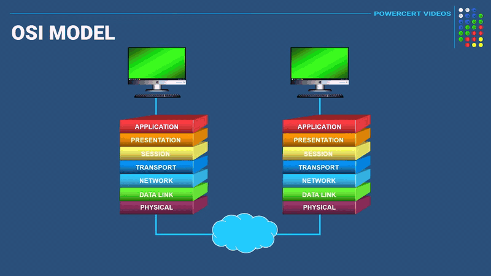

The OSI model breaks down data communication into **7 different layers**:

| # | Layer | Main job | Examples |
| --- | --- | --- | --- |
| 1 | **Physical** | Transmits **raw bits** through cables and connectors | Cables, connectors |
| 2 | **Data Link** | Organizes bits into **frames** | Switch, MAC address |
| 3 | **Network** | Routes **packets** across networks | Routers, layer 3 switches, IP address |
| 4 | **Transport** | Transfers data between end users | TCP, UDP |
| 5 | **Session** | **Starts, manages and ends** communication | |
| 6 | **Presentation** | **Translates**, compresses and encrypts data | |
| 7 | **Application** | Provides the **protocols** applications use | HTTP/HTTPS, DNS, SMTP, FTP |

---
#### The 7 layers
##### 1. Physical
- Deals with how **raw bits** of data are transmitted through **cables** and connectors.
- Defines the **topology** of a network.

##### 2. Data Link
- Responsible for getting the raw bits of data from the physical layer and organizing them into **frames**.
- A **frame** is raw data that has been properly formatted and prepared by adding **headers and trailers**.
- The frame contains the **MAC address**, which is used when devices talk to each other.
- A common layer 2 device is a **switch**, because it reads the **MAC address** in a frame and uses it to determine where to forward it.

##### 3. Network
- Responsible for **routing packets across different networks** using **IP addresses**.
- Data is encapsulated into **packets**.
- Some examples of layer 3 devices are **routers** and **layer 3 switches**.

##### 4. Transport
Provides the **transfer of data between end users** using the **TCP** or **UDP** protocols:
- **TCP**
	- **Resends** any data packets that **did not receive an acknowledgement** from the destination, ensuring the data packets are **received** by the destination.
	- It also **reassembles the data in the correct order**.
- **UDP**
	- **Does not guarantee** the delivery of the data.
	- It is a **faster** protocol, mainly used for applications such as **streaming videos**.

##### 5. Session
- **Controls the dialogue** during communications.
- Responsible for **starting**, **managing** and **ending** the communication.

##### 6. Presentation
- Responsible for **translating** the data into a **readable format** as it hands it off to the application layer.
- This layer is where the data is **compressed/decompressed** and **encrypted/decrypted**.
- Sometimes referred to as the **translation layer**.

##### 7. Application
- Provides the **protocols** that applications use to communicate over the network (e.g. **HTTP/HTTPS**, **DNS**, **SMTP**, **FTP**).
- It is **not the application itself** (e.g. a web browser), but the **network services** the application relies on.

[↑ Back to top](#networking)

## Network devices & services

### Network Devices, Applications, & Functions

#### Switch
- **Connects all of your network devices together** on a **local network**.
- Has **multiple ports** that accept **Ethernet connections** from network devices.
- It is considered **intelligent** because it **learns the physical (MAC) addresses** of the devices connected to it and stores them in its **table**. So when a **frame** is sent to a switch, it is forwarded **only to the intended destination port**.
- Works at **layer 2** (Data Link) of the [OSI Model](#osi-model).

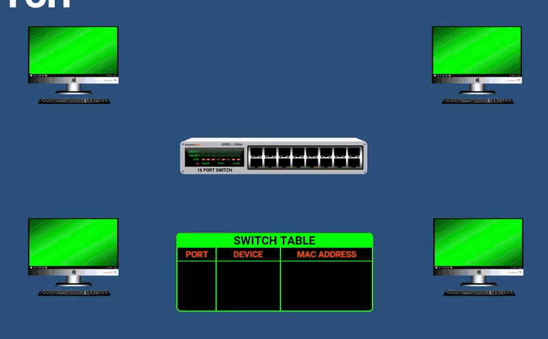

---
#### Router
- **Routes (forwards) data from one network to another** based on the **destination IP address**.
- Inspects the packet's destination IP address and **determines**, using its **routing table**, where to forward it next.
- It is the **default gateway** for a network: devices send traffic meant for **other networks** to the router.
- Works at **layer 3** (Network) of the [OSI Model](#osi-model).

---
#### Firewall
- A **hardware or software** system designed to **block unwanted traffic** from entering a private network by **filtering the information that comes in from the internet**.
- A firewall uses a **set of rules** to decide whether traffic is **allowed or blocked**. These rules are often implemented as an **access control list (ACL)**.
- The rules are **customizable** and configured by the **network administrator**. They can decide not only what can **enter** a network but also what can **leave** it.

---
#### IDS / IPS
- **Intrusion detection/prevention systems** alert on and protect a network from **attacks** (viruses, malware, hackers), including threats coming from **inside the network**.
- They can be **hardware or software**, and are usually placed **between the internet and the firewall** (many modern firewalls have one built in).
- They **monitor traffic** flowing through a network, looking for **suspicious patterns**.

| | IDS (detection) | IPS (prevention) |
| --- | --- | --- |
| **Position** | Works on a **copy** of the traffic | Sits **inline**: traffic passes through it |
| **Action** | **Sends alerts**, but doesn't block the packets | Can **drop malicious packets** |

---
#### Load Balancer
- A piece of **hardware or software** used to **distribute incoming traffic across multiple servers**, so that **no single server becomes overwhelmed** with the workload.

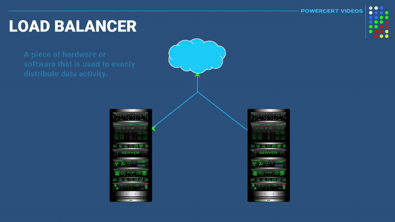

---
#### QoS (Quality of Service)
- **Quality of service** is a feature built into many **routers and switches**.
- It is used to **prioritize network traffic** based on certain **applications and devices**.
- **Traffic shaping** is one QoS technique: it **controls the rate** at which traffic is sent, to **smooth out bandwidth usage**.

> [!TIP]
> **Example**
>
> A network administrator can decide that an application such as **voice communication** is more important than **web browsing**, and give voice communication a **higher priority**, so it gets bandwidth **before** the other application.

[↑ Back to top](#networking)

---

### Proxy

> [!NOTE]
> **Definition**
>
> In general, a **proxy** is something that has the **authority to do something for another person or thing**.
> In networking, a proxy is a **server**: the **middleman** that sits between a **private network** and the **public internet**.

**What a proxy server does:**
- **Security:** using a **forward proxy** creates a **safety barrier** between a private network and the internet, because it can **regulate** traffic by **blocking harmful websites**.
- **Anonymity:** it **hides the identity of clients** by masking their IP addresses and using its own IP address, so websites and servers only see the **proxy server's IP address**, not the clients'.
- **Logging:** it **logs** user activity and keeps **track** of which websites were visited and how long users stayed on them (organizations like to know what websites their clients are visiting).
- **Bypassing restrictions:** it can **bypass** restricted content.
- **Speed:** a proxy can **cache** (store copies of) websites that are frequently used by its clients.

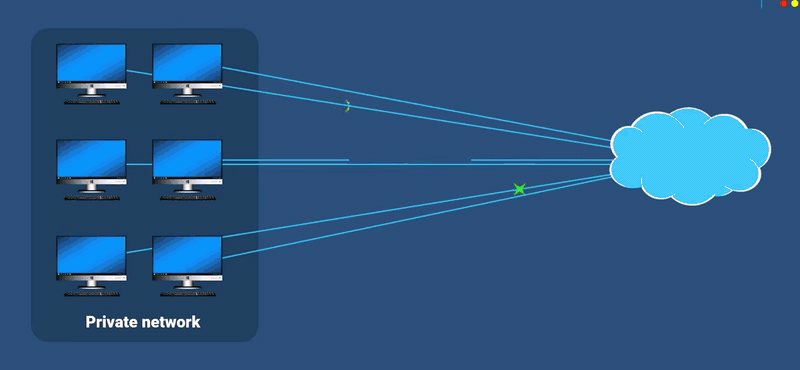

---
#### NAS (Network Attached Storage)
- A **storage device** used **strictly for storing data**.
- It may have **multiple drives for redundancy** and a **network interface card** directly attached to a **switch or a router**, so the data can be **accessed over a network**.
- Used in **homes** and **small to medium-sized businesses**.

---
#### SAN (Storage Area Network)
- A special **high-speed network** that stores and provides access to **large amounts of data**.
- It is a **dedicated network** used for **data storage**.
- This network consists of:
	1. **disk arrays**
	2. **switches**
	3. **servers**
- It has multiple disk arrays, switches and servers, so it is **fault tolerant**: the data is shared among the disk arrays, so if a disk array, a switch or a server goes down, the data can **still be accessed**.
- When a server accesses the data, it sees it **as if it were a local hard drive** (**block-level** access), because that is how operating systems recognize a SAN. A NAS, by contrast, appears as a **shared network drive** (**file-level** access).
- SANs are **very expensive**, so they are used mainly by **large companies**.

> [!NOTE]
> **NAS vs. SAN**
>
> | | NAS | SAN |
> | --- | --- | --- |
> | **What it is** | A storage device | A dedicated high-speed storage network |
> | **Appears to the OS as** | A shared network drive (**file-level**) | A local hard drive (**block-level**) |
> | **Redundancy** | Multiple drives | Multiple disk arrays, switches and servers (fault tolerant) |
> | **Used by** | Homes, small to medium-sized businesses | Large companies (very expensive) |

---
#### Wireless Access Point
- It acts as a **bridge** that wireless devices use to **connect to an existing wired network**.
- Primarily used by **medium and large organizations**.
- An organization will have **multiple access points** to make sure it **covers the entire building**.
- A wireless access point is connected to the network (usually a **switch**, or directly to the **router**) through an **Ethernet cable**. The access point then **broadcasts a Wi-Fi signal** so other devices can connect wirelessly and join the network.
- **Wireless** laptops, tablets and phones use the wireless access point, unlike **desktop computers**, which connect to the wired network directly using **Ethernet cables**.

---
#### Wireless LAN Controller
- Wireless access points can work on their own, but in **larger networks** they are also managed by a **wireless LAN controller**.
- It is a device that **manages the configuration of wireless access points** in a network.
- Instead of configuring each wireless access point, you **configure everything on the wireless LAN controller** and it **pushes the settings to all the wireless access points**.

[↑ Back to top](#networking)

---

### CDN

> [!NOTE]
> **Definition**
>
> **CDN** stands for **Content Delivery Network**. It makes websites **faster** by **bringing the website content closer to the user**.

#### The problem: distance
- The **distance** between the user's location and the **web server** directly affects **how fast the website loads**.

> [!TIP]
> **Example**
>
> If the **origin web server** is located in the **USA** and a user accessing it is also located in the USA, the website loads **fast** because the distance is short. If the user is located in **Asia**, the website takes **longer to load** because of the greater distance.

- A CDN was created to make websites faster by **reducing the distance between the user and the origin web server**.

#### How a CDN works
1. A CDN establishes **points of presence (PoPs)**, placed in **different geographical areas all over the world**.
2. The PoPs are made up of servers called **edge servers**.
3. The edge servers **cache** the content of the origin web server, so they can deliver the website data to users faster by bringing it closer to them.
4. Instead of connecting directly to the origin web server to retrieve the web page, users connect to the **edge server closest to their location**.

**Result:** this **reduces the latency** caused by long distances and **dramatically speeds up** website retrieval.

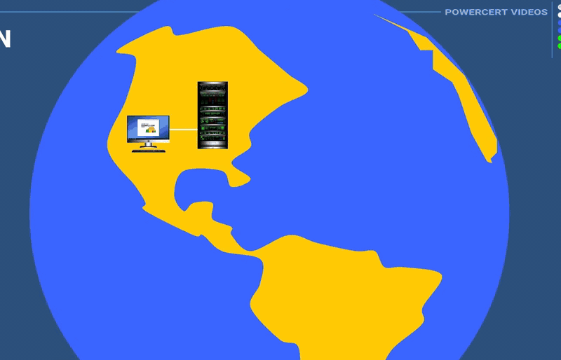

[↑ Back to top](#networking)

## Cloud & virtualization

### Virtualization

> [!NOTE]
> **Definition**
>
> **Virtualization** is the process of simulating hardware and software in a virtual (software) environment.

#### The traditional approach
Traditionally, a business runs **one application per physical machine**, e.g.:
1. A server dedicated to running an **email service**, with **Windows** as its OS
2. A server dedicated to running a **website**, with **Linux** as its OS
3. A server dedicated to running a **database**, with **UNIX** as its OS

#### The virtualized approach
- Instead of having three servers each running one application, we can use **one server** to take the place of all three, running every application along with its own OS. This is what virtualization does.
- In other words, virtualization **consolidates multiple physical servers**, with their different operating systems and applications, and runs them on **just one physical server** in a virtual environment.
- All of this is done **entirely through software**.
- Users interact with a virtual server the same way they would with separate physical servers, **without being able to tell the difference**.

#### The hypervisor
- The software that creates and runs the virtualization is called a **hypervisor** (e.g. *VirtualBox*).
- It **allocates and controls the sharing** of a machine's resources, such as storage space, RAM, CPUs, etc.

[↑ Back to top](#networking)

---

### VPC

> [!NOTE]
> **Definition**
>
> **VPC** stands for **Virtual Private Cloud**. It is an **isolated private network** within a **public cloud**.

#### What is a cloud?
- The cloud is just **a bunch of servers in a building**.
- These servers are **accessed from the internet** and provide services on behalf of clients, such as businesses and organizations.
- The **public cloud** is available for the public to use.
- A public cloud is a **3rd-party service provider** that sells its servers' computing resources to the public.

> [!TIP]
> **Example**
>
> An organization wants to run its applications, such as a website or a database. It could either:
> 1. **Build its own servers:** spend the money and time to build and maintain its own servers on-site and run these applications on them.
> 2. **Use a public cloud:** go with a cloud provider and use its servers instead to run the applications.

**Popular cloud providers:**
1. Amazon Web Services
2. Microsoft Azure
3. Google Cloud Platform

#### Public cloud vs. virtual private cloud
- In a **public cloud**, computing resources are **shared** between all the clients using that public cloud.
- A **VPC** is the creation of a **secure and isolated private network** within a public cloud.
- Its purpose is **isolation and security**, so it provides **greater security** than the shared public cloud.

#### How do you create a VPC?
For example, a business wants to use a VPC. What do they do?
1. They go to a **public cloud provider** of their choosing.
2. In that public cloud, they **create and configure their own VPC**.
3. In a VPC you can configure an **entire network**: servers, route tables, internet gateways, subnets, security groups, etc. It is **all done virtually**. You can also create **multiple networks** in your VPC.

##### Why would you need different networks in your VPC?
Let's say the business wants to create separate networks in its VPC by creating a couple of **subnets**:
- **1st subnet:** hosting their **website**
- **2nd subnet:** hosting their **database**

**Website → public subnet**
- The website needs to be accessed by the public from the internet, so its subnet needs internet access.
- This makes it a **public subnet**, so you have to configure a **virtual internet gateway** and **routing tables** to let traffic in and out.

**Database → private subnet**
- The database holds **sensitive information** that should not be accessed by the public, so its subnet will be a **private subnet**.
- No internet gateway needs to be configured for it.
- However, the company itself still needs to access the database on this private subnet. This is done by configuring a **VPN**, which creates a **secure and direct connection** from one network to another over the internet.

[↑ Back to top](#networking)

---

### Cloud

- It is just a **bunch of servers in a big building**
- The servers provide services on behalf of clients, such as businesses and organizations
- The cloud offers **scalability**, meaning it can add more resources, such as servers, when needed and it can do this on the fly
- It also offers **elasticity**, which means that the cloud can dynamically adjust its resources quickly, whether it's up or down, to adapt to fluctuations in a business or an organization
- It also offers **multitenancy**, which means multiple customers or clients share the same resource infrastructure in the public cloud

---

#### Cloud deployment models
When a company is ready to deploy a cloud, that company must decide what type of **cloud deployment model** it wants to use. The **deployment model** is about infrastructure isolation, while who’s allowed to log in is an access policy.

1. **Public model**
   - Is when a company is going to offer their product or service accessible to **anyone** who wants to access it.
   - For example, this could be a company's website where anyone can just use their computer to access the website.
   

2. **Private model**
   - Is when a company offers their service to **private users** instead of the general public.
   - For example, an internal website where only employees of that company can access it.
   

3. **Hybrid model**
   - Is a **mixture** of private and public models.
   

---

#### Service models in Cloud computing
There are **3 different service models** in cloud computing:

1. **IAAS (Infrastructure as a Service)**
   - It means that you allow the cloud provider to manage a portion of your business, which is going to be the **hardware portion**. The cloud provider will manage the servers, storage, virtualization, and the networking portion. You will still have control over the **software portion**, such as the applications, data, operating system, middleware, runtime.
   - An example of IAAS would be **iDrive**, which provides cloud storage.
   

2. **PAAS (Platform as a Service)**
   - PAAS, like IAAS, allows the cloud provider to manage a portion of your business, but the cloud provider has **more control**. In a PAAS, the cloud provider not only manages the hardware, such as server, storage and networking, but it also manages the **OS, middleware, and runtime**. You will be only responsible for the **applications and the data**.
   

3. **SAAS (Software as a Service)**
   - This is the **most common** cloud service by far. In this type, the cloud provider manages all the hardware, software, networking, operating system, and storage. There is no software to install on your computer and no hardware to manage. You just simply access and run the application from your computer when you connect to the cloud service through the internet.
   - A good example of SAAS is **Google Docs**, which is a free online office suite that is accessed using a web browser. There is no additional software that needs to be installed on your computer to use Google Docs. Everything is accessed and managed from your web browser.
   

[↑ Back to top](#networking)

## Ports & protocols

### Ports, Protocols, Services & Traffic Types

#### Ports
- A **port** is a logical connection that is used by programs to exchange information.
- These ports have a **unique number** that identifies them.
- Port numbers range from **0 - 65535**
- Some ports that are very common and used every single day are:
  1. **Port 80/TCP (HTTP):** used by the web server for HTTP connections to serve web pages on the internet over HTTP without encryption
  2. **Port 443/TCP (HTTPS):** used by the web server for HTTPS connections to serve secure web pages over HTTPS
  3. **Port 25/TCP (SMTP):** used for sending email through SMTP
  4. **Port 22/TCP (SSH):** used for remotely managing network devices and Linux servers
  5. **Port 53 (DNS):** used for DNS queries and responses to resolve domain names into IP addresses
  6. **Port 67/UDP and 68/UDP (DHCP):**
     - **Port 67:** Used by DHCP servers to listen for client requests, such as DHCPDISCOVER and DHCPREQUEST, and send responses from source port 67 to destination port 68.
     - **Port 68:** Used by DHCP clients to receive responses, such as DHCPOFFER and DHCPACK, from DHCP servers. Clients send DHCP requests from source port 68 to destination port 67.
  7. **Port 161/UDP and 162/UDP (SNMP):**
     - **Port 161:** Used by network management systems to query and manage network devices and retrieve information and statistics.
     - **Port 162:** Used by network management systems to receive SNMP notifications.
  8. **Port 179/TCP (BGP):** Used by the Border Gateway Protocol to establish connections between BGP peers and exchange routing information between autonomous systems.
  9. **Port 446/TCP (SMB):** Used by the Server Message Block protocol for network file sharing and other shared resources, particularly in Windows environments.
  10. **Port 514/UDP (Syslog):** Commonly used to transmit system logs from network devices and servers to centralized logging systems.
  11. **Port 3389/TCP (RDP):** Used by Microsoft's Remote Desktop Protocol to access and manage Windows systems remotely.
  12. **Port 23/TCP (Telnet):** Used for remote command-line access, but it transmits data without encryption and is generally avoided in favor of SSH.

---

#### TCP
Whenever a computer wants to communicate with another computer, the communication between these two computers needs to be good and reliable so it can guarantee that the data is received correctly. E.g.: when you want to view a web page or download a file or look at an email, you would expect to view the web page intact and in order with nothing missing, or if you download a file you would want the entire file and not just a part of the file. This is where TCP comes in. TCP stands for **Transmission Control Protocol**.

- TCP is used to **guarantee that all the data is received and in order**

  

- TCP is a **connection-oriented** protocol, which means that it must first acknowledge a session between two computers that are communicating
- The two computers verify a connection before any communication takes place by using a **three-way handshake**:
  1. First step is that a computer will send a message called a **SYN**
  2. The receiving computer will send back an **acknowledgement** message telling the sender that it has received the message
  3. Finally, the sender computer sends another **acknowledgement** message back to the receiver

  Once these steps have taken place, data can be delivered.

  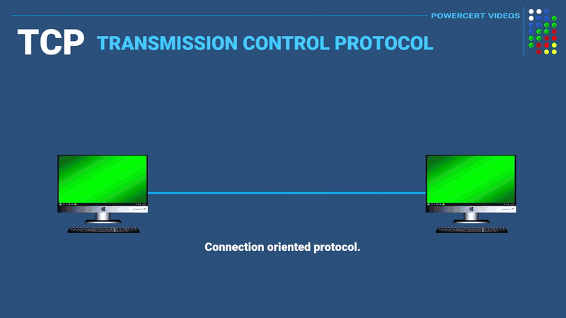

- TCP **guarantees the delivery** of the data, so if a data packet goes astray and doesn't arrive, then TCP will resend it.

  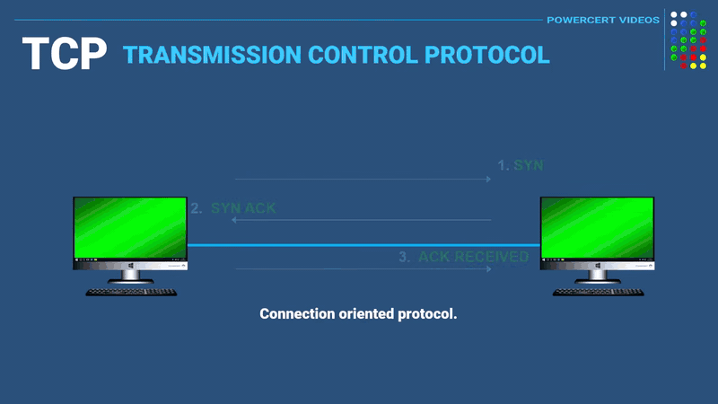

---

#### UDP
UDP is also for sending and receiving data.
- The main difference from TCP is that UDP is **connectionless**, which means that it does not establish a session and it does not guarantee data delivery
- UDP is also known as a **fire and forget** protocol because it sends data and it doesn't really care what happens to it

  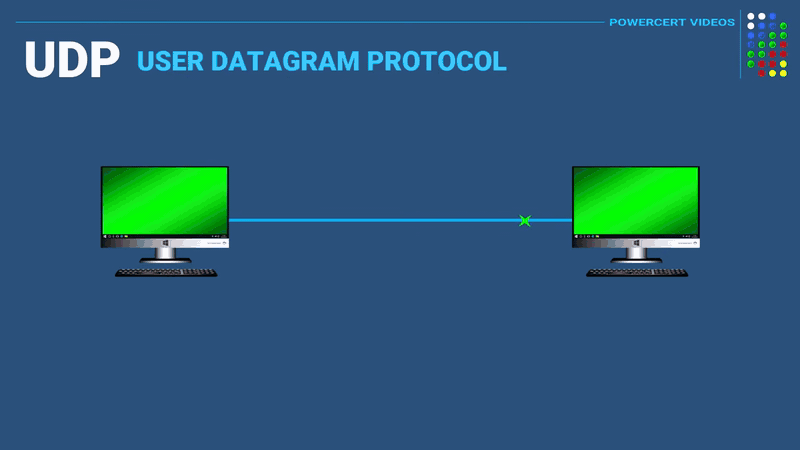

- Because of the less overhead that is involved of not guaranteeing data delivery, **UDP is faster than TCP**

---

#### IPsec
It is a set of protocols used for **security at the network layer** of the OSI model.
- **IP** stands for Internet Protocol, which is what the internet uses to route data, which is by using IP addresses
- **Sec** stands for secure, which is exactly what IPsec does: it secures the data when communication is happening between two points over a network

- IPsec secures the data by adding **encryption and authentication**
- It is the protocol that is commonly used to create **VPNs** (VPN just means making a public network, like the internet behave as if it were a private one, Private means that the traffic is hidden from everyone else, encrypted and the two sides can talk to each other as if they were directly connected. The tunnel is what makes it “virtual” and “private”, virtual because there’s no dedicated physical cable, private because the data inside is encrypted and only reachable by the two endpoints.)

When devices communicate over a public network such as the internet, the data that is being exchanged is sent in **clear text**, which means anyone can steal the data. It would not normally be a big deal if they were just sending nonsensitive information. But when sending sensitive information such as credit card or other personal information, then this would be a major problem.

IPsec was developed to ensure that the data cannot be stolen by protecting the data while it's being transferred over the internet. It does this by authentication and making sure that the data is impossible to read by using encryption algorithms to scramble the data that is being transferred.

- IPsec creates **secure tunnels** (a tunnel isn't a real physical path, it's a name for what happens when a packet gets wrapped inside another) to protect the data during transfer, and it is done in two phases using a protocol called **IKE (Internet Key Exchange)**:
  1. **Phase 1:** The 2 sites will identify each other and negotiate parameters for authentication and encryption methods. This is the first tunnel that is used to protect the negotiation process.
	- In order to use IPsec, both sender and receiver must **share a public or private key**. This key is what locks and unlocks the encrypted data as it travels across a network. This ensures that the data cannot be read and tampered with. The sender will secure the data by encrypting it with the key and the receiver will use the key to decrypt the data so it can be read.
	- **Diffie-Hellman Key Exchange:** Both sides publicly agree on **P** (a large prime, prime becua) and **G** (a base). Each then picks a private number it never shares: Alice picks **a**, Bob picks **b**. Each computes a public number and sends it over the network:
	  - Alice sends A = G^a mod P
	  - Bob sends B = G^b mod P
	
	  Each then raises the other's public number to their own private number:
	  - Alice computes B^a mod P
	  - Bob computes A^b mod P
	
	  Both results equal **G^(a·b) mod P**, so they get the same shared key. Only G, P, A and B ever cross the network, and recovering a or b from them is the **discrete logarithm problem**, which is infeasible at real sizes.
  1. **Phase 2:** Creation of the IPsec tunnel, and in this tunnel the protected data is going to be exchanged between the two sides.
	- Before the data is sent, it needs to be protected, and this can be done by using a couple of different protocols:
		  1. **AH - Authentication Header:** It offers authentication and integrity, but it doesn't do any encryption
		  2. **ESP - Encapsulating Security Payload:** It is the better of the two protocols. ESP does offer all three: authentication, integrity, and encryption

  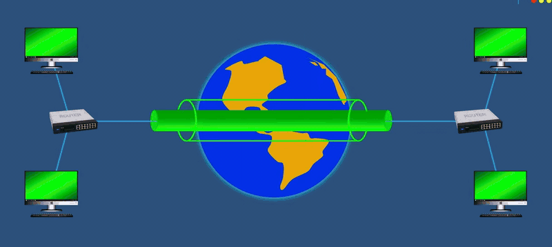

- IPsec operates in **2 different modes**:
  1. Transport mode
  2. Tunnel mode
- When data is sent across the network, the data is not sent in one chunk. It's sent in smaller chunks called **packets**.
- These packets have an **IP header, TCP header, and a payload**. The IP and TCP headers contain information such as the source and destination IP address, port and sequence numbers, and more. The payload contains the actual data. Right now this IP packet has no security.

  

If we would want to add security to this packet with IPsec using **transport mode**, an ESP header, trailer, and authenticator gets added to the original packet. And the TCP header, payload and ESP trailer are all encrypted.
Transport mode is used when **two devices** connect over the public internet.

In **tunnel mode**, a new IP header is attached to the packet, and in addition to the TCP header, payload, and ESP trailer, the IP header also gets encrypted. So it provides even more security than transport mode.
Tunnel mode is used when **two sites**, such as two businesses, are connected over the public internet using a VPN.

---

#### GRE
Stands for **Generic Route Encapsulation**
- Is used with point-to-point tunneling protocol in creation of a VPN network
- GRE is actually what **creates the tunnel in PPTP**; it is used to encapsulate the data in a secure manner
- It wraps one packet inside another, but with **no encryption or authentication**. It just does the wrapping

---

#### Traffic types

##### Broadcast
- When there is a **single transmitter** of data and that data is being **received by every device**
- E.g.: When a computer is sending an ARP broadcast out on the network and every computer will receive the message

  

##### Unicast
- It is a **one-to-one** communication, so the data is sent to a single device

  

##### Multicast
- The data is sent to **multiple devices** at the same time, but not to every device

  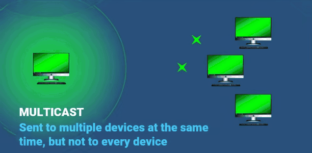

##### Anycast
- Data is sent to the **nearest device**

  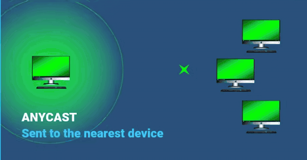

[↑ Back to top](#networking)

## Cabling & transmission

### Transmission media & Transceivers

#### Wireless

##### Wi-Fi Standards
**Wi-Fi** is a wireless technology that uses **radio waves** to allow networking devices to communicate with other networking devices wirelessly, using a device such as a **Wi-Fi router** or a **wireless access point**.

- The organization that created and maintains the wireless standards is the **IEEE** (**Institute of Electrical and Electronics Engineers**).
- The IEEE started a project called the **802 project**.
- The wireless standards they created start with the number **802.11**, first released in **1997**.

---
##### Cellular
Another method of connecting to the internet is by using **cellular networks**, which are used by devices such as cell phones and mobile tablets.

- Cellular networks divide geographical areas into sections called **cells**, with each cell having a **cellular tower** to cover that area.
- It's these cells that allow devices to connect to the internet wirelessly.
- Early on, cellular networks used technologies such as **2G** and **3G**. Today they use modern technologies such as **4G LTE** and **5G**, which significantly increase the speed of cellular data.

---
##### Satellite
Satellite internet is typically used when there is **no other option available** for internet access, e.g. in undeveloped areas where there is no network infrastructure.

**How it works:**
1. Data is transmitted by a **dish at the customer's location** up to **orbiting satellites**.
2. The satellites relay the data to a **broadband internet ground station**.
3. The ground station sends data back up to the satellites.
4. The satellites relay the data back to the dish at the customer's location.

> [!TIP]
> **Example**
>
> An example of a satellite internet provider is **Starlink**.

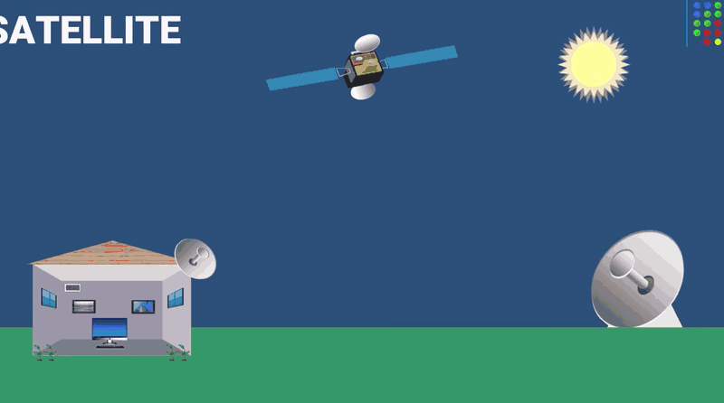

---
#### Wired

##### 802.3 Ethernet
The same IEEE organization that created the 802.11 wireless standard also created standards for cables: the **802.3 Ethernet standard**, which defines how data is transmitted over **wired connections**.

- Ethernet is the **most common network technology** used today.
- Its speed ranges from **10 to 40,000 Mbps**.
- It uses both **copper wire** and **fiber optic** media.

Today there are many different Ethernet cable standards used on networks. The cables are categorized and named according to their **speed**, **type**, and **media**.

> [!TIP]
> **Analyzing the cable name "10BASE-T"**
>
> - **10** → the maximum speed of this cable, which is **10 megabits per second**
> - **BASE** → **baseband transmission**: the signal is sent directly in its original form, for example on a copper cable. (Unlike **broadband transmission**, where data is modulated onto carrier waves at different frequencies.)
> - **T** → **twisted pair** cable

###### 10 – 100BASE Ethernet cables
- Maximum speed of **10 and 100 megabits per second**.
- There are variations in lengths and cable types. Examples in the following chart:

###### 1000BASE Ethernet cables
- Maximum speed of **1000 megabits per second**. Examples in the following chart:

###### 10GBASE Ethernet cables
- Maximum speed of **10,000 megabits per second**. Examples in the following chart:

---
##### Twisted-Pair Cables
**Twisted-pair cables** are Ethernet network cables used in **local area networks**.
- These are the Ethernet cables you'll use to connect your computer to your router or modem so you can have internet access.
- One end of the cable plugs into your computer's **network interface card**, and the other end plugs into the network port of the **router, switch, or modem**, depending on what you're using.

**There are 2 different types:**
1. **Unshielded Twisted Pair (UTP)**
	- The **most common** type of cable used today.
	- Consists of **four pairs of color-coded wires** twisted around each other.
	- The wires are twisted to **prevent electromagnetic interference (crosstalk)** ([explanation](html/twisted_pair_signaling_1.html)).
	- It is what most people use in their **home or business**.
2. **Shielded Twisted Pair (STP)**
	- Similar to UTP, except it has a **foil shield** covering the wires, which adds an extra layer of protection against electromagnetic interference leaking into and out of the cable.
	- Mainly used for **industrial purposes**, not so much in a home or business.

**There are 7 cable categories:**
- Category 3
- Category 5
- Category 5e
- Category 6
- Category 6a
- Category 7
- Category 8

> [!NOTE]
> - The difference between the categories is the **maximum speed** they can handle **without any crosstalk** (interference).
> - The category numbers represent the **tightness of the twists** applied to the wires.
> - If you have an older network running slower speeds, you can still use Cat 7, because it is **backward compatible**.

---
##### DAC Cable
**DAC** stands for **Direct Attach Copper** cable.
- It is a copper cable used for **high-speed data transmission over a short distance**.
- Typically used in **data centers** to connect devices to each other, such as switches on the same rack.
- DAC uses **twinaxial cable**, which has two conductor wires in a twisted pair separated by an insulator.
- The cable comes **pre-made from the manufacturer** and is terminated with transceiver housings at each end using **small form-factor pluggable (SFP)** connectors.
- They are simple to use: you just plug them into the **SFP ports** on the switches to connect them, and that's it. **No special configuration** needs to be done.
- DAC cables are better than Ethernet cables because they offer **lower latency**, **higher speeds**, **better signal quality**, and are **cost-effective**.

---
##### Plenum Cables
The term **plenum** refers to a space where there is **open airflow circulation**, usually between the **drop ceiling** and the **structural ceiling**. As a result, buildings that have plenum spaces are **more prone to fires**.

Therefore, cables that run through these plenum spaces must meet certain requirements:
- must be **more fire resistant**
- must **not produce toxic fumes**

This is the environment where **plenum cables** should be used.

Buildings that don't have plenum spaces have **air ducts** encapsulating the airflow, so there is no open airflow circulation. Because of this, the chances of a fire happening and recirculating toxic fumes are minimal. This is an example where you could use **nonplenum cables**.

---
##### Coaxial Cable
Used today primarily by **cable providers** to provide a computer with a **broadband internet connection**.

**There are 2 types:**
- **RG-6:** made for **long distances**; commonly used for cable television and internet connections
- **RG-59:** made for **short distances**; generally used for HD/HQ video

---
##### Fiber Optic Cable
It uses **pulses of light** to send data, and as a result it is **very fast** and can span **great distances**.

**There are 2 different modes in fiber optics:**
1. **Single-mode fiber**
	- Allows light to enter at **only a single angle**. Because the light enters at this single angle, it can span **great distances**.

2. **Multi-mode fiber**
	- Light travels in **multiple beams** that reflect off the walls of the cable.
	- Unlike single-mode fiber, multi-mode is made for **short distances**.

---
#### Connectors

##### RJ-11 Connector
- A **4-wire connector** used mainly to connect **telephone equipment**.
- Also used to connect computers to a local area network through the computer's **modem**.
- It resembles the RJ-45, but it is **a little bit smaller**.

---
##### RJ-45 Connector
- The **most common network connector**.
- An **8-pin modular connector** used to connect computers and other network devices in a local area network.

**How it's used:**
1. The RJ-45 is used with **unshielded twisted pair** cable that has **8 wires**.
2. The wires are arranged in a certain order and inserted into an RJ-45 connector.
3. They are then **crimped** on both ends using a **wire crimper**.
4. One connector plugs into the computer's **network card**, and the other end into a device such as a **switch, modem, or router**. Once that's done, the computer can connect to a network.

---
##### F-Type Connector
- A **threaded connector** typically used on **coaxial cables**.
- Primarily used by **cable providers** to attach to **cable modems**.
- In addition to broadband cable, it is also used with **satellite internet**.

---
##### BNC Connector
- Used on **coaxial cable**.
- Used for both **analog and digital video** transmissions, as well as **audio**.

---
##### SC Connector
- A **fiber optic** connector, also called the **standard**, **square**, or **subscriber** connector.
- One of the **first connectors** to be used in the marketplace.
- Uses a **push-pull** connector, similar to audio and video plugs.
- Commonly used **between floors** in a building.

---
##### LC Connector
- Also called the **local connector** or **Lucent connector**, since it was developed by **Lucent**.
- Also used **between floors** in a building.
- Designed to **compete with the SC** connector.
- About **half the size** of the SC connector, which makes it better for **highly populated racks and panels**.
- Uses a **latch** that locks itself into place, similar to the RJ-45.

---
##### MPO (Multi-Fiber Push On) Connector
- **Multiple fibers** are combined into a **single interface** via an MPO connector.
- A type of fiber optic connector used in **high-density environments** and for **high-speed data transfer** applications.

---
##### ST Connector
- Uses a **half-twist bayonet** type of lock and is commonly used with **single-mode** fiber optic cable.
- A **large** connector developed by **AT&T**. Because of its large size, its usage has **declined** in favor of smaller connectors such as the **LC** and the **MTRJ**.

[↑ Back to top](#networking)

## IP addressing

### IPv4 Addressing

#### Public vs. Private IPv4 addresses

##### Public IP addresses
When you order internet service from a company, they assign the modem in your home or business a **public IP address**.
- A public IP address is **registered** on the internet. It is what gives you access to the World Wide Web, so if you don't have a public IP, you **cannot access the internet**.
- Public IP addresses are **unique**, so there are **no duplicates**.

> [!WARNING]
> **The IPv4 shortage**
>
> When public IP addresses were created, engineers didn't realize how big the internet would become. Even though there were **over 4 billion IPv4 addresses** available, the engineers thought this would be enough, but they were wrong.
>
> To prevent a shortage of public IPv4 addresses, engineers from the **Internet Engineering Task Force** developed **private IP addresses** in a document labeled **RFC 1918**.

##### Private IP addresses
- Private IP addresses are **not publicly registered** on the internet, so you **can't access the internet** using a private IP address.
- If your device has a private IP address and you want to access the internet, your private IP has to be **converted into a public IP address** first.
- Private IP addresses are only used **internally**, such as inside a home or a business, and are not used on the public internet.

---
#### NAT and PAT

##### NAT
The service that converts (translates) a private IP address into a public IP address is called **NAT** (**Network Address Translation**).
- This service is **built into a router**.
- It translates **both ways**:
	- **private → public**
	- **public → private**: if a computer on the internet wants to communicate with a computer on this private network, NAT needs to translate the public IP address to the private IP address of that computer.

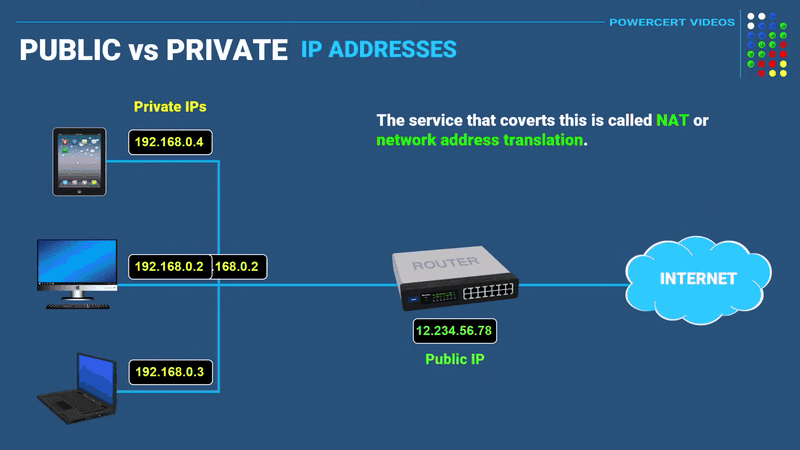

##### PAT
**PAT** (**Port Address Translation**) is an **extension of NAT**.

> [!IMPORTANT]
> **The problem with only NAT**
>
> With only NAT, we can't have **multiple devices** accessing the internet through a router. When a reply comes back, the router's job is to translate it into the right **private** IP. With only NAT and several devices, **every reply has the same destination**, so the router can't decide which private IP to pick.

> [!TIP]
> **How PAT fixes it**
>
> PAT gives **each connection its own port number**, which allows devices on a private network to **share a single public IP address**. When the router gets a reply, it can decide which private IP to pick, because the **port number is mapped to the private IP**.

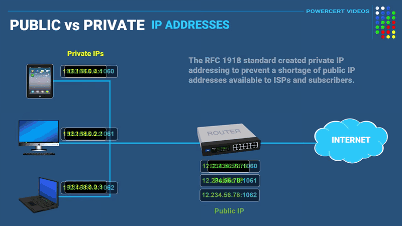

---
#### Private IP Address Classes
Private IP addresses come from **special ranges** that are **reserved for use in local networks** and are **never used on the public internet**.

There are **3 different classes** of private IP addresses, and each class has a different range:

| Class       | Starts with | Range                    | Used for                     |
| ----------- | ----------- | ------------------------ | ---------------------------- |
| **Class A** | 10          | 10.x.x.x                 | Large organizations          |
| **Class B** | 172         | 172.16.x.x to 172.31.x.x | Medium-size organizations    |
| **Class C** | 192.168     | 192.168.x.x              | Small organizations or homes |

[↑ Back to top](#networking)

---

### Subnet Mask

#### IP address
An **IP address** is an **identifier** for a computer or device on a network.
- Every device has to have an IP address for communication purposes, more specifically an **IPv4 address**.

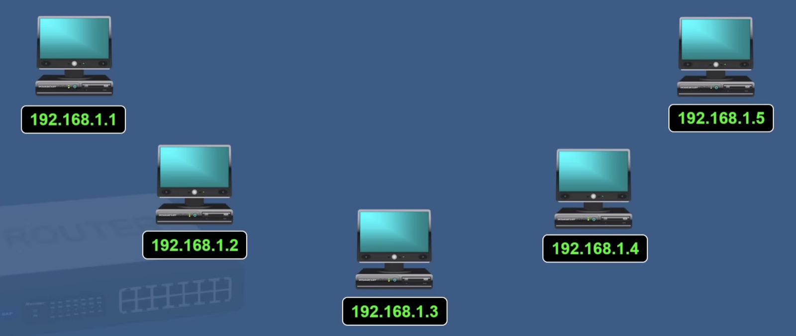

An **IPv4 address** is a **32-bit numeric address** written as **four numbers separated by periods**.
- Each group of numbers separated by periods is called an **octet**.
- The number range in each octet is from **0 to 255**.

---
#### Network address & Host address
An IP address consists of **two parts**:
1. **Network address** (network ID): a number assigned to a **network**, so every network has a **unique** address.
2. **Host address** (host ID): what is assigned to **hosts** such as computers, servers, tablets and routers **within that network**. Every host has a **unique** host address.

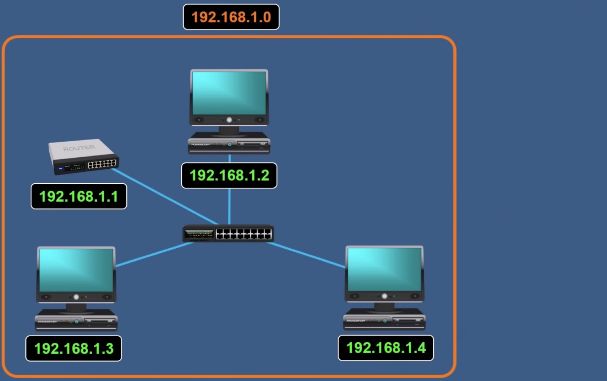

---
#### 8-bit octet chart
In the computer world, IP addresses and subnet masks are not in decimal, because computers and networks don't read them in this format. They only understand numbers in **binary format**: **ones and zeros**.

> [!TIP]
> **Example**
>
> The binary number for this IP address:
> **192.168.1.0** → **11000000.10101000.00000001.00000000**

**How do you get the binary numbers from an IP address?** We use the **8-bit octet chart**:

| 8th bit | 7th bit | 6th bit | 5th bit | 4th bit | 3rd bit | 2nd bit | 1st bit |
| ------- | ------- | ------- | ------- | ------- | ------- | ------- | ------- |
| 128     | 64      | 32      | 16      | 8       | 4       | 2       | 1       |
| 0/1     | 0/1     | 0/1     | 0/1     | 0/1     | 0/1     | 0/1     | 0/1     |

- Each bit in an octet is **represented by a number**: the 8th bit by 128, the 7th bit by 64, the 6th bit by 32, and so on.
- Each bit in an octet can be either a **1** or a **0**:
	- If the bit is a **1**, the number it represents **counts**.
	- If the bit is a **0**, the number it represents **does not count**.
- So by manipulating the 1s and 0s in the octet, you can come up with any number from **0 to 255**.

**E.g. for 192.168.1.0:**

| 8th bit | 7th bit | 6th bit | 5th bit | 4th bit | 3rd bit | 2nd bit | 1st bit | Number  |
| ------- | ------- | ------- | ------- | ------- | ------- | ------- | ------- | ------- |
| 128     | 64      | 32      | 16      | 8       | 4       | 2       | 1       | -       |
| 1       | 1       | 0       | 0       | 0       | 0       | 0       | 0       | **192** |
| 1       | 0       | 1       | 0       | 1       | 0       | 0       | 0       | **168** |
| 0       | 0       | 0       | 0       | 0       | 0       | 0       | 1       | **1**   |
| 0       | 0       | 0       | 0       | 0       | 0       | 0       | 0       | **0**   |

- 128 + 64 = **192**
- 128 + 32 + 8 = **168**
- 1 = **1**
- 0 = **0**

So **192.168.1.0**(10) is **11000000.10101000.00000001.00000000**(2)

---
#### Subnet Mask
The **subnet mask** is how you tell which portion of the IP address is the **network** and which is the **host**.

A subnet mask is a **32-bit value** made of 1s and 0s:
- the **1s** in the subnet mask indicate the **network address**
- the **0s** in the subnet mask indicate the **host addresses**

Wherever a binary digit of the subnet mask is a **1**, it indicates a position in the IP address that defines the **network**.

1. 1st example:

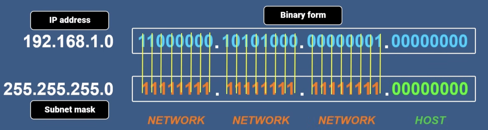

2. 2nd example:

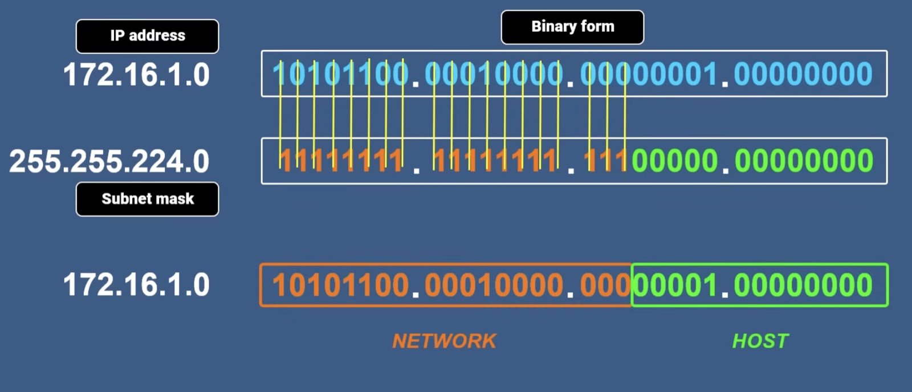

---
#### CIDR
Subnet masks can also be expressed using a different method called **CIDR** (**Classless Inter-Domain Routing**), also known as **slash notation**.
- Slash notation is a **shorter way to write a subnet mask**.
- It is written as a **forward slash** followed by a number **counting the 1s** in the subnet mask.

> [!TIP]
> **Example**
>
> **192.168.1.0/24** ↔ 11111111.11111111.11111111.00000000 ↔ **255.255.255.0**
> (The /24 means that the mask has **24 ones**.)

---
#### Public IP Address Classes
When an organization needs networking, it will need an **IP address class** according to its needs, which is based on **how many hosts** it has.

| Class       | First Octet Address | Default Subnet Mask | Hosts                | Used for                                         |
| ----------- | ------------------- | ------------------- | -------------------- | ------------------------------------------------ |
| **Class A** | 1 - 126             | 255.0.0.0           | Up to **16 million** | Organizations with a **very large** amount of hosts |
| **Class B** | 128 - 191           | 255.255.0.0         | Up to **65,000**     | **Medium to large** organizations                |
| **Class C** | 192 - 223           | 255.255.255.0       | **254**              | **Small** organizations and homes that don't have a lot of hosts |

> [!TIP]
> **Example**
>
> An example of an organization that would need a Class A address is an **internet service provider** like **DIGI**, because it needs to distribute **millions of public IP addresses** to all its customers.

---
#### Subnetting

##### Why does an IP address have a network and a host part?
> [!IMPORTANT]
> Why can't an IP address have just a host part, to uniquely assign each device an IP address?

The reason is **manageability**: breaking down a large network into smaller networks, or **subnetworks**, which is known as **subnetting**.

**The problem: one huge network**
- Let's say there were no small networks, and an organization has a large number of computers in **one huge network**.
- When a computer wants to talk to another computer, it needs to know how and where to reach that computer. It does this by using a **broadcast** to locate that computer.

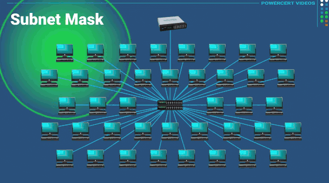

- The problem is that when a computer sends out a broadcast on the network, asking the target computer to identify itself so they can communicate, **every computer on this network also receives the broadcast**, because they are all on the same network.
- If every computer on this large network were broadcasting to every other computer just to communicate, it would **slow down the network** and potentially **bring it to a halt** because of the tremendous amount of **broadcast traffic** it would cause.

**The solution: smaller networks separated by routers**
1. To prevent this, the network needs to be **broken down into smaller networks**.
2. The networks are broken down and **physically separated by routers**. This alleviates the problem of excessive traffic, because **broadcasts do not go past routers**.

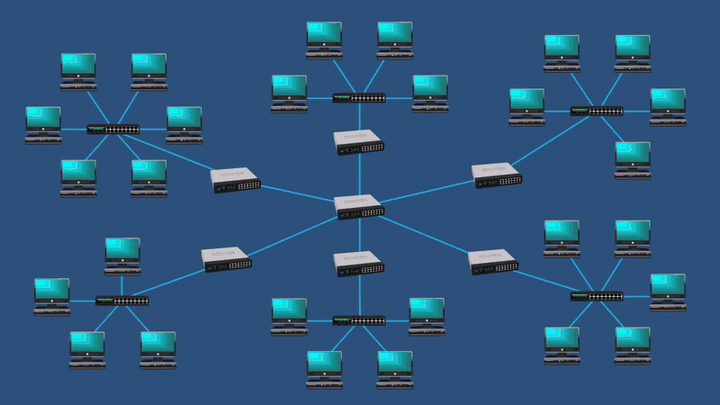

- After subnetting, if two computers in two different subnets want to communicate, the computer sends out a broadcast that **only the computers in its own subnetwork** can receive.
- Since the target computer is on a different subnetwork, the data is sent to the **default gateway**, which is the **router**, and the router then intelligently **routes the data to the destination**.

> [!NOTE]
> This is why IP addresses have a **network** and a **host** part: so networks can be **logically broken down into smaller networks**, which is known as **subnetting**.

##### How subnetting works
Subnetting is done by **changing the default subnet mask**, **borrowing some of the bits from the host portion**.

> [!NOTE]
> **Usable hosts**
>
> The subnet mask **255.255.255.0** gives us **one network with 256 hosts**. Technically, we have to **subtract two hosts**, because the values that are **all ones** and **all zeros** are reserved for the **broadcast** and **network** address respectively. So we actually have **254 usable hosts**.

###### Borrowing 1 bit → 2 subnets
For example, we borrow **one bit** from the host portion:

255.255.255.0 ↔ 11111111.11111111.11111111.<ins>0</ins>0000000
becomes:
**255.255.255.128** ↔ 11111111.11111111.11111111.<ins>1</ins>0000000

By borrowing one bit, the network is **divided in half**. Instead of having one network with 254 hosts, we get **two networks (subnets) with 126 hosts each**, because a bit can hold two values, 0 or 1, and each value is a different network.

| Borrowed bit in the last octet | Host addresses range         | Subnet               |
| ------------------------------ | ---------------------------- | -------------------- |
| **0**                          | 192.168.1.0 to 192.168.1.127   | **192.168.1.0/25**   |
| **1**                          | 192.168.1.128 to 192.168.1.255 | **192.168.1.128/25** |

###### Borrowing 2 bits → 4 subnets
If we borrow **another bit** from the host portion, the network is divided even further, giving us **four subnets with 62 hosts each**.

255.255.255.128 ↔ 11111111.11111111.11111111.1<ins>0</ins>0000000
becomes:
**255.255.255.192** ↔ 11111111.11111111.11111111.1<ins>1</ins>0000000

| First 2 bits in the last octet | Host addresses range           | Subnet               |
| ------------------------------ | ------------------------------ | -------------------- |
| **00**                         | 192.168.1.0 to 192.168.1.63    | **192.168.1.0/26**   |
| **01**                         | 192.168.1.64 to 192.168.1.127  | **192.168.1.64/26**  |
| **10**                         | 192.168.1.128 to 192.168.1.191 | **192.168.1.128/26** |
| **11**                         | 192.168.1.192 to 192.168.1.255 | **192.168.1.192/26** |

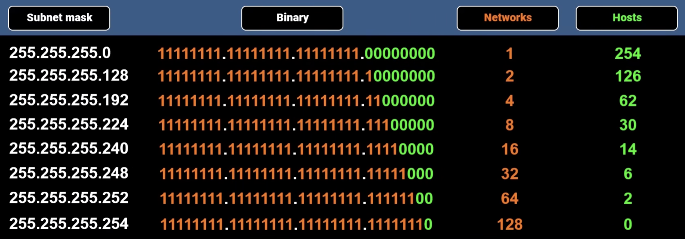

[↑ Back to top](#networking)

---

### IPv6 Addressing

> [!WARNING]
> **Why IPv6?**
>
> When the internet was first developed, programmers didn't realize how big it would become. They thought that **IPv4**, which produced **over 4 billion IP addresses**, would be enough. But they were obviously wrong.

**IPv6** (IP version 6) is the **next generation of IP addresses**.
The main difference between IPv4 and IPv6 is the **length of the address**:

| | IPv4 | IPv6 |
| --- | --- | --- |
| **Length** | **32-bit** | **128-bit** |
| **Format** | Numeric | **Hexadecimal** (uses both **numbers and letters**) |
| **Number of addresses** | Over **4 billion** | An unbelievable **340 undecillion** |

---
#### IPv6 compression
An example of an IPv6 address:
`2601:b589:0000:4b01:0000:0000:bb81:0712`

It is a very long IP address, but there is a method in IPv6 that can be used to **compress the address** and make it **easier to read**.

An IPv6 address has **8 groups of hexadecimals**, known as **hextets**. To compress it:
1. **Leading 0s:** if there are 0s at the start of a group (reading from left to right), those 0s **can be omitted**, except for the **last digit** in the group.
2. **Consecutive all-0 groups:** if there are **2 or more consecutive groups of all 0s**, they can be replaced with a **double colon (`::`)**.

> [!TIP]
> **Example**
>
> | Full address | Compressed |
> | --- | --- |
> | `2601:b589:0000:4b01:0000:0000:bb81:0712` | `2601:b589:0:4b01::bb81:712` |
> | `2002:0c3e:0000:4b01:0000:0000:0000:0002` | `2002:c3e:0:4b01::2` |

---
#### Migrating from IPv4 to IPv6
- IPv4 was the first version of IP addresses, but we have **officially run out of them**, so ISPs are **not giving out new ones**.
- Because of this, we are now **migrating to IPv6**, but we haven't fully migrated, because a lot of organizations are **still using the older IPv4**.
- So today we are using a **mixture of IPv4 and IPv6**, and we need **transition technologies** to enable communication between them.

##### Tunneling
**Tunneling** is when **IPv6 packets are enclosed into IPv4 packets**, so routing can be accomplished between the two IP versions.

> [!TIP]
> **How tunneling works**
>
> Your network has IPv6 devices and wants to talk with another network that also has IPv6 devices.
> 1. When the packet crosses the internet to reach the other network, it may encounter an **IPv4-only segment** in the **ISP's network**.
> 2. Your router (the **tunnel start**) **encapsulates the whole IPv6 packet inside an IPv4 packet**, using **its own IPv4 address as the source** and the **other site's router IPv4 address as the destination**.
> 3. The ISP forwards it like **any normal IPv4 packet**, **without ever seeing the IPv6 packet inside**.
> 4. When it reaches the router of the other network (the **tunnel end**), the IPv4 header is removed (**decapsulation**) and the original IPv6 packet is forwarded to the destination device, **unchanged**.

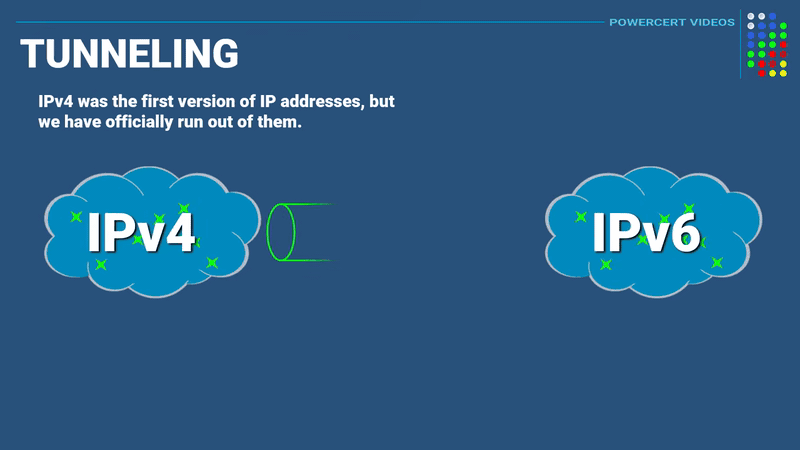

##### Dual Stack
**Dual stack** is another transition technology that allows your device to **process IPv4 and IPv6 data simultaneously**, so you won't have any **compatibility issues** when accessing websites and servers during the migration.

> [!TIP]
> **Example**
>
> This is why, if you type the `ipconfig` command, you will see that your computer has **both an IPv6 and an IPv4 address**: it's a result of having dual stack installed on your computer.

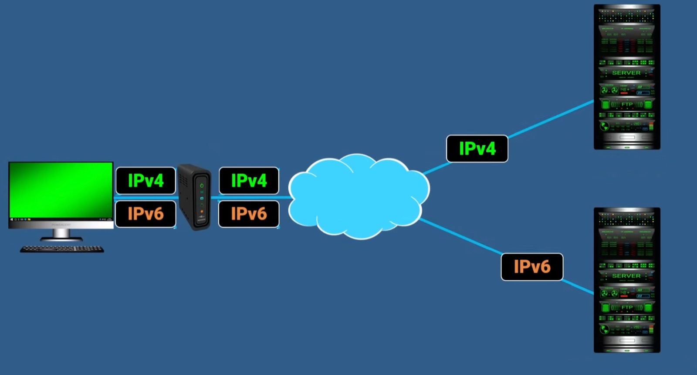

##### NAT64
**NAT64** is another transition technology.
- While dual stack allows devices to run both IPv4 and IPv6 simultaneously, NAT64 is used on **IPv6-only devices**.
- It **translates** traffic from **IPv6-only devices** so they can communicate with **IPv4-only servers**.

> [!TIP]
> **How NAT64 works**
>
> - A device has an **IPv6 address**, for example: `2001:db8:1::10`
> - It wants to send a packet to a server that has an **IPv4 address**, for example: `192.0.2.33`
> - The device uses the standard prefix **`64:ff9b::/96`**, an address range **reserved for NAT64**.
>
> 1. The device sends the packet to `64:ff9b::192.0.2.33`, which goes to the **NAT64 gateway**.
> 2. The gateway **reads the last part**, sees `192.0.2.33`, and sends the packet to that **IPv4 server**.
> 3. The reply comes back to the gateway, which **wraps it in IPv6 again** and sends it to the device.

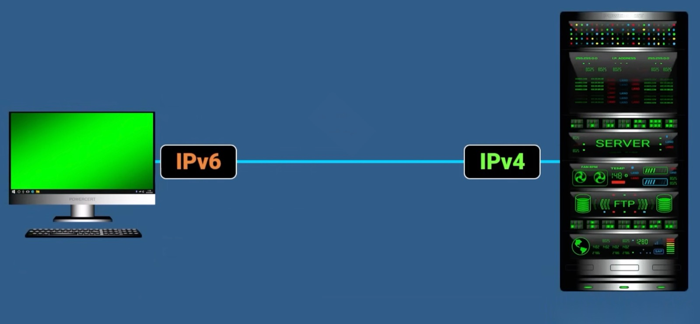

> [!NOTE]
> **Transition technologies**
>
> | Technology | What it does |
> | --- | --- |
> | **Tunneling** | Encloses IPv6 packets into IPv4 packets so they can cross IPv4-only networks |
> | **Dual stack** | Lets a device process IPv4 and IPv6 simultaneously |
> | **NAT64** | Translates for IPv6-only devices so they can reach IPv4-only servers |

[↑ Back to top](#networking)

## Modern networks

### Modern Network Environments

#### SDN (Software-Defined Network)
> [!NOTE]
> **Definition**
>
> **SDN** is a system where the network is managed by administrators from a **centralized software system**, rather than having each individual device make decisions itself.

##### The two layers of a network device
In a traditional network you have **switches and routers**, and these devices have two different layers:
1. **Control plane:** the **"manager"**. It decides how traffic should move through the network based on **policies and configurations**, and sends those rules to the network devices.
2. **Data plane:** the **physical network hardware**: switches, routers and the cables connecting them.
	- Using **specialized chips**, these devices receive packets, look them up in their **flow tables**, and forward them out the correct port at **very high speed**.
	- They **don't make decisions**; they just move packets through the network, following the rules set by the control plane.

##### Traditional network vs. SDN
- **Traditional network:** when routers and switches receive data, they refer to **their own control plane** (such as routing and switching tables) and, based on their configuration, **decide themselves** how and where the data is sent.
- **SDN:** the control plane is **taken away from the individual routers and switches** and is instead managed by **software in a centralized location**.

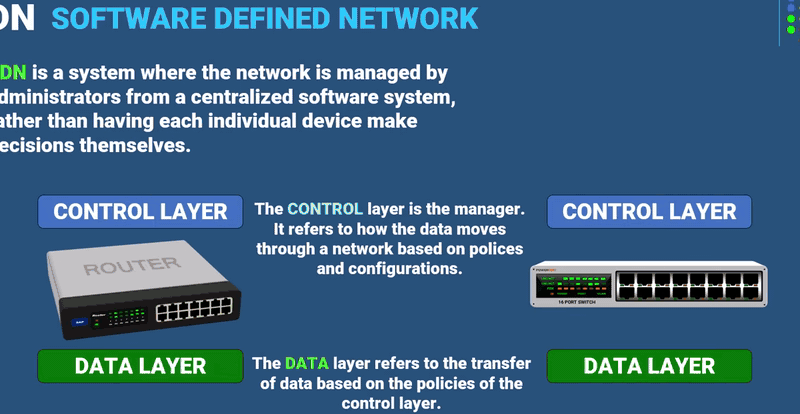

##### Benefits
An SDN allows network administrators to **manage and configure all the traffic** in a network. This has several benefits:
- **prioritizing traffic** and **load balancing** when needed
- **easy scalability**, to scale up or down when needed
- **improved network performance**
- **greater security** using **segmentation and isolation**

---
#### SD-WAN (Software-Defined WAN)
A **WAN** is any network that **connects separate LANs over long distances**. The **internet** is the biggest example of a WAN.

##### Traditional WAN and MPLS
Imagine your company needs to send traffic between **two offices** in two different geographical locations.
- You could send the traffic over the **regular internet**, but that is **risky** if you send any sensitive information, and the traffic might **get stuck during rush hours**.
- Instead, you pay a **telecom provider** to give you a **private, reserved connection line** between your offices.
- **MPLS** (**Multiprotocol Label Switching**) is the technology the provider uses to build and manage that private connection efficiently.

> [!TIP]
> **How MPLS works**
>
> - **Normally:** every router along the way has to open up each packet, look at the **destination IP address**, and figure out where to send it next. That takes a bit of **processing time at every single hop**.
> - **With MPLS:** the **entry router** does that lookup **once** and slaps a small **label** on the packet, like a sorting tag. Every router after that just **reads the tag and forwards it**, without re-examining the whole packet.
> - **Result:** it's **quicker**, and the provider can **guarantee** your traffic takes a **specific, consistent path**, with **consistent speed**.

**The problem with a traditional WAN**
Let's say your company has **five offices**. With a traditional WAN:
- Each office gets **one connection**, an MPLS line, and that is the **only path** to the rest of the company.
- If that line **goes down or gets congested**, that office is **stuck**.
- If you want to change anything, like adding a new office or changing how traffic is prioritized, someone has to **manually configure each router at each site**.
- It is **slow and rigid**.

##### How SD-WAN improves on it
A **software-defined WAN** is an **extension of SDN**. Long-distance networks can be created and managed **more effectively** with SD-WAN.

The main difference between SD-WAN and a regular WAN is that SD-WAN is **software-defined**:
- You can use **multiple links at the same office at once** (for example **MPLS, broadband, and 5G**) instead of depending on a single one.
- A **central controller** monitors the quality of each link and **automatically sends each type of traffic over the best one**, such as video calls over MPLS and large file backups over cheaper broadband.
- If a link **fails or gets congested**, traffic is **rerouted automatically**.
- **Policies are set once in a central dashboard** and pushed to every office, so adding a new office or changing priorities no longer means configuring each router by hand.

| | Traditional WAN | SD-WAN |
| --- | --- | --- |
| **Links per office** | One (MPLS line) | Multiple at once (MPLS, broadband, 5G) |
| **Link fails / congested** | Office is stuck | Traffic rerouted automatically |
| **Making changes** | Configure each router manually at each site | Set once in a central dashboard, pushed to every office |

> [!NOTE]
> You **still rent the physical links** from providers (an ISP, a mobile carrier, a telecom). SD-WAN is the **software layer on top** that manages them.
> The management of the network (policies, configurations, and the flow of data) is all done through a **central policy management system** (like Cisco or Fortinet) using a **centralized controller**.

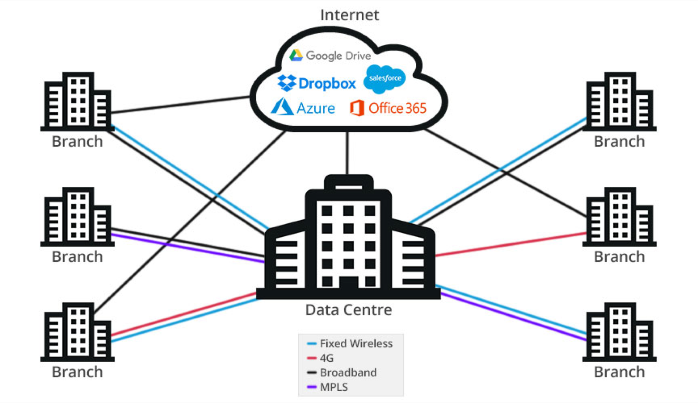

##### Zero-Touch Provisioning
SD-WAN has a feature called **zero-touch provisioning** that **configures new network devices automatically**, without any manual intervention.
- It automates the process of **installing software**, **configuring settings**, and **enrolling devices** in an SDN/SD-WAN.
- This results in **faster deployment** of new devices.

##### Transport Agnostic
SD-WAN is also **transport agnostic**, which means it'll **work with just about anything**.
- When SD-WAN is implemented, it can make effective use of the **underlying physical network infrastructure regardless of what it is**: broadband internet, 5G, satellite, MPLS, etc.

---
#### ZTA (Zero Trust Architecture)
> [!NOTE]
> **Definition**
>
> **Zero trust architecture (ZTA)** is a security framework that assumes that **no user, device, or application**, **even those located inside a network**, should be completely trusted.

- With **traditional security**, once users log into a system they can often be trusted and verified for a period of time **without requiring extra verification**. With ZTA, this is **no longer the case**.
- ZTA follows a **"never trust, always verify"** guideline.
- It uses **policy-based authentication** before access is granted, based on the user's:
	- **identity**
	- **time and date** they log in
	- **location**
	- **behaviour**
- It requires users and devices to be **continuously verified** as part of its authentication.
- When users are granted access, they are given **least privilege access**, which only grants them the **minimal access needed to do their job**.

So zero trust architecture provides the **highest security framework** to verify someone's identity.

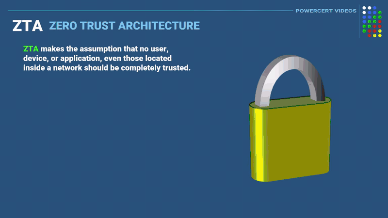

---
#### SASE (Secure Access Service Edge)
The way organizations do business has changed in the past 20 years: they've moved from **hosting their own applications and servers on premises** to **using cloud infrastructure** instead.
Since transitioning to the cloud, **security needs to evolve** to incorporate the cloud as well. This is where **SASE** (**Secure Access Service Edge**) comes in.

- SASE provides a better and safer way to **access data and applications** by **integrating networking and security into the cloud infrastructure**.
- SASE includes different technologies:
	- **Zero trust network access**
	- **Secure web gateways**
	- **SD-WAN**
	- **VPNs**
- SASE is also referred to as the **"next-generation VPN"**, because it provides a **more thorough and more secure** method of cloud communication and remote access.

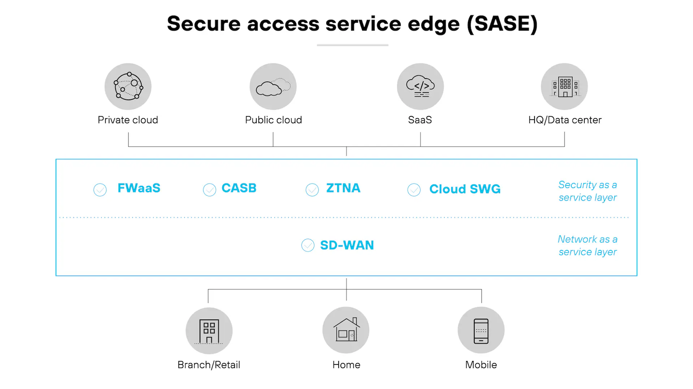

---
#### SSE (Security Service Edge)
**SSE** (**Security Service Edge**) is another **cloud security solution**.
- It aims to **secure access to websites, cloud services, and private apps**, **no matter the user's location or device**.
- It is frequently a **component of a broader SASE architecture**, in which **WAN edge services** control **network connectivity** and **SSE** manages the **security**.

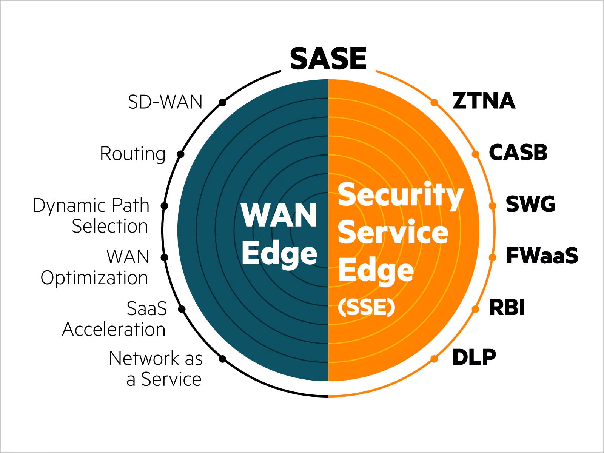

---
#### IaC (Infrastructure as Code)
> [!NOTE]
> **Definition**
>
> **IaC** is a way of **setting up and managing the infrastructure of a cloud network** by using a **script**.

##### Traditional way vs. IaC
- **Traditional way:** setting up a network in the cloud is done **manually**. For example, administrators would log into the cloud provider's dashboard and click through menus to set up and configure virtual machines, load balancers, firewalls and databases, install and configure software, and manage that network.
- **IaC:** this is done **automatically** by writing **code or a script**.

**How it works:**
1. Instead of manually setting up a network, administrators get together and **write scripts** that **design, build, and configure** the network they want.
2. Those scripts are **uploaded to the cloud**.
3. The cloud **builds and configures the network automatically** using those scripts.

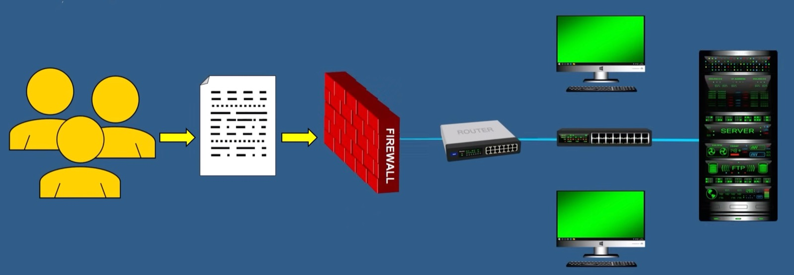

##### Benefits
- **Fast deployment:** instead of manually setting up a network, the network is built and configured automatically by scripts.
- **Reliable and consistent:** it **eliminates human error**.
- **Saves money:** it doesn't require a large staff to build and manage a network.

##### Key concepts
**Playbook**
- A structured document used in IT that offers a **collection of procedures** for managing different scenarios, including complicated operations, common IT tasks, and security issues.

**Template**
- A **reusable file** used in IaC that specifies the **ideal configuration** of your cloud infrastructure, such as servers, databases, and networks.
- By automating the distribution and administration of these resources, templates provide **scalability**, **consistency**, and **reduce human error**.

**Configuration drift**
- Since IaC uses code, it also **prevents configuration drift**.
- **Configuration drift** is a **deviation from the network's baseline configuration** caused by **manual configurations and human error**.

> [!TIP]
> **Example**
>
> Two servers were supposed to be identical, but because of configuration drift they slowly become **different from each other over time**.

**Upgrades**
- Whenever an upgrade is needed, a **new script version** is written with the new upgrade instructions.
- The whole file is then uploaded to the cloud, and the **whole network is recreated** with the new upgrades.

**Source control**
- Source control in IaC refers to **tracking the changes to IaC scripts** using a **version control system** such as **Git**.
- Git is used to **manage the different versions** of scripts and acts as a **central repository**, providing a centralized location to store them.
- Version control systems also **identify conflicts** in scripts, which happen when **multiple users are making changes** to the code.
- It also supports **branching**: making a **copy of a codebase at a certain point in time**. This enables developers to work on experiments, bug fixes, and new features **without affecting the project's main version**.

[↑ Back to top](#networking)

## VLANs & switching

### VLANS & Switch Technologies

#### VLANs

##### VLAN
> [!NOTE]
> **Definition**
>
> **VLAN** stands for **Virtual Local Area Network**. It is a local area network where computers, servers, and other network devices are **logically connected regardless of their physical location**.
> Even if these devices are **scattered in different places**, it doesn't matter, because a VLAN can **logically group them into separate network segments**.

**The purpose of a VLAN:**
- **improved security**
- **traffic management**
- **a simplified network**

> [!TIP]
> **Example**
>
> There is a **3-story office building**, and in this building you have computers that belong to certain departments **mixed in** with computers that belong to **other departments** on the same floor.
>
> 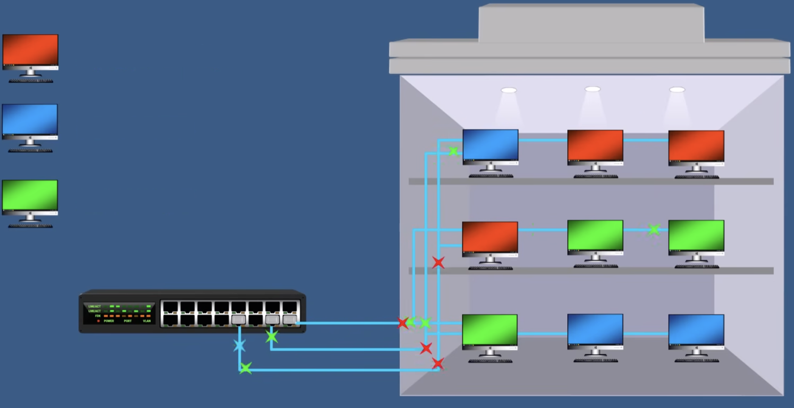
>
> - **Without VLANs:** all of these computers are connected to a switch, so the network **broadcast traffic** from the different departments is **mixed together**, and the departments all **see each other's network traffic**.
> - **With VLANs:** to separate the broadcast traffic between the departments, you create **3 VLANs**: one for **accounting**, one for **shipping** and one for **support**. After that, each department **only sees its own network traffic**, even though all the computers are connected to the **same switch**.
>
> 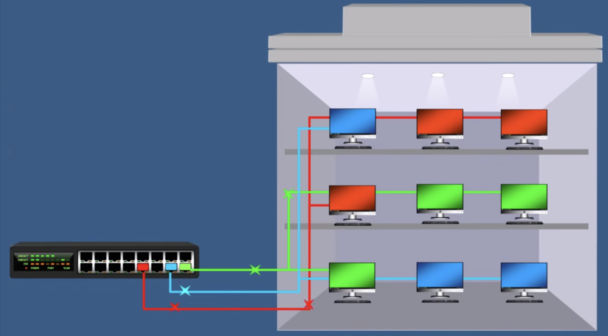

**How VLANs are created:**
- If the switch is **VLAN-capable**, VLANs can **logically create several virtual networks** to separate the network broadcast traffic.
- VLANs are created by **designating specific ports on the switch** and **assigning those ports to a specific VLAN**.

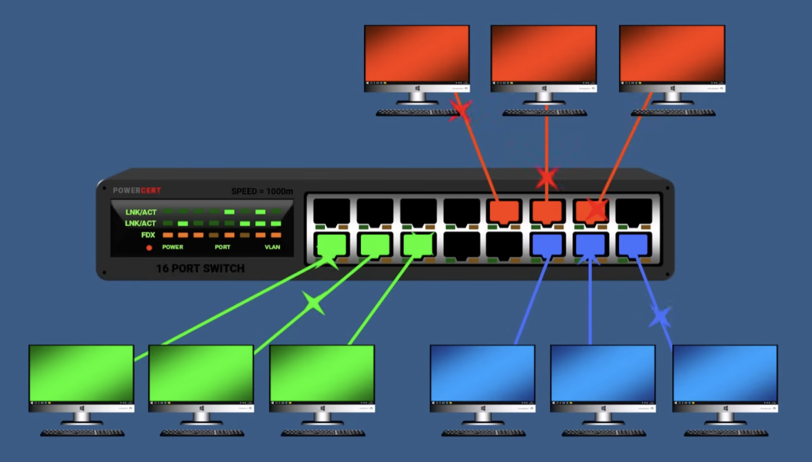

> [!NOTE]
> Just to be clear, this **doesn't mean that computers can't communicate** with computers on **different VLANs**, because they can. Creating VLANs just means that their **broadcast traffic is kept within their own VLAN**.

---
##### VLAN 802.1Q tagging
If you want to **connect VLANs together across different switches**, this is where **802.1Q tagging** comes in.

> [!TIP]
> **The scenario**
>
> 1. On **switch 1** we have two VLANs, tagged **VLAN 10** and **VLAN 20**.
> 2. On **switch 2** we also have two VLANs, tagged **VLAN 10** and **VLAN 20**.
>
> We want the computers on **VLAN 10** on each switch to be able to communicate with each other, and the computers on **VLAN 20** on each switch to be able to communicate with each other.

**How it's done: 802.1Q VLAN trunks**
- A **VLAN trunk** allows **multiple VLANs** to communicate through a **single physical cable** between the switches.
- To carry multiple VLANs over that link, the **port mode** needs to be changed from **access** to **trunk** and a cable needs to be connected to a **trunk port** on each switch, and it is on these trunk ports that the **tagging is configured**.
- The frames coming from the computers are now **tagged**. These tags contain the **VLAN ID number**, which allows each switch to determine **which VLAN to send the frame to**.

**Sending a frame from VLAN 10 on switch 1 to VLAN 10 on switch 2:**
1. The frame is first sent to **switch 1**.
2. Switch 1 sees that it's going to a **VLAN 10 device**, so it **tags the frame** with the VLAN ID: **VLAN 10**.
3. Once the frame reaches the **trunk port on switch 2**, switch 2 **looks at the VLAN ID on the tag** and forwards the frame to the computer on **VLAN 10**.

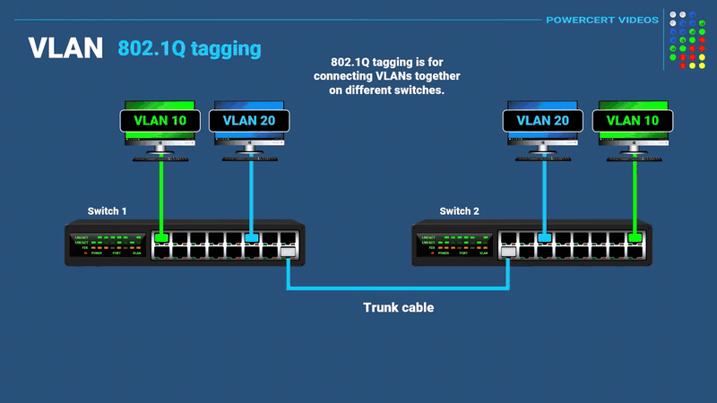

---
##### Native VLAN
A **native VLAN** is a VLAN where **frames are untagged**. Its purpose is to let **older devices that don't support VLAN tagging** communicate over a **trunk link**.

> [!TIP]
> **Example**
>
> We've added **older computers on each switch**, and we want those older computers to be on the **same VLAN**.
> 1. For any device on the native VLAN, the **Ethernet frames will not be tagged**.
> 2. When the trunk receives the frame, it notices that it's **untagged**, which means it's on the **native VLAN** we configured, so it sends the frame to **switch 2**.
> 3. Switch 2 also notices that it's **untagged**, which means it's on the **native VLAN** we configured.

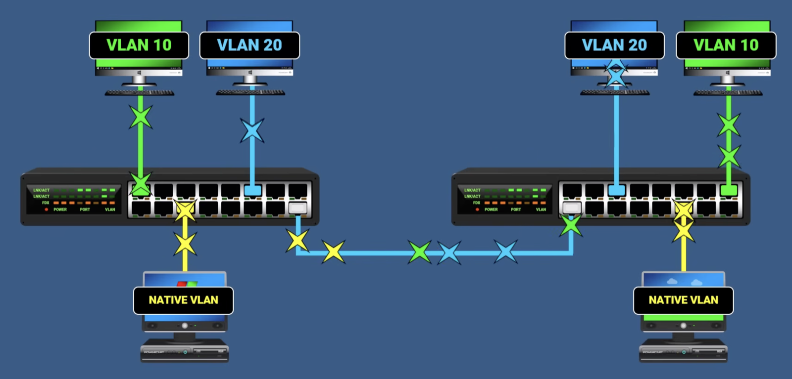

---
##### VXLAN
**The limitations of VLANs:**
1. VLANs only operate at **layer 2**, so they are **not routable**. This means VLANs **cannot be created across networks in different geographical locations**.
2. VLANs support a **maximum of 4000 virtual networks**. This isn't a problem for most organizations, but for **large enterprise organizations** with data centers that use **cloud computing and virtual machines**, 4000 is **not enough**.

This is where **VXLAN** comes in. **VXLAN** stands for **Virtual Extensible Local Area Network**.

| | VLAN | VXLAN |
| --- | --- | --- |
| **Maximum virtual networks** | 4000 | **16 million** |
| **Routable** | No (layer 2 only) | **Yes**: can create virtual networks across different geographical areas |

**How VXLAN works:**
- VXLANs use a **VNID** (**Virtual Network Identifier**, also written **VNI**), which is a **label or tag** used to **identify a specific virtual network**.
- On each switch, we need to create and configure **VTEPs** (**VXLAN Tunnel Endpoints**). These endpoints are responsible for **encapsulating and decapsulating** the VXLAN frames that are sent and received through a **VXLAN tunnel**.

> [!TIP]
> **Example**
>
> We have **two data centers** in **two different geographical areas**, and we want them to be on the **same virtual network**, so we tag them both as **VNI 100**.
> 1. When one data center sends a frame, the **VTEP encapsulates** that frame in a **VXLAN header**. This header includes the **VNI number**, which in this case is **VNI 100**.
> 2. The frame is sent **over the internet**.
> 3. The other switch **decapsulates** the frame and sends it to the other data center.
>
> The data centers **act as if they were on the same local network**, even though they are in different geographical areas.

This is where we get the term **DCI** (**Data Center Interconnect**), which refers to a technology that **connects multiple data centers together** in a VXLAN.

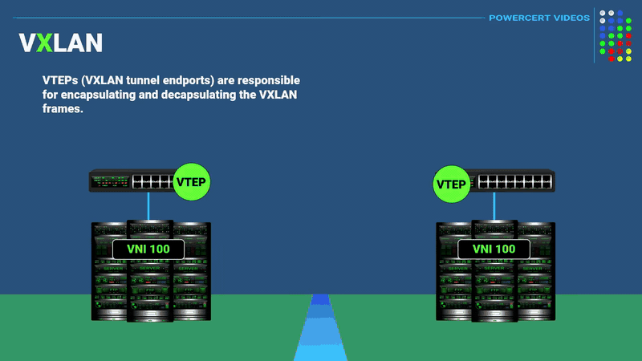

---
#### Switch Technologies

##### Layer 3 switch
- **Layer 2 switches** are by far the **most common** type of switch.
- A **layer 3 switch** (**multilayer switch**) operates at **layer 3** of the [OSI Model](#osi-model).
- Layer 3 is the **network layer**, which has to do with **routing** and deals with **IP addresses**. So a layer 3 switch can **route data using IP addresses**.
- In addition to operating at layer 3, it can **still operate at layer 2**.

So a layer 3 switch can:
- **forward** data using **MAC addresses** (layer 2)
- **route** data using **IP addresses** (layer 3)

---
##### Link aggregation
A networking technique that uses **multiple cables connected to multiple ports** to create a **single logical connection**, which **increases the bandwidth** between the switches.

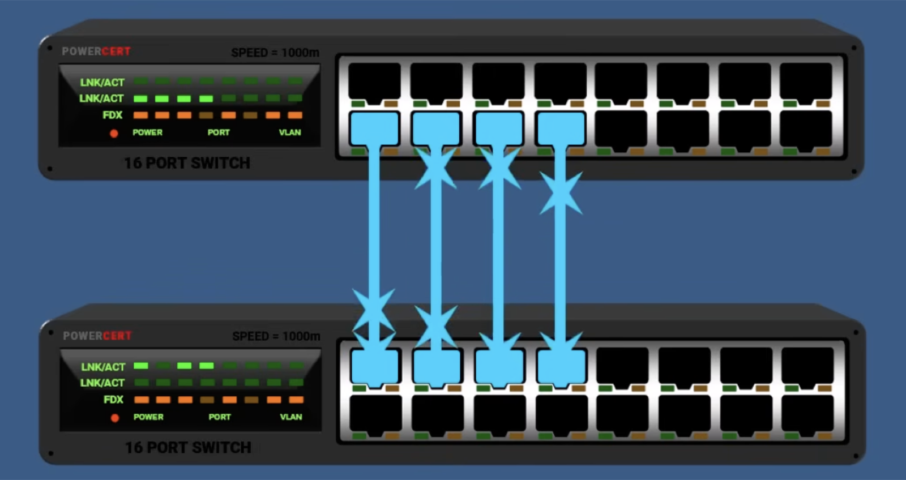

---
##### Duplex
###### Full duplex
The term **duplex** in a network switch means that a device can **send and receive data in either direction at the same time**, which is also known as **full duplex**.
- It is **faster** than half duplex and can **double the bandwidth**.

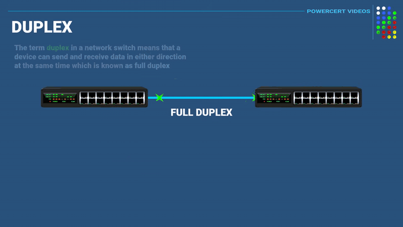

###### Half duplex
If a device can only send and receive data in **one direction at a time**, this is known as **half duplex**.

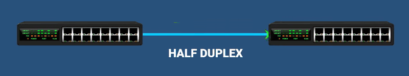

---
##### Interface speed
- Switches have different **interface speed ratings**. The most common interface speeds are measured in **megabits per second**, such as **10, 100, 1000 or 10,000 Mbps**.
- To take full advantage of a certain speed, **both connected interfaces** must be **capable of handling that speed**.

> [!TIP]
> **Example**
>
> If your device has an interface of **1000 Mbps**, but you plug it into a switch rated at only **100 Mbps**, you will only achieve **100 Mbps**. You need to plug your device into a **1000 Mbps switch** to get the maximum speed possible.

- A lot of switches have a feature called **auto-negotiation**, a protocol that **automatically determines the best settings** (**speed and duplex mode**) for both devices.

---
##### Maximum transmission unit
- The **MTU** (**Maximum Transmission Unit**) is the **biggest size of a data packet** that a network device, such as a switch, can accept. It is measured in **bytes**.
- The MTU size for Ethernet is **1500 bytes** by default.
- Frames bigger than 1500 bytes are called **jumbo frames**. These are typically **9000 bytes** in size.
- Jumbo frames are **not typically used on the internet or in homes**. They are typically used in **high-speed internal networks** for **moving large amounts of data**. These high-speed networks use **gigabit** or even **10 gigabit** switches.

[↑ Back to top](#networking)

---

### Spanning Tree Protocol

#### Finding a device's MAC address
- When network devices want to communicate with other network devices, they first need to **know the MAC address** of those devices.
- They find the MAC address of the device they want to talk to by **broadcasting a frame** out on the network, **asking for that device's MAC address**.
- Once the MAC address is known, **communication can take place**.

> [!TIP]
> **Example**
>
> We have **four computers (A, B, C, D)** in a **star topology**, with a **switch connecting all of them**. If computer A wants to communicate with another computer on this network, it'll **send a broadcast frame**, and the switch will **forward that broadcast to every device** that's connected to it.

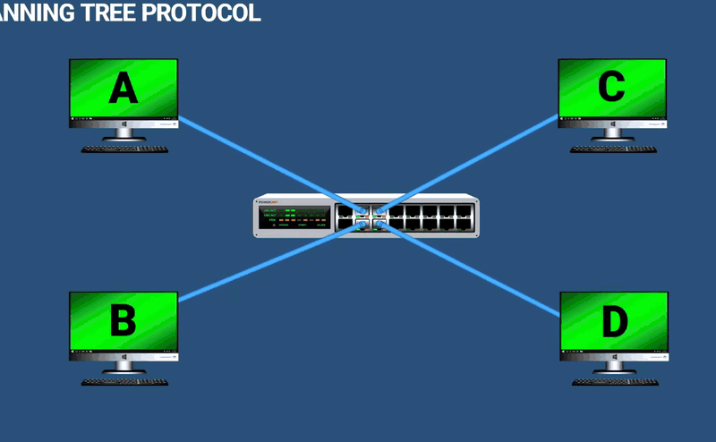

#### Adding redundancy
- In some cases, network administrators want to **add redundancy** to their network in case of a **switch or cable failure**.
- So instead of having **one switch**, they may use **multiple switches**.

> [!TIP]
> **Example**
>
> Below we have **3 switches**, so computer A has **2 options** it can take to communicate with computer C.

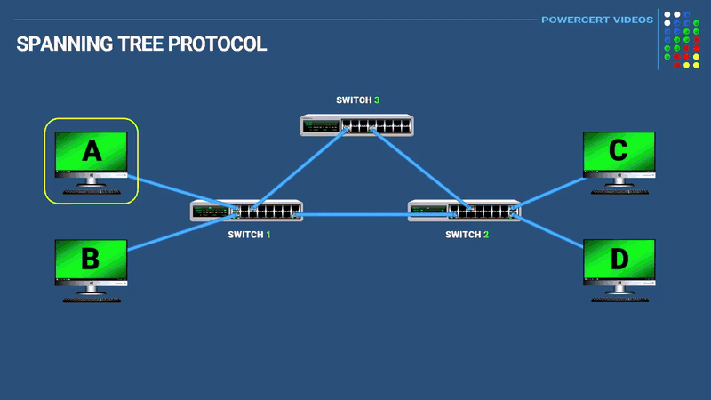

---
#### Broadcast Storm
The problem is that with a setup like this, when a computer wants to talk to another computer, it needs to **send a broadcast frame** out on the network to find the computer it wants to talk to. But:

1. **Phase 1**
	- Computer A sends the broadcast frame to **Switch 1**
2. **Phase 2**
	- Switch 1 sends the broadcast frame to **Switch 2**
	- Switch 1 sends the broadcast frame to **Computer B**
3. **Phase 3**
	- Switch 2 sends the broadcast frame to **Computer C**
	- Switch 2 sends the broadcast frame to **Computer D**
	- Switch 3 sends the broadcast frame to **Switch 2**
4. **Phase 4**
	- <ins>Switch 2 sends the broadcast frame to Switch 1</ins> → **Loop!!!**

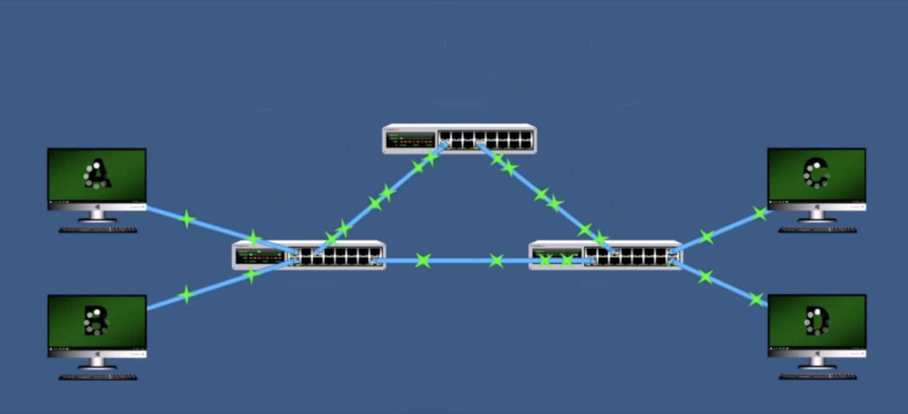

> [!WARNING]
> **Broadcast storm**
>
> The whole network will be caught up in a **never-ending loop of broadcasts**, which is known as a **broadcast storm**.
> When this happens, the network **can't do anything** because of the **constant broadcasts**, and the entire network will **come to a grinding halt**.

> [!TIP]
> **The solution**
>
> This is why the **Spanning Tree Protocol** was developed: to **prevent broadcast storms** when **multiple switches** are used on a network.
> STP solves this by **blocking certain ports on the switches**.

**How does it determine which port or ports to block?**

---
#### Spanning Tree Protocol Step by Step

##### Step 1: Which switch will be the root bridge?
The **root bridge** is considered the **most important switch**.

###### BPDU
The way to determine which of the switches is the most important switch is by **sending out messages** called **BPDUs** (**Bridge Protocol Data Units**) on the network.

###### BID
These units contain information called the **BID** (**Bridge ID**). The bridge ID consists of the switch's:
- **Priority number**
- **VLAN ID**
- **MAC address**

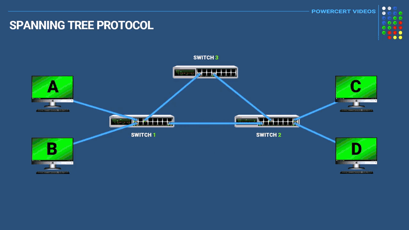

###### Electing the root bridge
**The bridge with the lowest BID value will be elected as the root bridge.**

> [!TIP]
> **Example**
>
> - By default, each switch will have a **default priority number** like **32768**, and let's say that all the switches are on **VLAN 1**.
> - The **BID equals the priority number + VLAN ID**, so each switch will be **32769**.
> - Since each switch has the **same priority value**, there will be a **tie**.
> - The **tie-breaker** is the **MAC address**: whichever switch has the **lowest MAC address** will be elected as the **root bridge**.

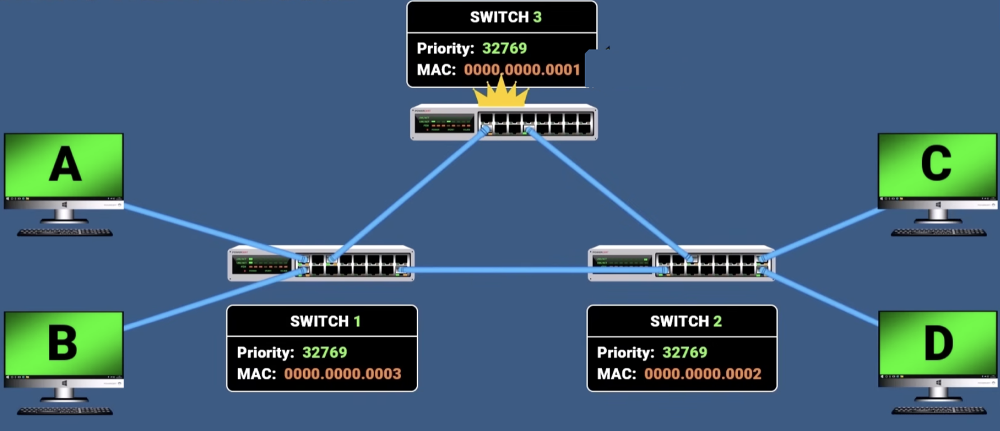

###### Designated Ports
- The **ports on the root bridge** are labeled as **designated ports**.
- Designated ports are ports that **lead away from the root bridge**.

##### Step 2: Determine the root ports
- The **root ports** are ports on the **non-root switches** (the switches that **forward data to the root bridge**).
- Root ports are elected by what's called the **lowest path cost**, which means the port on the switch that has the **fastest link to the root bridge**.

The path cost is calculated with the following chart:

| Link speed | Path cost |
| --- | --- |
| **1 Gbps** | **4** |
| **100 Mbps** | **19** |
| **10 Mbps** | **100** |

> [!TIP]
> **Example**
>
> In our topology, **each link between the switches is 100 Mbps**. 100 Mbps has a **cost of 19**, so all three links will have a **path cost of 19**.
>
> **Switch 1** has two paths to reach Switch 3:
> 1. Switch 1 → Switch 3 (cost **19**)
> 2. Switch 1 → Switch 2 → Switch 3 (cost **38**)
>
> Since the path with the cost of 19 is less than the path with the cost of 38, the port on Switch 1 that is **directly linked to Switch 3** will be the **root port**.
>
> **The same thing goes for Switch 2:**
> 1. Switch 2 → Switch 3 (cost **19**)
> 2. Switch 2 → Switch 1 → Switch 3 (cost **38**)
>
> Since the path with the cost of 19 is less than the path with the cost of 38, the port on Switch 2 that is **directly linked to Switch 3** will be the **root port**.

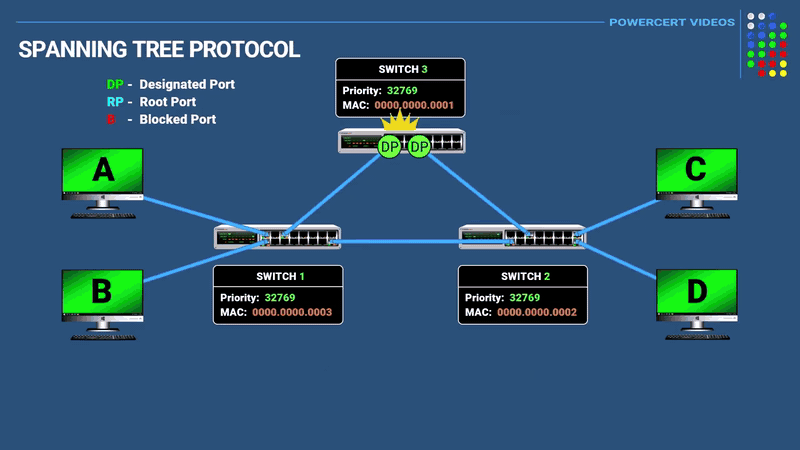

##### Step 3: Determine which of the remaining ports are going to be blocked
- Which port will **remain open** and which one will be **blocked** is based on the **switches' bridge IDs**.
- Since **Switch 2 has a smaller BID than Switch 1**, the port on **Switch 2 will remain open**, and the port on **Switch 1 will be blocked**, shutting down the link to **prevent any broadcast loops**.

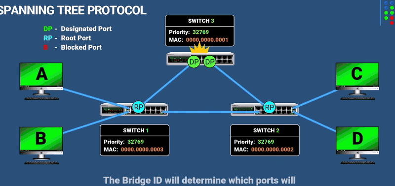

> [!NOTE]
> If one of these **links or devices were to go down**, STP will **reactivate the blocked port** and **bring the link back up**.

> [!NOTE]
> **STP port roles**
>
> | Port | Where it is | How it's chosen |
> | --- | --- | --- |
> | **Designated port** | On the **root bridge** | All ports on the root bridge; they **lead away from the root bridge** |
> | **Root port** | On the **non-root switches** | The **lowest path cost** (fastest link) to the root bridge |
> | **Blocked port** | On one of the **remaining** links | The switch with the **smaller BID** keeps its port open; the other switch's port is **blocked** |

[↑ Back to top](#networking)

## Routing

### Routing Technologies

#### Routers and routing tables
The internet is a **giant highway of pathways** for data to travel to reach its destination.
In between these pathways are devices called **routers**. Just like their name says, routers **route data** on the internet so it can reach its **intended destination**.

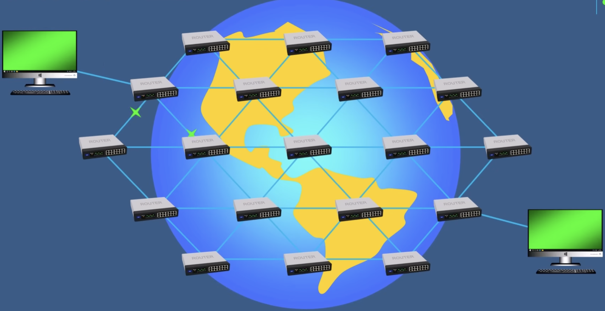

Routers route data by using **routing tables**.

> [!NOTE]
> **Definition**
>
> A **routing table** is a file that contains a **set of rules** showing **what path a data packet takes** to its destination.

As a data packet arrives at the router, the router **looks at its routing table** to find out where to forward the packet along the **best path** to its destination.

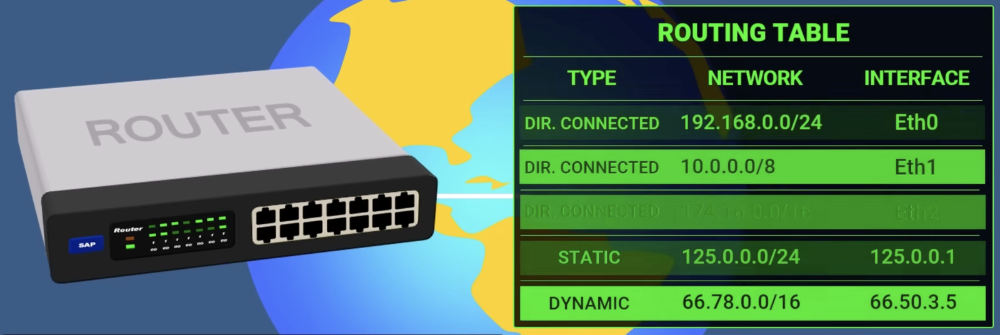

---
#### Populating the routing tables
Routing tables are populated in **three ways**:

| Type | How the route is entered | Used for |
| --- | --- | --- |
| **Directly connected** | **Automatically** by the router | Networks **directly connected** to a router's interface |
| **Static** | **Manually** by a network administrator | Networks **not directly connected** to a router's interface |
| **Dynamic** | **Automatically** by **neighboring routers**, using dynamic routing protocols | — |

##### Directly connected
- Directly connected routes show the routes for the networks that are **directly connected to a router's interface**.
- These routes are **automatically created** by the router as soon as its interfaces are configured with an **IP address and subnet mask**.

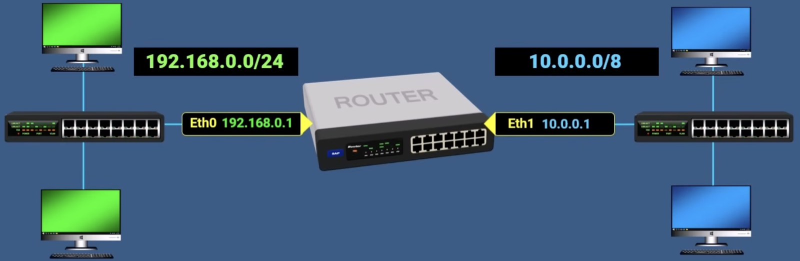
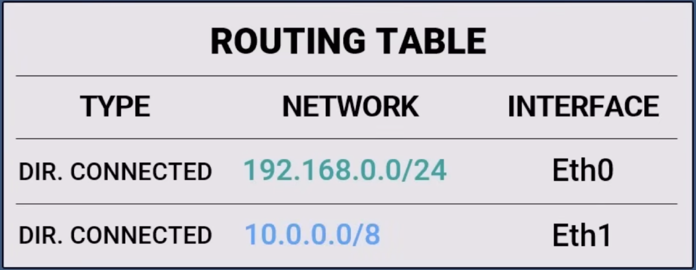

##### Static routes
- Static routes are **entered manually** by a **network administrator**.
- These routes are necessary to access networks that are **not directly connected** to a router's interface.

##### Dynamic routes
- Dynamic routes are similar to static routes; the difference is **how the routes are entered** into a routing table.
- Where static routes are entered **manually**, dynamic routes are entered **automatically by neighboring routers** using one or more **dynamic routing protocols**.
- These dynamic routing protocols are **RIP**, **OSPF**, **BGP** and **EIGRP**.

###### RIP & RIPv2
- The **oldest** routing protocol is called **RIP** (**Routing Information Protocol**).
- Routers that use RIP **broadcast the routing information** to other routers **every 30 seconds**, regardless of whether the routing information has changed or not.
- As networks got bigger, this caused a lot of **unnecessary traffic** on the network.
- This is why **RIP version 2** was created: it **solved the problem of excessive broadcast traffic** that RIP version 1 caused.

###### OSPF
**OSPF** stands for **Open Shortest Path First**. It is a routing protocol that uses the **shortest path first algorithm**, which is used to determine the **least-cost path**, in other words the **most efficient route** for data packets to take to their destination.

**Key terms:**
- **LSA:** the **basic unit of information** in OSPF, a small record in which a router **describes one piece of the network**.
- **LSDB** (**Link State Database**): the **collection of all the LSAs** a router has received for an area.

**How does OSPF work under the hood?**
1. Routers send **OSPF packets** out **every 10 seconds**. Two routers become **neighbors** if their **parameters match**, for example the **area ID**.
2. Neighbors **exchange summaries** of what they know, **request what they're missing**, and end up with **identical link-state databases**.
3. Whenever a link **goes up, goes down or changes cost**, the router originates a **new version of its router LSA** with a **higher sequence number** and **floods it** to its neighbors.
4. Every router that installs a changed LSA **reruns Dijkstra (SPF)** on its own copy of the **LSDB**.

###### BGP
**BGP** stands for **Border Gateway Protocol**, and it is the **standard routing protocol of the internet**.
- It connects **autonomous systems (ASes)**: networks run by **one organization** (an ISP, a cloud provider, a university) under a **single routing policy**, each identified by an **AS number (ASN)**.
- It determines routing directions based on **paths and policies**, and it's the **language used when different networks on the internet want to communicate**.
- BGP is a **distance vector** routing protocol, which means it factors the **distance to the destination** based on **how many hops**.
	- A **hop** refers to how many **routers** a data packet has to go through to reach its destination.

###### Hybrid (EIGRP)
Another type of routing protocol is a **hybrid**. In this case, we're talking about **EIGRP**, which stands for **Enhanced Interior Gateway Routing Protocol**.
- It is a **combination of distance vector and link state** protocols, and it runs on **Cisco routers**.
- It uses the **Diffusing Update Algorithm**, known as **DUAL**, to find the **best path** to the destination.
- It is **fast**.
- It has **less overhead**.
- It can **support many network layer protocols**.

> [!NOTE]
> **Dynamic routing protocols**
>
> | Protocol | Full name | Key point |
> | --- | --- | --- |
> | **RIP / RIPv2** | Routing Information Protocol | Oldest; RIP broadcasts every 30 seconds, RIPv2 solved the excessive traffic |
> | **OSPF** | Open Shortest Path First | Shortest path first algorithm: least-cost path |
> | **BGP** | Border Gateway Protocol | Standard routing protocol of the internet; connects autonomous systems |
> | **EIGRP** | Enhanced Interior Gateway Routing Protocol | Hybrid, Cisco routers, uses DUAL |

---
#### Route Selection
**Route selection** is the process by which a router **chooses the best path** to forward data packets to their destination. The selection is based on different factors, including:
- the **destination address**
- the **routes available** in the router's routing table
- the **rules and protocols** used by the router

Here is an entry in a routing table, showing its different fields:

A route is selected in **three ways**:

##### 1. Prefix length
- The **prefix length** in IPv4 is the **bit count in the network part** of an IP address.
- It shows **how many bits are used to identify the network portion**, which refers to the **subnet mask**.
- When there are **numerous routes that match** a destination IP address, the prefix length is very important in deciding which route to choose.
- Routers use the **longest prefix match** algorithm: they give priority to routes with the **longest prefix that still matches** the destination IP address.
- This makes sure that **more specific routes** are chosen over **less specific** ones.

> [!TIP]
> **Example**
>
> A router looks at an incoming data packet and sees the destination IP address **192.168.0.1**. The router looks at its routing table to see where to forward the packet, and there is **more than one matching entry** (shown below).
> Both entries will work, but the router chooses the one with the **longer prefix length**, in other words the **more specific** one, to send the packet.

##### 2. Administrative distance
- The router uses **administrative distance** to decide which route to take if there is **more than one route to the same location** in the routing table, such as a **tie**.
- The administrative distance is a **number given to each route** to show **how reliable and trustworthy** it is.
- **The lower the number, the higher the priority.**

##### 3. Metric
- A **metric** is a **numerical value** given to a path that indicates the **cost or preference** of choosing that particular path.
- The main purpose of a routing metric is to **rank routes** and choose the **best way** to send network data.
- **The lower the metric, the higher the preference** for choosing that route.

[↑ Back to top](#networking)

## Wireless

### Wireless Devices & Technologies

#### Frequency Bands
Wi-Fi uses **three frequency bands**: **2.4 GHz**, **5 GHz**, and **6 GHz**. Each of these bands has its own **advantages and disadvantages**.

| | 2.4 GHz | 5 GHz | 6 GHz |
| --- | --- | --- | --- |
| **Range** | **Longest** | Shorter than 2.4 GHz | **Shortest** |
| **Speed** | **Slowest** | Faster than 2.4 GHz | **Fastest** |
| **Interference** | High: very common, used by lots of other devices | A lot less (not as common), more privacy | **Lowest**: relatively new, few devices use it |

##### 2.4 GHz band
- The 2.4 GHz band has the **longest range** of the three bands.
- But it's also **very common** and is used by a lot of other devices, such as **microwave ovens, cordless phones, wireless cameras**, and so on.
- These devices often **interfere with Wi-Fi signals**, which can cause problems: it can **slow down the Wi-Fi network** and sometimes make you **lose connection** to the Wi-Fi router.
- It's also the **slowest** band.

##### 5 GHz band
- The 5 GHz band is **faster** than 2.4 GHz, and it's also **not as common**.
- So there's **a lot less interference** and **more privacy** with the 5 GHz band.
- **Disadvantage:** it has a **shorter range** than 2.4 GHz.

##### 6 GHz band
- The **newest** band is the 6 GHz band, and it is the **fastest** of the three.
- Since it's relatively new, it has the **lowest interference**, because few devices use it.
- **Disadvantage:** it has the **shortest range** of the three.

---
#### Wi-Fi Channels
- Within all these frequency bands are **Wi-Fi channels**: **smaller ranges of frequencies** within a band.
- Devices use these channels to **send and receive data**.
- Channels have different **bandwidths**, measured in hertz, such as **20, 40, 80, and 160 MHz**.

##### Channels in the 2.4 GHz band
- The 2.4 GHz band (about **2.4–2.48 GHz**) is divided into channels, each with its own **frequency interval**.
- **Neighboring channels overlap**, so only a few (like **1, 6 and 11**) can be used side by side **without interfering**.
- We spread networks across the band by having **each router pick one channel**, and **every device connected to it uses that same channel**.
- **Multiple routers can share the same channel**, but **speeds drop** as more routers are in range, because they **can't transmit packets at the same time** without causing a **collision** from the signals overlapping each other.
- To avoid transmitting at the same time, which would **corrupt both signals**, every device (router or client) **listens before sending**. If the channel is **busy**, it **waits a random time** and tries again.

> [!TIP]
> **2.4 GHz channel diagram**
>
> In the picture below, we can see that there are **14 channels** that **overlap each other**, and each channel is **22 MHz** wide.
> - **The wider the channel, the more data can be transferred.**
> - On the 2.4 GHz band we can also have a **40 MHz channel**, which combines **two adjacent 20 MHz channels** into one wider block.

##### Changing channels
- You can also use wireless channels to **fine-tune and alter a frequency**, because sometimes you might need to **change to a different channel** if you are experiencing **interference from other nearby wireless networks**.
- For example, the 2.4 GHz band has **11 channels** to choose from, but of these 11 channels, **only three are non-overlapping**: **channels 1, 6, and 11**.
- So if you're experiencing interference with other Wi-Fi networks, you can try **changing to one of these non-overlapping channels**.

---
#### 802.11h
The **IEEE 802.11h** standard for wireless networking focuses on **dynamic frequency selection (DFS)** and **transmit power control (TPC)** in the **5 GHz band**, mainly in **Europe**.
- It was made so that **radar systems** and other devices that use the same frequency band **would not interfere** with it.
- The 802.11h standard was first made to **meet the rules in Europe**, but it's also being used in **other places around the world**.

##### DFS (Dynamic Frequency Selection)
- DFS is part of a system that lets wireless devices **know when radars are nearby** and **automatically change to a different channel**.
- This keeps **5 GHz networks and radar devices** from **interfering with each other** too much.
- When a radar is found, the device has to **wait a certain amount of time** before it can **use that channel again**.

##### TPC (Transmit Power Control)
- TPC **limits the maximum power** that wireless devices can send, which makes them **less likely to interfere** with other systems or devices that use the same frequency.

---
#### Band Steering
**Band steering** is a feature in modern **Wi-Fi routers and access points** that **automatically connects Wi-Fi devices to the best frequency band**, such as 2.4 or 5 GHz.

It does this so the user gets the **best performance available**:
1. It looks at **signal strength**, which is the practical result of **distance, walls and obstacles**.
2. It checks **what bands a Wi-Fi device can handle**.
3. If the device supports **both the 2.4 and 5 GHz bands**, it **automatically connects it to the 5 GHz band**, because of its **faster speeds** and **less interference** than 2.4 GHz.

---
#### Network Identifiers
| Identifier | Full name | What it identifies |
| --- | --- | --- |
| **SSID** | Service Set Identifier | The **name** of your wireless network |
| **BSSID** | Basic Service Set Identifier | A **single Wi-Fi router or access point** (its **MAC address**) |
| **ESSID** | Extended Service Set Identifier | The **whole Wi-Fi network** made of **multiple** routers/access points |

##### SSID
When you set up a new Wi-Fi router, you can configure the **wireless settings** for your network. For example, you can set the **SSID** (**Service Set Identifier**), which is basically the **name of your wireless network**.

- The SSID is **shared among all wireless devices** in your network.
- The SSID is **customizable**, and you can call it whatever you want.

> [!TIP]
> **Example**
>
> When a wireless device **scans for wireless networks** to join in the vicinity of this router, the device will see the router's **SSID broadcast**, called for example **HOME-WIFI**. If it has the **proper credentials**, it can **join the network**.

##### BSSID
- Sometimes two nearby Wi-Fi routers or access points are **broadcasting the same SSID name**. The **BSSID** is how you **distinguish between the two signals**.
- **BSSID** stands for **Basic Service Set Identifier**, and it is a **unique identifier** for a Wi-Fi router or access point.
- The identifier is the **MAC address** of that device.
- So the BSSID makes sure that you're **connecting to the correct SSID**.

##### ESSID
- If a network has **more than one Wi-Fi router or access point**, the **ESSID** (**Extended Service Set Identifier**) is used instead of the SSID.
- Instead of identifying a single access point, the ESSID stands for the **whole Wi-Fi network**.
- This lets a Wi-Fi device **move between access points without losing its connection**.

---
#### Wireless Network Types
##### Infrastructure
- This is **very similar to a star topology**: you have **wired devices** (such as computers) **physically connected to a switch**, and a **wireless access point** that is also **connected by a cable to the switch**.
- The wireless access point is there so that **wireless devices**, such as laptops, tablets, and cell phones, can **connect wirelessly** to the network.
- So the wireless access point acts like a **bridge between the wireless network and the wired network**.
- The infrastructure topology is **not limited to a single wireless access point**: you can have **multiple** wireless access points if you want. It just depends on the **needs of the network**.

##### Ad Hoc
- **Ad hoc** is a **very simple** wireless network, because it **doesn't rely on any infrastructure** such as cables, routers, servers, or wireless access points.
- All the devices in an ad hoc network **wirelessly connect to other devices** in a simple **peer-to-peer network**.
- So ad hoc networks are very useful for **setting up a quick wireless network on the fly**.

**How it works:**
1. **One device creates the network** by choosing an **SSID** and a **channel** and starting to **send frames**.
2. **Others see it in their Wi-Fi list** and join like any normal network.
3. The **sender** puts the **receiver's MAC address** in the frame and **transmits it on the shared channel**.
4. The **receiver** picks it up and sends back an **acknowledgment (ACK)**.
5. **Everyone else** on the channel hears it too, but **ignores it** because the address isn't theirs.

##### Wireless Mesh
- A **wireless mesh** is the latest technology to solve the issue of **weak spots or dead spots** in Wi-Fi.
- It is a **group of routers or Wi-Fi access points** placed in **different locations inside a home**, providing a **blanket of Wi-Fi coverage** throughout the home.
- So it does a pretty good job of **eliminating weak Wi-Fi signals or dead spots**.
- A great feature of mesh Wi-Fi is that the Wi-Fi points **communicate with each other wirelessly** to create **one large Wi-Fi network**.
- There are **no cables involved** when the Wi-Fi points communicate with each other, which makes **placing the Wi-Fi points much easier**.

##### Point-To-Point Wireless
- A **point-to-point wireless** network is where **two wireless access points** in **different locations** are **directly connected to each other wirelessly**.
- So if you want to **join two networks in two separate buildings**, you can create a **wireless link** between the two access points.
- This is very **convenient and cost-saving**, because there is **no need to use a cable**.
- However, for a strong and stable connection, most point-to-point wireless systems need a **clear line of sight** between the antennas in each place.
- Most point-to-point setups use **directional antennas** to direct the wireless signal in the right direction, which **increases signal strength** and **reduces interference**.

---
#### Wi-Fi Encryption
- To join a network with your device, you **select the network name** and then **supply a password**.
- Wi-Fi networks can be **open**, with **no password required**, which means **anyone can join**.
- In the majority of cases, Wi-Fi networks are **secure** and **require a password**.

There are several different **protocols** used for securing a Wi-Fi network:

| Protocol | Encryption | Status |
| --- | --- | --- |
| **WEP** | — | Earliest (1999); **easily hackable**, no longer used |
| **WPA** | **TKIP** | Better than WEP, but **outdated** |
| **WPA2** | **AES** | Stronger than WPA; resists brute force attacks |
| **WPA3** | **AES with GCM**, plus **OWE** | **Latest**, enhanced security over WPA2 |

##### WEP
- **WEP** (**Wired Equivalent Privacy**) was developed in **1999**, and it's the **earliest security protocol** used for wireless networks.
- WEP is **no longer used**, because it was **easily hackable**.

##### WPA
- **WPA** (**Wi-Fi Protected Access**) is another wireless protocol, developed to **solve the problems of WEP**.
- WPA is **far better than WEP**, because it uses a **stronger encryption method** called **TKIP** (**Temporal Key Integrity Protocol**).
- TKIP **dynamically changes its keys** as it's being used, which **ensures data integrity**.
- But even though WPA is more secure than WEP, WPA is now **outdated**.

##### WPA2
- **WPA2** was developed to provide **even stronger security** than WPA, by **requiring a stronger wireless encryption method**.
- While WPA uses **TKIP**, which is known to have **some limitations**, WPA2 uses **AES** (**Advanced Encryption Standard**).
- AES uses a **symmetric encryption algorithm**, which makes it **strong enough to resist a brute force attack**.

##### WPA3
**WPA3** is the **latest security protocol** for wireless networks, offering **enhanced security features** compared to WPA2:
- **Stronger encryption:** it uses **AES with GCM** (**Galois/Counter Mode**), which is a **mode of operation** for **symmetric key cryptographic block ciphers**.
- **OWE** (**Opportunistic Wireless Encryption**): used to **prevent snooping** by **encrypting each device's connection** when using an **open public network**.

---
#### Authentication
As discussed above, when users want to access a secure Wi-Fi network, such as in a home, they need to **type in the password**, and it's the **same password for everyone**.

| | Pre-shared key authentication | Enterprise authentication |
| --- | --- | --- |
| **Passwords** | **Same password** for everyone | **Unique usernames and passwords** for individual users |
| **Suitable for** | **Homes** | **Corporate networks** |
| **Management** | — | **Centralized**, using a **RADIUS server** |

- This is known as **pre-shared key authentication**, which is **suitable for homes**.
- Using pre-shared key authentication in **corporate networks** would **not be a good idea** because of **security concerns and manageability**.
- This is why corporate networks should use **enterprise authentication**:
	- It **doesn't use the same password** for everyone. Instead, it assigns **unique usernames and passwords** to individual users, which makes it easier for the corporation to **manage who can access** their Wi-Fi network.
	- Enterprise authentication uses a **RADIUS server** to provide **centralized authentication**.

---
#### Guest Network
A **guest network** is a feature on modern Wi-Fi routers that allows **visitors to have internet access** in your home, **without** you giving them your **primary Wi-Fi password** or access to **any devices in your network**.

> [!IMPORTANT]
> **The problem**
>
> If you have visitors over and they need to access the internet with their device, for whatever reason (to check their email or look something up), they will ask for your **Wi-Fi password**. If you agree and give it to them, this could pose a **security risk**:
> - They now have access to the internet using your Wi-Fi, and they could potentially **download a virus** and **affect other devices** in your home network.
> - Or their device might **already be infected** with a virus, and once they join your home network, that virus could **spread to other devices** in your home.

> [!TIP]
> **The solution: a guest network**
>
> Visitors join your **guest network** and **only have internet access**:
> - You **don't have to give them your primary** home Wi-Fi password.
> - Even better, they **won't be able to see or access any other devices** in your home, because their device is **isolated** from your devices.
>
> So basically, it's like having **two separate networks** in your home.

---
#### Captive Portal
- Often, when you're at a place like an **airport or hotel**, they may give you the option of using their **Wi-Fi network** to access the internet.
- As soon as you join, you may be directed to a **web page** called a **captive portal**, which makes you **log in** or **agree to their terms of service**.
- It's basically a **gatekeeper for network access** that lets companies **manage and watch who uses their Wi-Fi**.
- It allows companies to **handle their network resources** and **control their network bandwidth**.

---
#### Antennas
**Antennas** are another factor that affects a wireless service. Since wireless devices operate using **radio waves**, the antenna is a **big factor** in determining the **range and speed** of a signal.

##### Omnidirectional antenna
- The **most common** type of antenna.
- It **transmits the signal in all directions**, so every wireless device in **all directions** can pick up the signal, as long as it's **in range**.

##### Directional antenna
- It **directs the signal in one direction**: **wherever you point the antenna**.

---
#### Access Points
| | Lightweight access points | Autonomous access points |
| --- | --- | --- |
| **Management** | Depend on a central **wireless LAN controller (WLC)** | **Largely independent**, handle their own network data |
| **Used in** | **Large networks** | **Smaller networks** (easier to set up and manage) |

##### Lightweight access points
- **Lightweight access points** depend on a central **wireless LAN controller (WLC)** for the **management and configuration of multiple APs**.
- They are typically used in **large networks**.

##### Autonomous access points
- **Autonomous access points** are **largely independent** devices that **handle their own network data**.
- They are **easier to set up and manage** for **smaller networks**.

[↑ Back to top](#networking)

## Physical installations

### Factors of Physical Installations

#### Equipment & Power

##### Server Rack
> [!NOTE]
> **Definition**
>
> A **server rack** is a **frame** that **holds and arranges IT equipment** like servers, routers, switches, and storage systems.

**Rack dimensions:**
- **Width:** racks have an **industry-standardized width of 19 inches**, which lets products from **different manufacturers** fit on the same rack.
- **Height:** measured in **rack units (U)**. A rack unit is **1.75 inches**.
- **Depth:** ranges from **20 to 36 inches** or more, based on the type of rack and the equipment that will be stored in it.

> [!TIP]
> **Example**
>
> If a server rack is labeled **42U**, the rack is **73.5 inches** tall (42 × 1.75).

- Server racks are **essential for data centers** and other places that need to keep their IT systems **organized and scalable**.
- As a **network administrator**, you have to decide on the **size of the rack** (such as the **height and depth**) and **where the equipment is going to be mounted** on it.
- This depends on **how much equipment** will be mounted in the rack and the **spacing between each piece of equipment** for **adequate airflow**.

**Open vs. closed racks**
Racks can be either **open** or **closed**, and which one to use depends on the **specific needs of the organization**. With **closed racks** (**cabinets**), the equipment is **enclosed in a cabinet or box**.

| | Open racks | Closed racks (cabinets) |
| --- | --- | --- |
| **Airflow & cooling** | **Better** airflow and cooling | — |
| **Access** | **Easy access** to the mounted equipment | **Lockable door**, so only the **proper personnel** have access |
| **Main benefit** | **Cheaper** | **Security** |

---
##### UPS
- To keep a network in **constant operation**, you need to make sure it **always has power**.
- **Power outages** can happen for several reasons, such as **storms and blackouts**.
- To prevent a **disruption in network operation** from a power loss, you need to use a **UPS**.

**UPS** stands for **Uninterruptible Power Supply**:
- It's a **battery backup** that **supplies power** to your equipment if a **power outage** happens.
- In addition to supplying backup power, a UPS also **protects against surges and spikes**.

---
##### PDU
A **PDU** is a device that has a **power cord connected to a box**:
1. The power cord **plugs into an electrical wall outlet**.
2. On the other end, the cord is connected to a **box or strip with multiple power outlets**, where you plug in the devices that need power.
3. The PDU then **distributes power** to the devices plugged into those outlets.

> [!NOTE]
> In the IT world, PDUs are **rack-mounted**, and they are typically **plugged into a UPS** rather than directly into a wall outlet.

---
##### Port-Side Intake/Exhaust
For network devices like **switches**, **port-side intake** and **port-side exhaust** refer to the **direction of airflow**: how **cool air enters** and how **hot air leaves** the device.

| | Cool air comes in from | Hot air goes out the |
| --- | --- | --- |
| **Port-side intake** | The **front**, where the **ports** are | **Back** |
| **Port-side exhaust** | The **back** | **Front**, where the **ports** are |

---
#### Cabling & Distribution

##### Patch Panel
- A **patch panel** is a **flat piece of hardware with network ports**, typically located in a **server room or wiring closet**.
- Its purpose is to **reduce clutter** by keeping your **network cables neat and organized**.
- A patch panel has a **large number of ports** and is installed on a **server rack near a switch**.

Patch panels come in **different types**, depending on what kind of network you're running: **Ethernet** (described above), **fiber optic** and **coaxial**.

---
##### MDF
- **MDF** stands for **Main Distribution Frame**.
- It is the **main wiring frame**, used as a **distribution point for all the wiring** in a building.
- **All of the internal communication lines** in a building connect to the MDF.
- The **external lines** also connect to it, **completing the circuit**.

---
##### IDF
- **IDF** stands for **Intermediate Distribution Frame**.
- IDFs are **smaller distribution frames** located in **various locations in a building**.
- They provide **better flexibility** to **distribute wires to the main distribution frame**.

> [!NOTE]
> **MDF vs. IDF**
>
> | | MDF | IDF |
> | --- | --- | --- |
> | **Full name** | Main Distribution Frame | Intermediate Distribution Frame |
> | **Size & number** | **The main** wiring frame of a building | **Smaller** frames in **various locations** |
> | **Role** | Distribution point for **all the wiring**; internal and external lines connect here | Gives **flexibility** to distribute wires **to the MDF** |

---
#### Environment

##### Humidity & Temperature
Buildings that contain a lot of **server and networking equipment**, such as **data centers**, need to **keep track of the humidity** to make sure the equipment **performs at its best** and for **longevity**.

**Humidity:** it is recommended to keep the **relative humidity between 45 and 55%**:
- **Too little humidity** → **static electricity** builds up, leading to **electrostatic discharge**, which **damages the equipment**.
- **Too much humidity** → **condensation and rust**.

**Temperature:** the temperature in a data center also needs to be maintained within a certain range to **prevent overheating**, typically **between 64 and 81 °F**.

---
##### Fire Suppression
**Fire suppression systems** in data centers are also very important for **data and equipment safety**.
- These systems usually use **gas-based** or **fog** systems, because they are **non-conductive** and **don't leave behind a residue**.
- A **clean agent system** like **FM200** is often chosen, because it's **safe for electrical equipment**.
- **Sprinkler systems** can also be used, but they are often used **together with gas suppression** to **improve their effectiveness**.

[↑ Back to top](#networking)

## Processes & procedures

### Purpose Of Organizational Processes & Procedures

#### Diagrams
**Physical and logical diagrams** are **visual documents** used in many fields, including networking. They show how a network is **set up physically** and how **data flows logically**.

| | Physical diagram | Logical diagram |
| --- | --- | --- |
| **Shows** | The **specific hardware and technology** used in a network | How the network **functions** and how **data flows** through it |
| **Specific hardware?** | **Yes** | **No**: it focuses on **functionality** |

##### Physical diagram
- The physical diagram shows the **specific hardware and technology** that is going to be used in a network.
- It shows **what type** of Ethernet cables, switch, computers, and Wi-Fi router are going to be used.

##### Logical diagram
- A logical diagram **does not show the specific hardware** that's going to be used. Instead, it focuses on **functionality**.
- It shows **how the network functions** and **how data flows** through the network.
- This helps give an understanding of **how a network behaves** and **how to design a network**.

##### Rack diagrams
- Rack diagrams give a **visual representation of a server rack**, showing **what equipment is installed** and **where to install it** on the rack.
- For example, the rack diagram below shows a **monitor, switches, RAID arrays, a UPS**, and so on, and tells you **specifically where to install** these components in the server rack.

##### Cable maps
- Cable maps show **how the cables in a building are connected and routed**.
- They show **what type of cables** are being used and **what specific device** they are connected to, such as a switch, router, patch panel, and so on.

##### Network diagrams
Based on the [OSI Model](#osi-model), **layer 1, layer 2, and layer 3** network diagrams show **computer network architecture and connectivity**.

| Diagram | OSI layer | Shows | Also shows |
| --- | --- | --- | --- |
| **Layer 1** | Physical | The **physical layout** of network devices | Their **physical interfaces** |
| **Layer 2** | Data link | **Logical connections** between layer 2 devices (switches, bridges) | Their **MAC addresses** |
| **Layer 3** | Network | The **logical structure (topology)**: how routers, subnets, and network segments are connected | The **IP address** of each device |

###### Layer 1
- Layer 1 of the OSI model is the **physical layer**.
- Layer 1 network diagrams show the **physical layout** of network devices such as servers, switches, routers, computers and so on.
- They also show the **physical interfaces** of those devices.

###### Layer 2
- Layer 2 is the **data link layer**.
- Layer 2 network diagrams show **logical connections between layer 2 devices**, such as **switches and bridges**.
- They also show the **MAC addresses** of those devices.

###### Layer 3
- Layer 3 is the **network layer**.
- Layer 3 network diagrams show the **logical structure or topology** and how **routers, subnets, and network segments** are connected.
- They also show the **IP address** of each device.

##### Wireless survey / Heat map
- A **wireless survey heat map** shows the **Wi-Fi signal strength and coverage** on a **floor plan or map**.
- Its purpose is to **find Wi-Fi dead zones**.

**How it's done:**
1. To do a **wireless site survey**, a person walks around the area with a **Wi-Fi optimizer or survey tool** and **checks the signal strength** at different points.
2. The heat map shows locations with **no or poor signal strength**, which tells a network administrator **what changes need to be made**, such as **moving Wi-Fi points** to different locations.
3. It also shows **which Wi-Fi channel** is being used. So if there is **interference from other Wi-Fi networks**, the network administrator can try **changing to a different Wi-Fi channel**.

---
#### Asset & Resource Management

##### Asset Inventory
It's very important for a company or organization to **keep track of all its assets**. That's why it's important to have an **asset inventory**.

> [!NOTE]
> **Definition**
>
> An **asset inventory** is a **thorough list of all the things** that a business or organization **owns**, whether they are:
> - **physical items**, such as servers, routers, switches, cables, and so on, or
> - **non-physical items**, such as software, licensing, and warranties.

**Why it's important:**
- It gives you a **single place** to keep track of **where the assets are**, **how they are doing**, and **how they are being used**.
- It helps in making **future decisions** for a business, such as **new purchases and upgrades**.

##### IPAM

- **IPAM** stands for **IP Address Management**. It is a way to **plan, keep track of and manage IP addresses** and the **other network resources** connected to them.
- It basically means making sure that **every device** on the network has a **real and unique IP address**, which **prevents IP conflicts** and makes sure the devices **can communicate** on the network.

##### Service Level Agreement
A **service level agreement** is an **agreement between a service provider and you**. It explains the **quality and performance standards** that the provider **promises to meet**.

It makes clear:
- **what is expected**
- **how it will be measured**
- **what will happen if it's not met**

---
#### Life-Cycle Management
A product goes through these stages: **EOL** → **EOS** → **Decommissioning**.

##### EOL (End of Life)
- **End of life (EOL)** means that a product has **reached the end of its useful life**.
- This could mean **getting rid of the product totally** or **replacing it with a newer version**.
- EOL can happen when:
	- a product **no longer meets business goals**
	- **technology changes**
	- **the market changes**

##### EOS (End of Service)
- The next step after EOL is **EOS** (**End of Service**).
- This means the product will **no longer get any support**, such as **firmware updates, maintenance releases or security updates**.
- It's important to **know these dates**, so a network administrator can stay informed on **what equipment needs to be replaced**.
- The next step after EOS is **decommissioning**.

##### Decommissioning
- **Decommissioning** something means **ending its use or service**.
- It's a **set of steps** that make sure devices are **removed or retired** in a way that is **safe and good for the environment**.
- This includes not only the **hardware** of a device, but also **any data** in that device.
- The data on the device should be **erased** to make sure it **doesn't end up in the wrong hands** after it's been decommissioned.

##### Software management
- **Software management** is essential to keep **software and firmware up to date**, to **fix bugs** and **keep systems stable**.
- **Patch management** is an important part of managing software and firmware, because it involves **installing changes that fix bugs and security holes**.
- **Software updates** usually fix problems such as **security holes**, **slow performance**, or problems with how well **software programs and running systems work together**.
- **Firmware updates** are also important. Hardware devices such as routers, printers, and so on get firmware updates to **fix bugs**, **make them run faster**, and **make them safer**.

---
#### Change & Configuration Management

##### Change Management
- **Change management** is a way to **handle changes to IT services and systems** so that there are **as few problems as possible** and the **transition goes smoothly**.
- It's an important step for **documenting any changes, updates**, or other changes that could **affect how a network functions**.
- Change management **plans, makes, and records changes**, usually by using **best practices from the industry**.

##### Configuration Management
- **Configuration management** is another type of **documentation**. It makes sure that a network is **maintained and runs smoothly** by **documenting the configurations of network devices**, such as routers, firewalls, switches, and so on.
- It also involves the **production configuration**: the **current configuration** of a device that's **currently operating** on a network.
- It's also important to **back up the configurations** of these running devices, to allow a **quick recovery** in case of a **device failure**.

##### Baseline Configuration
A **baseline** is how you **measure a network's performance**: it **measures and documents the performance** of a network **at a given time**.
1. Typically, a baseline is taken when a network is **performing well**, and also when it is **not performing well**.
2. By **comparing these two baselines**, a network administrator can see **how well or badly** the network is performing and make any **necessary changes**.

> [!TIP]
> **Golden configuration**
>
> A **baseline golden configuration** is the **gold standard baseline**: the **highest standard baseline** for how a network, its devices, and its configurations are performing.
> It's an **approved setup** used as a **guide** to make sure a network **runs at its best**. Essentially, it's the **gold standard for comparison**.

[↑ Back to top](#networking)

## Network monitoring

### Network Monitoring Technologies

#### Monitoring Protocols & Tools

##### SNMP
> [!NOTE]
> **Definition**
>
> **SNMP** stands for **Simple Network Management Protocol**. It is a protocol used for **network management**, and it's basically used for **collecting data from various network devices** such as routers, printers, and servers.

###### Components
SNMP has **two major components**:

| Component | Runs on |
| --- | --- |
| **SNMP manager** | A **centralized computer or server** |
| **SNMP agent** | The **individual network devices** |

- The agents on these devices **collect information about their own device**, such as its **traffic statistics**, **IP and MAC addresses**, **operational state**, **errors**, and so on.
- Each agent **stores this information in its own database**, called the **MIB** (**Management Information Base**).

###### Requests and traps
- **Request:** if the SNMP manager wants information about a certain device, it can **talk to that device's SNMP agent** and get the information that's **stored in the device's MIB**. When the SNMP manager sends a request, it uses **port 161** and the **UDP** protocol.

- **Trap:** if something happens on the network, such as a **link or device failure**, the SNMP agent will **proactively send a message** to the SNMP manager to **notify it of the event**. This message is known as a **trap**. The SNMP agent uses **port 162** to send traps.

| Message | Direction | Port |
| --- | --- | --- |
| **Request** | Manager → agent | **161** (UDP) |
| **Trap** | Agent → manager | **162** |

###### SNMP versions
SNMP comes in **three versions**:
1. **SNMPv1**
	- Version 1 was the **original** version.
	- It used a **plain-text community string** for authentication, which made it **vulnerable to hackers**.
2. **SNMPv2c**
	- Version 2c also used a **plain-text community string** for authentication, but it **improved error handling and overall performance** over version 1.
	- It featured **GetBulk**, which made it easier to **retrieve large amounts of data**.
	- It also has **InformRequest**, which lets agents **confirm that they have received notifications**.
3. **SNMPv3**
	- Version 3 has **better features** and **stronger security**.
	- It added **integrity checking and encryption** to its authentication.

---
##### Data Flow
- As a network administrator, it's important to **monitor the flow of data** on a network in case a problem happens. That's why there are **data flow analyzers** such as **NetFlow**.
- NetFlow gives a network administrator the ability to **monitor data packets** as they **enter or exit a network interface**.
- It **collects data** from various network devices such as **switches, routers, and firewalls**.

---
##### Packet Capture
> [!NOTE]
> **Definition**
>
> A **packet capture**, also known as a **packet sniffer**, is a **software or hardware tool** used to **troubleshoot and analyze traffic** on a network, such as logs, data packets, broadcasts, and so on.

- It can **detect network problems** and **intrusion attempts**, and **monitor networking issues** so a technician can **correct the problem**.
- A very common software **protocol analyzer** is called **Wireshark**, and it can be **downloaded for free** at wireshark.org.

---
##### Port Mirroring
**Port mirroring** is a technique used to **monitor and analyze network traffic**.

> [!NOTE]
> **Definition**
>
> **Port mirroring** is when **all the data from a port on a switch** is **copied, or mirrored, to another port** on the switch.

> [!TIP]
> **Example**
>
> Let's say you want to see **all the traffic going through port 1** on a switch that's connected to a network.
> 1. Port 1 is considered the **source port**.
> 2. You then configure another port, such as port 2, to be the **destination port**.
> 3. After the ports have been configured, **all the data going through port 1** is **copied to port 2**.
> 4. On port 2, you can plug in a **computer running a packet analyzer** such as **Wireshark** to **analyze all the data from port 1**.

---
##### Log Aggregation
> [!NOTE]
> **Definition**
>
> **Log aggregation** is the act of **collecting and organizing log data** from **several sources into one place**.

- This makes it easy to **analyze, fix, and keep an eye on** systems and applications.
- **Without log aggregation**, network administrators would have to **go through log files from many different sources manually**, which could **take a long time** and be **inefficient**.

###### Syslog
- Many systems and applications use **syslog** as a **standard logging protocol**.
- Syslog works by using a **centralized syslog server or collector**. This server **receives syslog messages** from many different devices, such as **routers, switches, servers, and applications**.
- Syslog messages inform network administrators about **activity**, **security incidents**, and **application issues**, which helps them **keep an eye on, fix, and keep their systems running smoothly**.

---
##### SIEM
> [!NOTE]
> **Definition**
>
> **SIEM** (**Security Information and Event Management**) is a **security tool** that enables a network to **look at security events and alerts in real time** to **find and fix security problems**.

- It **combines security information management with security event management** to give a network a **single, centralized view of all its security data**.
- This makes it possible to **find and fix possible issues before they cause problems** on a network.

---
#### Monitoring Methods

##### Network Discovery
- **Network discovery** is a **key component of monitoring a network**. It deals with **locating and listing network resources, services, and devices** in a network.
- By using **monitoring tools**, it enables the **detection of devices** such as computers, servers, applications, and services.
- These monitoring tools can include things such as **SNMP**, **network scanners**, and **LLDP**.
- These tools can **generate an inventory of resources** to monitor and analyze, by **identifying the devices and their characteristics**, such as **IP and MAC addresses**, the **type of device**, **software**, and **operating systems**.

Network discovery can also be **ad hoc** or **scheduled**:

| Type | How it works |
| --- | --- |
| **Ad hoc discovery** | Devices are discovered in a **direct and decentralized** manner, **when a network scan is specifically needed** |
| **Scheduled discovery** | An **automated process** where a network scan is done **at a scheduled time** |

---
##### Baseline Metrics
To keep a network **running normally**, it's important to **track and measure its performance while it is running normally**. This measurement creates a **standard performance benchmark** that can be used for **comparison when the network is not running normally**.

> [!NOTE]
> **Definition**
>
> This benchmark is created by **baseline metrics**. Baseline metrics help figure out **what typical network performance looks like**, by **monitoring key performance indicators** and **looking at traffic trends over time**.

**Baseline metrics include things such as:**
- **bandwidth usage**
- **latency**
- **packet loss**
- **traffic patterns**, and so on

These metrics are used as a **benchmark for comparison**, which helps network administrators **find problems, fix them**, and make sure that the network is **running at its best**.

---
##### Traffic Analysis
> [!NOTE]
> **Definition**
>
> **Network traffic analysis** is the process of **looking at network data** to **understand how devices communicate** and **spot possible problems or security threats**.

- Analyzing traffic is essential to **learn more about network performance, security, and behavior**. It involves **tracking, recording, and evaluating** network traffic.
- By doing this, network administrators can **identify security breaches**, **improve performance**, and **fix network issues**.

---
##### Performance Monitoring
> [!NOTE]
> **Definition**
>
> **Performance monitoring** is the process of **gathering, evaluating, and reporting on different metrics**, to evaluate the network and make sure it is **running at its best**.

- This allows network administrators to **proactively detect and fix possible problems** before they **affect network operations**.
- Some performance monitoring tools are **SNMP** and **NetFlow**.

---
##### Availability Monitoring
**Availability monitoring** is the **observation of what resources, devices, and applications are available** on the network.

---
##### Configuration Monitoring
- **Configuration monitoring** is the process of **keeping track of the configurations** of network devices, software, and systems in a network.
- This includes **tracking changes** and **current configuration settings**, which is an important step in making sure that a network is **running at its best**.

> [!NOTE]
> **Monitoring methods at a glance**
>
> | Method | What it does |
> | --- | --- |
> | **Network discovery** | **Locates and lists** network resources, services, and devices |
> | **Baseline metrics** | Create a **benchmark of normal performance** for comparison |
> | **Traffic analysis** | Looks at network data to see **how devices communicate** and **spot problems or threats** |
> | **Performance monitoring** | Gathers, evaluates, and reports on **metrics** so the network **runs at its best** |
> | **Availability monitoring** | Observes **what is available** on the network |
> | **Configuration monitoring** | Keeps track of **configurations and their changes** |

[↑ Back to top](#networking)

## Disaster recovery

### Disaster Recovery

> [!NOTE]
> **Definition**
>
> **Disaster recovery** is the process that a company uses to **get its IT infrastructure back up and running** after a disaster, such as a **natural disaster**, a **cyber attack**, and so on.

In case a disaster happens, disaster recovery needs:
1. A **disaster recovery plan** to be **created**.
2. That plan to be **tested** to make sure **it works**.
3. A **strategy** on **how to put that plan into action**, to **reduce data loss and business disruption**.

> [!TIP]
> **Goal**
>
> The goal of disaster recovery is to **get the business up and running as soon as possible**.

---
#### Recovery Objectives & Metrics

##### Recovery Point Objective
- The recovery point objective defines the **most data loss that is acceptable** over a **certain period of time**.
- That time is measured **from the moment of a disaster** to the **latest backup that is known to be reliable**.

**In short:** it's the **quantity of data** that a business **may lose** without causing **major problems or damage**.

##### Recovery Time Objective
- The recovery time objective defines the **longest time** that a service **can be down** without causing problems.
- This is important for **determining how to recover from a disaster**, since it shows **how quickly operations need to be back online** to **limit the damage** to the business and **possible losses**.

> [!NOTE]
> **Recovery point vs. recovery time objective**
>
> | | Recovery Point Objective | Recovery Time Objective |
> | --- | --- | --- |
> | **Defines** | The **most data loss** that is acceptable | The **longest time** a service can be **down** |
> | **In short** | The **quantity of data** a business may lose | How **quickly** operations need to be **back online** |

##### MTTR
- **MTTR** (**Mean Time To Repair**) is an indicator that tells you **how long it usually takes to fix** a major device or system **once it breaks**.
- It's a way to **measure how well the repair procedure works** and **how dependable** the equipment or systems are.
- **A lower MTTR means that repairs are done faster.**

##### MTBF
- **MTBF** (**Mean Time Between Failures**) is an indicator that shows **how long a system or part can run without failing**.
- It's a good way to tell **how reliable a system is**, and it's commonly used to **plan maintenance ahead of time**. It's a way to **assess how reliable a system is in numbers**.
- **A higher MTBF means a more reliable system.**

> [!NOTE]
> **MTTR vs. MTBF**
>
> | | MTTR | MTBF |
> | --- | --- | --- |
> | **Full name** | Mean Time To Repair | Mean Time Between Failures |
> | **Measures** | How long it usually takes to **fix** a device or system once it breaks | How long a system or part can **run without failing** |
> | **Better when** | **Lower**: repairs are done faster | **Higher**: the system is more reliable |

---
#### Recovery Sites
If a natural disaster were to occur, your goal would be to **get your organization up and running as fast as possible**. One of the best ways to do this is by using a **hot site**.

| Site | Equipment | Readiness |
| --- | --- | --- |
| **Hot site** | **Fully functional**: servers, computers, printers, and so on, **already powered up** | Ready to go **on a moment's notice** |
| **Warm site** | A **small portion** of the primary site's computer equipment | Gets the **bare essentials** of an organization up and running |
| **Cold site** | **No computer equipment**, just a building | A location that is **agreed upon** in case of a disaster |

##### Hot Site
- A hot site is an **alternative site** that is **fully functional**.
- It has servers, computers, printers, and so on **already powered up and ready to go**.
- If the **primary site is destroyed**, for example **by a fire**, the hot site is **on standby** and **ready to go on a moment's notice**.

> [!WARNING]
> **Cost**
>
> Hot sites can be **very expensive**, because you have to pay not only for the **cost of the building**, but also for the **cost of replicating the equipment** inside.

##### Warm Site
- A warm site is also an **alternative site** that is used in case of a disaster.
- It's different from a hot site because it **doesn't have that much equipment**. It may have a **small portion of the computer equipment** that the primary site has, but that's about it.
- It's basically a site you can go to, to get the **bare essentials** of an organization **up and running**.

##### Cold Site
- A cold site is pretty much just a **location that is agreed upon** in case of a disaster.
- It's basically **just a building** with **no computer equipment**.

---
#### High Availability
> [!NOTE]
> **Definition**
>
> **High availability** means that a system can be **up and running and available all the time**, even when there are **problems or breakdowns**.

There are **two types**: **active-active** and **active-passive**.

| | Active-active | Active-passive |
| --- | --- | --- |
| **Devices** | **All** devices are up and running and **share their workload evenly** | **Some** devices are up and running, **some are on standby** |
| **When a failure happens** | — | Only then are the **standby devices activated** |
| **Result** | Systems stay up **all the time**: **less downtime** and **better performance** | This could cause a **delay** |

##### Active-active
In an active-active setup, **all the devices** in the network are **up and running**, and they all **share their workload evenly**.

##### Active-passive
- In an active-passive setup, **some devices are up and running** and **some devices are put on standby**.
- Only **if a failure happens** will the **standby devices be activated**.
- This could cause a **delay**.

> [!TIP]
> **Active-active is preferred**
>
> Active-active is **preferred over active-passive**, because it **keeps the systems up and running all the time**, which not only **reduces downtime** but also **improves performance**.

---
#### Tabletop Exercises
> [!NOTE]
> **Definition**
>
> **Tabletop exercises** are a kind of **training** that allows a business to **practice dealing with emergencies or crises** in a **safe, low-stress setting**.

- They ask participants to **talk about possible situations** and **how they may react**.
- This helps find the **good and bad points** of **emergency plans and procedures**, and **where they can be improved**.

[↑ Back to top](#networking)

## DHCP & DNS

### DHCP

**DHCP** stands for **Dynamic Host Configuration Protocol**.

#### Assigning IP Addresses
Every computer on a network **has to have an IP address** for communication purposes. There are **2 ways** that a computer can be assigned an IP address:

| | Static IP | Dynamic IP |
| --- | --- | --- |
| **Assigned by** | A **user**, **manually** | A **DHCP server**, **automatically** |
| **Settings** | IP address, subnet mask, default gateway, DNS server: **all typed in by hand** | IP address, and it **can also assign** the subnet mask, default gateway and DNS server |

##### Static IP
- A static IP is where a user **assigns a computer or device an IP address manually**.
- For **each computer** on the network, you have to **open the computer's network configuration page** and **manually type in an IP address**.

In addition to an IP address, you also have to type in:
- the **subnet mask**
- the **default gateway**
- the **DNS server**

##### Dynamic IP
- A dynamic IP is where a computer **gets an IP address automatically** from a **DHCP server**.
- The DHCP server can also assign the **subnet mask**, **default gateway** and a **DNS server**.

---
#### DHCP Server Settings

##### Scope
> [!NOTE]
> **Definition**
>
> A **scope** is a **range of IP addresses** that a DHCP server **can hand out**.

The devices on the network will **get an IP address from that range** of IP addresses.

##### Address Reservation
- If you want a device on your network to have a **specific IP address all the time** (in other words, you **never want that IP address to change**), you can create a **reservation** on the DHCP server.
- A reservation ensures that a **specific device**, identified by its **MAC address**, will **always be given the same IP address** when that device **requests an IP address** from the DHCP server.

> [!NOTE]
> Reservations are **not typically given to regular computers**. They are typically given to **special devices** that **require the same IP address constantly**, such as **network printers, servers, routers**, etc.

##### DHCP Exclusion
- A **DHCP exclusion** is an **IP address or range of IP addresses** that the DHCP server **does not give out**.
- These IP addresses are **reserved for devices** that use them as **static IP addresses**.

> [!NOTE]
> **Reservation vs. exclusion**
>
> | | Reservation | Exclusion |
> | --- | --- | --- |
> | **Used for** | **Reserving dynamic** IP addresses | **Excluding static** IP addresses |
> | **What the DHCP server does** | **Always gives the same IP address** to a specific device (by MAC address) | **Does not give out** the IP address or range |

##### Lease
- When a device **obtains an IP address** from a DHCP server, the server **assigns the IP address as a lease**.
- So the computer **doesn't actually own the IP address**. It's actually a **lease**.

> [!NOTE]
> **Definition**
>
> A **lease** is the **amount of time** an IP address is **assigned to a computer**.

> [!TIP]
> **Example**
>
> If you run `ipconfig /all` in a **command prompt** on a **Windows computer**, you can see the **lease of the IP address** that was assigned to your computer by the DHCP server.

A DHCP server will **automatically renew the IP address** for you, so you won't have to do anything or even notice that the IP address is being renewed.

---
#### Self-Assigned IP Addresses

##### APIPA
Every computer has to have an IP address to communicate on a network. When a computer is set to **automatically obtain an IP address**, it **gets the IP from a DHCP server**.

**What happens if the DHCP server can't be reached:**
1. The computer **cannot reach the server**, because the **server was down** or the **connection to the server was lost**.
2. Computers running **Microsoft Windows** will then **self-assign their own IP address**, in the range **169.254.0.1 – 169.254.255.254**.
3. In addition, they will also **assign themselves a 16-bit subnet mask**.

This type of self-assigned IP addressing is called **APIPA** (**Automatic Private IP Addressing**).

> [!IMPORTANT]
> **Why do computers do this?**
>
> Even though they **can't get an IP from a DHCP server**, they will **still be able to communicate** with other computers on the **same local network or subnet**, through an **Ethernet cable**, a **wireless access point**, or **ad-hoc mode**.

##### SLAAC
APIPA is used in **IPv4**. Similarly, **SLAAC** is used in **IPv6**.

> [!NOTE]
> **Definition**
>
> **SLAAC** stands for **Stateless Address Autoconfiguration**. It is a **feature built into IPv6** that allows IPv6 devices to **auto-configure their own IP address**.

It works by using **router advertisements** that **come from the router** and **tell hosts how to configure themselves**:
- the **default gateway**
- the **address lifetime**
- the **host portion** of the IPv6 address

> [!NOTE]
> **APIPA vs. SLAAC**
>
> | | APIPA | SLAAC |
> | --- | --- | --- |
> | **Used in** | IPv4 | IPv6 |
> | **Routability** | **Not routable**: devices **can't communicate outside their own network** | **Routable**: devices **can talk outside their network** |
> | **Role** | A **backup method** | The **preferred way** of assigning IPv6 addresses |

---
#### DHCP Relay / IP Helper

##### Same subnet
When a computer **needs an IP address**, it **broadcasts a request** to a DHCP server. If the server is on the **same subnet** as the computer, the DHCP server will **receive the request** and **assign the computer an IP address**.

##### Different subnets
> [!WARNING]
> **Problem**
>
> If the computer and the DHCP server are **not on the same subnet**, the DHCP server **will not receive the request**, because **broadcasts can't go outside their own subnet**.

This is where a **DHCP relay** comes in.

> [!NOTE]
> **Definition**
>
> A **DHCP relay**, or **IP helper**, is a **service enabled on a router** that **relays a DHCP broadcast** it receives by **forwarding it**.

**How it works:**
1. The computer **broadcasts a request** for an IP address.
2. The **DHCP relay on the router receives the broadcast**.
3. The relay **forwards the broadcast to the DHCP server**.
4. The server **assigns the computer an IP address**.

[↑ Back to top](#networking)

---

### DNS, DNS Records & Protocols

#### DNS
> [!NOTE]
> **Definition**
>
> **DNS** stands for **Domain Name System**. DNS **resolves domain names to IP addresses**.

The reason it has to do this is that **computers do not understand names**, they **only understand numbers**.

- A **domain name** is just the **text that you type in a web browser** when you want to go to a certain website, such as **example.com**, **google.com**, **yahoo.com**, and so on.
- When you type in a domain name such as example.com in a web browser, DNS will **resolve that domain name into an IP address** so you can **retrieve the website**.

##### Parts of a domain name
**Computers read domain names from right to left**, and domain names have **several parts**:

| Part | In the example.com example |
| --- | --- |
| **Root domain** | The **hidden `.`** after .com |
| **Top-level domain** | **.com** |
| **2nd-level domain** | **example** |
| **Subdomain** | An **additional name to the left** of the 2nd-level domain, such as **www** |

---
#### DNS Hierarchy
There are **3 main levels of servers**:

| Server | Role |
| --- | --- |
| **Root servers** | The **top of the DNS hierarchy**. They look at the domain name and **forward the query to the correct top-level domain server** |
| **Domain servers** | Responsible for **top-level domains**, such as **.com, .net, .org**, and so on |
| **Name servers** | **Store the DNS records** for resolving domain names to IP addresses |

> [!NOTE]
> Out of these 3, the **name servers** are the DNS servers responsible for **storing the DNS records** for resolving domain names to IP addresses, because they are responsible for **knowing everything about the domain name**, including the **IP addresses** and much more.

**How example.com is resolved:**
1. For your query to resolve example.com, it needs to **know which name server to ask**. To find the correct name server, the query must **first go through the top of the DNS hierarchy**, which is the **root server**.
2. The root server **looks at example.com** and **forwards the query to the .com top-level domain server**, because the top-level domain for example.com is **.com**.
3. The top-level domain server **forwards the query to the specific authoritative name server** that's responsible for the example.com domain.
4. Once the query **reaches the name server**, example.com is **resolved to the IP address**, so the website can be retrieved.

---
#### DNS Records
In a **DNS database** you have a **zone file**, and this zone file **contains the DNS records**.

##### A record
- The **A record** is what **resolves a domain to an IPv4 address**.
- So when you type example.com in a web browser, the A record is what DNS uses to **resolve the domain name to an IP address**.

> [!NOTE]
> **TTL (Time To Live)**
>
> The record also has a **TTL** field, which tells us **how long each record is valid** until the **next update**.

##### AAAA record
This record is **like the A record**, but the difference is that **AAAA records resolve domain names to IPv6 addresses**.

##### CNAME record
> [!NOTE]
> **Definition**
>
> A **CNAME record** **resolves a domain or subdomain to another domain name**. Basically, it is an **alias for another domain name**.

**www** is a **common subdomain**, which is why it is common to **create a CNAME record** for it.

This is why, when you type **www.example.com** or **example.com** in your browser, you'll **end up at the same example.com website**: because of the **CNAME record**.

Subdomains are also often used when a website has **different services running on the same server**, using the **same IP address**.

> [!TIP]
> **Example**
>
> 1. example.com has an **FTP service** running on the **same server as its website**.
> 2. They can create a **subdomain** such as **FTP.example.com** for the FTP service on the server.
> 3. Then they can **create a CNAME record** and have it **directed to example.com**.
> 4. Even though it's pointing to example.com, when the request **reaches the web server**, the web server will **inspect the URL that the user has typed** and **direct it to its FTP service** on the server.

##### MX record
The **MX** (**Mail Exchange**) record is **used for email**. It simply **points to the server where email should be delivered** for that domain name.

> [!TIP]
> **Example**
>
> 1. When you send an email to **tom@example.com**, your **mail transfer agent** will **query the MX records for example.com**, because it's **looking for an email server**.
> 2. DNS will then **respond back, telling it which server to send the email to**.
>
> In the example below, the server to send the email to is **mail1.example.com**.

**Primary and secondary email servers:**
- MX records will generally have **two entries**, a **primary email server** and a **secondary email server**, along with a **priority number**.
- **The lower priority number means that it's the primary email server.**
- If the primary email server **gets overwhelmed or goes down**, the **secondary email server** would be used.

##### NS record
- The **NS** (**Name Server**) record provides the **name of the name server** that **resolves a specific domain to an IP address**.
- The NS record will generally **list multiple name servers**, because there is **not only one name server** on the internet that can resolve a specific domain to an IP address.

##### PTR record
- This is the **reverse of an A or AAAA record**: **PTR records resolve IP addresses to domain names**.
- They are used to **prevent email spam**. The email server uses the PTR record to **make sure that the sender is authentic**, by **matching the domain name in the email with its authentic IP address**.
- When an email arrives, the **receiving server looks at the IP it came from** and **checks that IP's PTR record** to see if it **belongs to a properly configured mail server**.

##### TXT record
- The **TXT** (**Text**) record contains **miscellaneous information about a domain**, such as **general or contact information**.
- It also helps to **prevent email spam**, by **making sure incoming email is coming from a trusted or authorized source**.

> [!NOTE]
> **DNS records at a glance**
>
> | Record | What it does |
> | --- | --- |
> | **A** | Domain name → **IPv4** address |
> | **AAAA** | Domain name → **IPv6** address |
> | **CNAME** | Domain or subdomain → **another domain name** (alias) |
> | **MX** | Points to the **email server** for a domain |
> | **NS** | Provides the **name of the name server** that resolves a domain |
> | **PTR** | IP address → **domain name** (reverse of A/AAAA); helps **prevent email spam** |
> | **TXT** | **Miscellaneous information** about a domain; helps **prevent email spam** |

---
#### DNS Zones
| Zone | Resolves |
| --- | --- |
| **Forward zone** | **Domain names → IP addresses** |
| **Reverse zone** | **IP addresses → domain names** |

---
#### Host File
- **Before DNS**, operating systems used a **host file** to **resolve host names to IP addresses**.
- The host file **works like a local database**, letting you **change how DNS resolves certain domains**.
- This means that **instead of querying a DNS server**, the computer will **use the information in the host file** to connect to a website or a server.

---
#### DNS Security

##### DNSSEC
- To make sure **DNS remains secure**, **DNSSEC** (**Domain Name System Security Extensions**) was developed.
- It is a **group of cryptographic protocols** that make DNS safer by **adding digital signatures to DNS records**.
- These signatures are added to DNS entries so that the **resolvers can make sure the data hasn't been tampered with**.

##### DoH
- Another security protocol that DNS uses is **DoH** (**DNS over HTTPS**).
- This protocol **encrypts DNS queries using HTTPS**, which makes your internet browsing **safer and more private**.
- DoH **doesn't send DNS requests in plain text**. Instead, they are **encrypted in regular HTTPS traffic**.

##### DoT
- **DoT** (**DNS over TLS**, **Transport Layer Security**) **also encrypts DNS queries**.
- It **improves privacy and security** by **stopping others from tampering**.
- It uses **port 853** and **adds TLS encryption to UDP**, which is what DNS queries use.

> [!NOTE]
> **DNSSEC vs. DoH vs. DoT**
>
> | Protocol | Full name | How it makes DNS safer |
> | --- | --- | --- |
> | **DNSSEC** | Domain Name System Security Extensions | Adds **digital signatures** to DNS records, so resolvers can check the data **hasn't been tampered with** |
> | **DoH** | DNS over HTTPS | **Encrypts DNS queries** inside **regular HTTPS traffic** |
> | **DoT** | DNS over TLS | **Encrypts DNS queries** with TLS, on **port 853** |

---
#### Time Protocols

##### NTP
- **NTP** (**Network Time Protocol**) is used to **synchronize the clocks of computers** with the **US Naval Observatory master clocks**.
- This protocol **runs on each computer** and **sends out periodic requests to the server** to make sure that the **time is in sync**.

##### NTS
**NTS** is a protocol that **makes NTP safer**, by making sure that **time synchronization between clients and servers** is both **encrypted and verified**.

[↑ Back to top](#networking)

## VPN & remote access

### VPN & Connection Methods

#### VPN
> [!NOTE]
> **Definition**
>
> **VPN** stands for **Virtual Private Network**. A VPN is what establishes a **secure and reliable network connection** over an **unsecured network**, such as the **internet**.
> It **protects your internet activity** and **disguises your identity** as you surf the internet.

##### Why you would use a VPN
When you order internet service from your **ISP** (**Internet Service Provider**), they will **set up your internet connection**.
- When your setup is complete, your internet activity is **routed through your ISP's servers**, which means that your ISP can **see and log all of your internet activity**. So they can see **every website that you visited**.
- Typically this wouldn't be a problem if they **kept your internet activity private**.

> [!WARNING]
> However, there is a possibility that your ISP could **share your information with third parties**, such as **advertisers** or maybe even the **government**. If this were to happen, your internet activity would **no longer be private**.

By **using a VPN**, your online activity will **no longer go straight from your ISP to the website**. Instead, it will be **redirected to another server**, which is a **VPN server**. This means that your **internet provider or any other party** can **no longer see what websites you are visiting**.

##### Without vs. with a VPN
**Without a VPN:**  
You → ISP → website (YouTube)

- Your ISP sees the **IP address you're connecting to** (YouTube's) and usually the **domain name** too, from your **DNS requests** and the **fields in the TLS handshake**. So it **knows you're on youtube.com**.
- The **exact content** (which video, which page) is **hidden by HTTPS**.

**With a VPN:**  
You → ISP → **VPN server** → website (YouTube)

- Your traffic **still goes through the ISP** to reach anything on the internet.
- But the VPN app creates an **encrypted tunnel** between **your device and the VPN server** _before_ the packets **leave your machine**.
- Each **original packet** (destined for youtube.com) is **wrapped inside another encrypted packet** addressed to the **VPN server**.

##### Benefits of a VPN
The **VPN server** is now **your source**, where **all of your internet activity goes through**. This has **several benefits**.

###### 1. It hides your IP address
The first benefit is that a VPN will **disguise your identity** by **hiding your IP address**.
- Whenever you order internet service from a provider, they will **assign you an IP address**.
- That **unique IP address** is **attached to your home or business**.
- So whenever you visit a website, **that website can see your IP address**.

| | Without a VPN | With a VPN |
| --- | --- | --- |
| **Websites see** | **Your IP address** | Only the **IP address of the VPN server** |

When using a VPN, websites **can no longer see your IP address**, which effectively **hides your identity**, so you can **surf the internet anonymously**.

###### 2. It encrypts and protects your internet data
Another benefit is that a VPN will **encrypt and protect your internet data**.
- Whenever you go on the internet, the data that you send and receive is **broken down into a bunch of smaller data packets**.
- These data packets **travel across the public internet** and ultimately find their way to their **destination**.

> [!WARNING]
> As they are traveling across the internet, your data **can be viewed by ISPs and governments**, and it can also be **intercepted by hackers**, especially if you use **public Wi-Fi networks**.

A VPN will **prevent this**.

> [!NOTE]
> **Tunneling**
>
> A VPN will **encapsulate each data packet** by **adding an extra layer of protection** to each one, which is known as **tunneling**.

- This extra layer ensures your data is **secure and kept private** as it travels across the internet in a **virtual tunnel**.
- So for any activity that you do on the internet, such as **visiting web pages** or **transferring files**, the data is **encrypted and kept private** when using a VPN.

---
#### Types of VPN

##### Site-to-site VPN
One type of VPN is called **site-to-site**. This is when an organization has **two offices in different geographical locations**, and it wants those offices to be **networked and share data with each other over the public internet**.

**How it works:**
1. The organization would just need to **set up a site-to-site VPN connection**.
2. The VPN will **encrypt the data** as it **goes through the internet**.
3. The VPN then **decrypts the data** as it **enters the organization's private network**.

> [!TIP]
> Creating a site-to-site VPN is an **alternative to an internet leased line**, at a **much cheaper cost**.

##### Client-to-site VPN
- A **client-to-site VPN**, also known as a **point-to-site VPN**, **securely connects a single computer to a remote network**, such as a **remote office**.
- Once it's connected, the computer can **use the network resources and services** as if it was **physically in the same office**.

###### Full Tunneling vs. Split Tunneling
In client-to-site VPNs, there's **full tunneling** and **split tunneling**.

| | Full tunneling | Split tunneling |
| --- | --- | --- |
| **Traffic through the VPN** | **All** user traffic | Users **pick which traffic** travels through the VPN |
| **Encryption** | **All the data** is encrypted | Only a **portion** of the traffic is encrypted |
| **Pros** | **Safer** | **More flexible** and **may increase performance** |
| **Cons** | Can **slow down performance**, because it **adds latency** | Could make your VPN **less secure**, because **some traffic goes around it** |

###### Full Tunneling
- Full tunneling **sends all user traffic through the VPN**.
- In full tunneling, **all the data is encrypted**, which makes it **safer**, but it can also **slow down performance** because it **adds latency**.

###### Split Tunneling
- Split tunneling **lets users pick which traffic travels through the VPN**.
- Only **a portion of the traffic is encrypted**, such as the **traffic going to a remote network**, but **all the other traffic**, such as **traffic for the internet only**, is **not encrypted**.
- This option is **more flexible** and **may increase performance**, but it could also make your VPN **less secure**, because **some traffic goes around it**.

##### Clientless VPN
- A **clientless VPN** is a type of VPN that lets users **connect their computers to a remote network** **without having to install any specific software or apps** on their devices.
- Instead, it uses a **web browser**, with protocols like **SSL and TLS**, to make the connection.

> [!NOTE]
> **Types of VPN**
>
> | Type | What it connects | How |
> | --- | --- | --- |
> | **Site-to-site** | **Two offices** in different geographical locations | Over the **public internet**; data is encrypted on the way and decrypted as it enters the private network |
> | **Client-to-site** (point-to-site) | A **single computer** to a **remote network** | **Full** or **split** tunneling |
> | **Clientless** | A **computer** to a **remote network** | Through a **web browser** (SSL/TLS), **no software to install** |

---
#### Connection Methods
There are **several ways** that a **connection to a network** can be made.

##### SSH
- One of those ways is by using **SSH** (**Secure Shell**). This way of connecting lets you use a **command line interface** to **safely access and administer network devices from a distance**.
- Users would **type commands into a terminal window** to **talk to network devices**.
- SSH **encrypts data** as it's sent, **verifies users with passwords**, and lets people **access computers remotely over networks securely**.
- Users often use it to **manage network devices** such as **routers and switches** remotely.
- SSH uses **TCP port 22** for its connection.

##### GUI
- A network connection can also be made by using a **GUI** (**Graphical User Interface**).
- This provides a **user-friendly way** to **connect, control, and change network settings**, such as:
	- **connecting to a wired or wireless network**
	- **setting up IP addresses**
	- **setting up VPNs**
- It lets you do all these things in a **friendly, visual fashion**, as opposed to using **command line tools**.

##### API
- **API integration** is the practice of **linking a couple of software applications via APIs** to provide a **seamless exchange of data**.
- APIs serve as a **middleman**, outlining **how various software components should interact and communicate** with one another.

##### Console Connection
- A **console connection** is a **physical serial connection** that uses a **serial cable**, such as an **RJ-45, USB, or DB-9** connection.
- It lets you **directly access a network device's command line interface**, for things such as **troubleshooting** or doing the **initial setup** when the device **hasn't joined the network yet**.

> [!NOTE]
> This feature is important for **routers and switches** that **don't have an IP address**.

##### Jumpbox
- A **jumpbox**, also called a **jump server** or **jump host**, is a **computer** that lets you **securely access other servers or networks** in a **more limited security zone**.
- It operates as a **gateway**, letting users **access internal systems** while **keeping those systems safe from direct access from outside**.

> [!NOTE]
> **Connection methods at a glance**
>
> | Method | How the connection is made | Used for |
> | --- | --- | --- |
> | **SSH** | **Command line interface** in a terminal window, **encrypted**, **TCP port 22** | Managing network devices such as **routers and switches** remotely |
> | **GUI** | **Graphical, visual** interface | **Connecting, controlling, and changing** network settings |
> | **API** | **Software applications linked via APIs** | A **seamless exchange of data** |
> | **Console connection** | **Physical serial cable** (RJ-45, USB, DB-9) | **Troubleshooting** and **initial setup**, devices **without an IP address** |
> | **Jumpbox** | A **gateway** computer | **Securely accessing** servers or networks in a **more limited security zone** |

---
#### In-Band Management vs. Out-of-Band Management
There are **two methods** for **managing devices in a network**: **in-band** and **out-of-band**. They differ mainly in **how the connection is made**.

| | In-band management | Out-of-band management |
| --- | --- | --- |
| **Network infrastructure** | **Shares the same** network infrastructure | **Doesn't use the same** network infrastructure |
| **How you connect** | The device is **assigned an IP address**, and an administrator **logs in using SSH** | A **direct connection** to the device, using its **console port** |

##### In-band management
- In-band management **shares the same network infrastructure** to make the connection.
- The network device will be **assigned an IP address**, which an administrator can use to **log into and access that device using SSH**.

##### Out-of-band management
- Out-of-band management **doesn't use the same network infrastructure** to make the connection.
- Instead, it uses a **direct connection to the device**, using the **device's console port**.

[↑ Back to top](#networking)

## Security

### Network Security Concepts

#### Encryption & Certificates

##### Encryption
One of the **most common types of security** is **encryption**.

> [!NOTE]
> **Definition**
>
> **Encryption** is a method to **make data unreadable** by **scrambling the data** using **encryption algorithms**.

| | Data in transit | Data at rest |
| --- | --- | --- |
| **Meaning** | The data is **moving over a network** to a different location | The data is **not moving** and is **stored somewhere** |
| **Why encrypt it** | So it **can't be read by hackers** if they **intercept** the information | To **keep it safe from hackers** |

- Encryption is **essential to security**, because as the data is **in transit**, that data needs to be **protected by encryption**, so it **can't be read by hackers** if they intercept the information.

- The same is true if the data is **at rest**. This data **also has to be encrypted** to keep it **safe from hackers**.

> [!TIP]
> This ensures that the data is **safe** and **only people with the decryption key can read it**.

##### PKI
- **PKI** (**Public Key Infrastructure**) is a way to make sure that **people are who they say they are** and that their **communications are safe**. This is done by using **digital certificates** and **public key encryption**.
- It's a system that lets **people and devices check each other's identities** and **encrypt data**, so that it can be **safely sent over a network**.
- Basically, it's used to let your computer know that **the website you're visiting is trustworthy**.

**How it works when a computer connects to a website:**
1. The computer's **web browser asks the website to identify itself**.
2. The web server **sends the computer a copy of its certificate**.
3. The computer's browser **checks that it trusts the certificate**, and if it does, it **sends a message to the web server**.
4. The web server **responds with an acknowledgement**, so a **session can proceed**.
5. After all these steps are complete, **encrypted data can now be exchanged** between your computer and the web server.

##### CA
- A certificate is **issued by a CA** (**Certificate Authority**).
- **Browsers and systems trust CA certificates by default**, which makes sure the **connection is secure** and shows a **security icon**, such as a **padlock**, in the web browser.

##### Self-Signed
- There are also **self-signed certificates**.
- Self-signed certificates are **not automatically trusted**, and will give you the option of **manually clicking a button to accept the certificate**, so you can proceed to the website.

> [!NOTE]
> **CA vs. self-signed certificates**
>
> | | CA certificate | Self-signed certificate |
> | --- | --- | --- |
> | **Trusted by default?** | **Yes**, by browsers and systems | **No** |
> | **In the web browser** | Shows a **security icon**, such as a **padlock** | You **manually click a button to accept** the certificate |

---
#### Identity & Access

##### IAM
> [!NOTE]
> **Definition**
>
> **IAM** (**Identity and Access Management**) is a **security framework** that deals with **keeping track of digital identities** and **controlling who can access an organization's resources**.

- It makes sure that the **right people and systems** can get to the **right resources** at the **right time**.
- IAM includes **rules, tools, and methods** for **verifying users**, **giving them permission**, and **controlling their access**.

##### LDAP
- **LDAP** (**Lightweight Directory Access Protocol**) is a **standard way to get to and manage directory services**.
- It lets **clients talk to directory servers**, like **Active Directory**, to do things like **search for information**, **verify users**, and **change directory entries**.
- LDAP is an **important part of many network and application settings**.

##### Authentication & MFA
> [!NOTE]
> **Authentication**
>
> **Verifying the identity** of a person, thing, or method to make sure **they are who they say they are** is called **authentication**.

- It's an important part of security that usually **comes before authorization**, which **limits the resources that a verified person can access**.
- Authentication **checks that identities**, such as **usernames and passwords**, **are real**.
- For **extra security**, it can also use **MFA** (**Multi-Factor Authentication**).

| | Authentication | Authorization |
| --- | --- | --- |
| **What it does** | **Verifies the identity** of a person, thing, or method | **Limits the resources** that a verified person can access |
| **Order** | Comes **first** | Comes **after** authentication |

**MFA:**
- MFA is a security system that asks users to **prove their identity in at least two ways** before they can **access a resource or account**.
- It makes it **harder for people who aren't supposed to be there** to get into accounts, because it **adds another layer of security** on top of a **username and password**.

##### SSO
- **SSO** (**Single Sign-On**) is a way for users to **log into several apps or websites** with **just one set of credentials**.
- Since people often use their **web browsers to access apps directly**, companies are putting in place **access management strategies** that make **both security and the user experience a priority**.
- SSO **provides both**, since users can **access all password-protected resources** **without having to log in again** after their identity has been verified.

##### TACACS+
**TACACS+** (**Terminal Access Controller Access-Control System Plus**) is a network protocol that is **widely used in Cisco systems** to provide **centralized authentication, authorization, and accounting** for **users and devices** on the network.

---
#### Physical Security & Deception

##### Physical Security
Another aspect of security is **physical security**. This includes things such as:
- **Security cameras** inside and outside a building. Cameras are a great way to **protect property** and **deter crime**.
- These camera systems will also include **motion detection** to **alert you of a pending danger**.
- **Locks** are also essential to **restrict access** and **protect personal property from theft**.

##### Honeypot & Honeynet
There are also some **deceptive technologies** that are used in cybersecurity, such as the **honeypot** and the **honeynet**.

> [!NOTE]
> **Honeypot**
>
> A **honeypot** is a **deceptive mechanism** used to **draw in and catch cyber criminals**, so that security personnel can **examine their strategies** and **better prepare their defenses**.

- It serves as a **safe haven** where **malicious activity can be observed, examined, and learned from**, **without posing a threat to a real network**.
- A **honeynet** is a **network of honeypots**.

---
#### Security Risks & Models

##### Risk
- A **risk** is a **potential for something bad to happen**.
- Risk is the **uncertainty of how an action will affect something that you value**, such as **money, health, property**, and so on.

##### Vulnerability
In terms of cybersecurity, a **vulnerability** is a **weakness or flaw** in **software, hardware, or security measures** that could be **used by hackers** to **compromise data** or **start an attack**.

##### Exploit
- An **exploit** is a technique used in cybersecurity to **benefit from a vulnerability or security hole** in a computer system or application.
- It's a technique to **hack into a system** by **taking advantage of a known flaw** to **obtain access**.

##### Threat
- A **cybersecurity threat** is a **possible bad action or incident** that could **harm computer systems and a network**.
- These threats **mostly come from outside the company**, but they **can also come from within**.
- These include things such as **viruses**, **malware**, **phishing attacks**, **ransomware**, and **spyware**.

> [!NOTE]
> **Risk vs. vulnerability vs. exploit vs. threat**
>
> | Term | Meaning |
> | --- | --- |
> | **Risk** | The **potential for something bad to happen** |
> | **Vulnerability** | A **weakness or flaw** that could be used by hackers |
> | **Exploit** | A technique that **takes advantage of a vulnerability** to obtain access |
> | **Threat** | A **possible bad action or incident** that could harm systems and a network |

##### CIA Triad
The **CIA triad** is one of the **most important models in information security**. It stands for **three main ideas**:
1. **Confidentiality**
2. **Integrity**
3. **Availability**

The CIA triad acts as a **guide** in helping people **make security rules and policies** that **keep data and a network safe**.

---
#### Data & Compliance

##### Data Locality
- **Data locality** means **doing calculations on the same computer where the data is stored**.
- This keeps data from **having to move around too much** in a network.
- This method is especially important in systems that **handle large amounts of data**, because **moving data between computers** can **slow things down** and cause **network congestion**.

> [!TIP]
> Data locality **reduces network traffic** and **speeds up processing**.

##### PCI DSS
- Companies that **deal with credit cards** must follow what's called the **PCI DSS** (**Payment Card Industry Data Security Standard**) when they **handle customer data**.
- It's made to **keep user data safe** while it's being **processed, sent, and stored**.
- **Any business** that **takes credit card data, processes it, or saves it** must follow this standard.

##### GDPR
**GDPR** (**General Data Protection Regulation**) is a **law in the European Union** that controls how **sensitive information about people** is **gathered, used, and kept safe**.

> [!NOTE]
> **PCI DSS vs. GDPR**
>
> | | PCI DSS | GDPR |
> | --- | --- | --- |
> | **What it is** | A **standard** for companies that deal with **credit cards** | A **law** in the **European Union** |
> | **What it protects** | **User data** while it's processed, sent, and stored | **Sensitive information about people**: how it's gathered, used, and kept safe |

---
#### Devices & Industrial Systems

##### IoT / IIoT
The **industrial internet of things** and the **internet of things** are both **networks of devices that are linked together**, but they are **used for different things** and have **different areas of coverage**.

| | IoT | IIoT |
| --- | --- | --- |
| **Full name** | Internet of Things | Industrial Internet of Things |
| **Network of** | **Everyday devices** connected to the internet | **Connected industrial devices and processes** |
| **Examples** | Things the **common person** would use, such as **smart devices** | **Machinery**, **transportation**, **energy**, and so on |

**IoT:** the internet of things is the network of **everyday devices** that are **connected to the internet**, such as the things that the **common person** would use, like **smart devices**.

**IIoT:** the industrial internet of things, on the other hand, is a network of **connected industrial devices and processes**, such as **machinery, transportation, energy**, and so on.

##### SCADA / ICS / OT
**SCADA, ICS, and OT** are **similar terms** that describe systems used for **controlling and monitoring equipment** in **industrial facilities**, such as **power plants**, **water treatment plants**, and **refineries**.

**How they work:**
1. These systems **communicate in real time** with **sensors and systems** that are **out in these industrial facilities**.
2. Those sensors and systems **send information back to PLCs and RTUs**.
3. The PLCs and RTUs then **send it to the SCADA computers** to be **analyzed**.

This information could be things like **how to reduce waste**, **how to improve efficiency**, or **whether there are any problems**.

##### BYOD
Employees who **bring their own network devices**, such as **smartphones, tablets, or laptops**, and use them for **job-related tasks** can do so through a program called **BYOD** (**Bring Your Own Device**).

> [!TIP]
> **Benefit**
>
> This program can **save a company money**, because it **wouldn't have to purchase and maintain these items** for its employees.

> [!WARNING]
> **Risk**
>
> However, it could **create a security risk**, for example **if the employee devices have malware installed**.

[↑ Back to top](#networking)

---

### Types Of Attacks

#### Network Attacks

##### DDoS
> [!NOTE]
> **Definition**
>
> **DDoS** stands for **Distributed Denial of Service**. It's basically a **cyber attack on a specific server or network**, with the intended purpose of **disrupting that network or server's normal operation**.

**How it works:**
1. The attack **floods the targeted network or server** with a **constant bombardment of traffic**, such as **fraudulent requests**.
2. This **overwhelms the system**.
3. The result is a **disruption**, or **denial of service**, to **legitimate traffic**.

##### VLAN Hopping
- **VLAN hopping** is also an attack on a network. It occurs when a hacker **attempts to access VLANs** that they are **not authorized to access**.
- In addition to posing a **substantial threat to network security**, this attack **weakens the isolation** that was expected to exist **between various VLANs**.

##### MAC Flooding
Another type of attack is **MAC flooding**.

**Normally:** whenever a device **connects to a port on a switch**, the switch will **enter that device's MAC address in its table**. That way, the switch will **know which port to forward the data to**.

**During the attack:**
1. A hacker **overwhelms the switch** by **flooding its MAC address table with fraudulent entries**.
2. When this happens, the switch will **default to fail-open mode**.

> [!WARNING]
> **Fail-open mode**
>
> **Fail-open mode** is basically when a switch **turns into a hub** and starts **forwarding traffic to every port**, which could **slow down a network** and potentially **open the door for hackers to intercept data**.

##### ARP Spoofing
**ARP** (**Address Resolution Protocol**) can also be **used as an attack on a network**.

###### How ARP normally works
Whenever a device on a network wants to **communicate with another device** on the network, it **needs the MAC address of that device**. For example, if a **computer** wants to communicate with a **router**:
1. The computer **sends out a broadcast** using the **router's IP address**, **asking for the router's MAC address**.
2. The router **responds back**, telling the computer **its MAC address**.
3. The computer **stores the IP address** along with the **corresponding MAC address** in its **ARP cache**.

So now, anytime the computer wants to talk to the router, it **knows the MAC address**, because it's **stored in its ARP cache**.

###### The attack
If a hacker on the network wanted to **intercept data between the computer and the router**, the hacker can do an **ARP spoofing** attack.

> [!NOTE]
> **Definition**
>
> **ARP spoofing** is when a device **impersonates another device** in order to **intercept and steal data**.

1. The **hacker's computer responds to the computer** and tells it that the router it wants to talk to has a **different MAC address**.
2. The computer **stores the updated MAC address** in its ARP cache, **thinking it's the MAC address of the router**. But in reality, it's the **MAC address of the hacker's computer**.
3. Any data coming from the computer **goes to the hacker's computer first**, which then **forwards the data to the router**.
4. So whenever the computer wants to communicate with the router, it's **actually communicating with the hacker's computer first**. The hacker can now **see all the communication** between the computer and the router.

> [!NOTE]
> **On-path attack**
>
> Since the hacker is now **in the path of these two devices**, this is also known as an **on-path attack** or **man-in-the-middle attack**.

##### DNS Poisoning
> [!NOTE]
> **Definition**
>
> **DNS poisoning**, or **DNS spoofing**, is a type of attack that **changes DNS data** to **send people to harmful websites**.

As covered in [DNS, DNS Records & Protocols](#dns-dns-records--protocols), DNS is what **resolves a domain name to an IP address**.
1. Hackers **get into a DNS server or a DNS cache** and **change or add fake DNS records**.
2. These fake records **lead people to a bad website** that **looks like a real one**.

> [!TIP]
> **Example**
>
> If you wanted to go to a certain website by **typing it into your web browser**, and the web browser **took you to a totally different website**, this is the **result of DNS poisoning**.

---
#### Rogue Devices & Services
There are also **rogue devices and services** that can **disrupt a network**.

##### Rogue DHCP
- A **rogue DHCP server** is an **unauthorized server** that can **interfere with network security**.
- These servers are frequently installed on networks either **accidentally** or **by hackers**.
- A rogue DHCP server can **duplicate IP addresses**, which can **block devices from connecting to the network**, or it could be used for a **man-in-the-middle attack**.

##### Rogue AP
- Another device that can cause disruption on a network is a **rogue AP**. This is when a **bad actor places a wireless access point on a secure network**, with the **intent of stealing a user's data** when that person **joins the rogue AP**.
- The **SSID name** that the rogue AP broadcasts **may look legit and secure** to others, but if they **join the wireless network**, they could **get their data stolen**.

> [!WARNING]
> **Evil twin attack**
>
> If the rogue AP **broadcasts the same SSID as a legitimate AP**, this is known as an **evil twin attack**. The purpose is to **trick users into connecting to the rogue AP** instead of the legitimate one.

---
#### Physical Attacks

##### Dumpster Diving
- **Dumpster diving** is another type of attack that involves the **retrieval of items that were discarded in the trash**.
- Those things can be **physical**, such as **on paper**, or **digital data**, such as what is **stored on storage drives**.
- If this information is recovered, it can be used to **steal personal information** and be **used for fraud**.

##### Shoulder Surfing
- If someone **takes your personal information**, such as a **PIN or password**, by **watching you enter it**, this is called **shoulder surfing**.
- This can typically happen where people **enter private information**, like at an **ATM** or a **computer**.
- This kind of **identity theft** is **pretty simple to do in public places**.

##### Tailgating
- **Tailgating** is an attack where a **physical breach** can happen.
- It happens when a person **follows another person into a restricted area** and **bypasses security**.
- From there, that **unauthorized person** can **observe sensitive information** that could **cause harm to an organization**.

---
#### Phishing & Malware

##### Phishing
- **Phishing** is a **very common type of internet fraud** in which criminals **try to fool people into giving private information**, such as **credit card numbers**, **passwords**, and other personal information.
- They do this by **posing as a legitimate company or person**.
- A lot of times this happens through things such as **emails**, **chat services**, **websites**, and so on.

##### Malware
- **Malware** stands for **malicious software**. This is software that's **intended to damage or take advantage of computer systems** in a network.
- Malware includes things such as **viruses**, **trojan horses**, **worms**, **ransomware**, and **spyware**.
- Typically, malware **accesses computers** through **email attachments** and **malicious websites**.

---
> [!NOTE]
> **Types of attacks at a glance**
>
> | Attack | What happens |
> | --- | --- |
> | **DDoS** | **Floods** a server or network with traffic until it **denies service** to legitimate traffic |
> | **VLAN hopping** | A hacker **accesses VLANs** they are **not authorized** to access |
> | **MAC flooding** | **Fraudulent entries** flood a switch's MAC address table, so it **fails open** and acts like a **hub** |
> | **ARP spoofing** | A device **impersonates another device** (on-path / man-in-the-middle) |
> | **DNS poisoning** | **Fake DNS records** send people to **harmful websites** |
> | **Rogue DHCP** | An **unauthorized DHCP server** duplicates IP addresses or is used for a man-in-the-middle attack |
> | **Rogue AP / evil twin** | A **fake wireless access point** steals the data of users who join it |
> | **Dumpster diving** | **Discarded items** are retrieved from the trash and used for fraud |
> | **Shoulder surfing** | Someone **watches you enter** a PIN or password |
> | **Tailgating** | Someone **follows another person** into a restricted area |
> | **Phishing** | Criminals **pose as a legitimate company or person** to get private information |
> | **Malware** | **Malicious software** that damages or takes advantage of computer systems |

[↑ Back to top](#networking)

## Performance

### Common Performance Issues

#### Network Traffic Issues

##### Congestion
**Congestion** happens when a **shared resource is at capacity**, which can cause performance problems such as:
- **poor network speeds**
- **dropped packets**

##### Contention
**Contention** happens when **too many devices are accessing the same resource**. Those devices are essentially **fighting, or contending, with each other** over that resource.

When this happens, it can cause:
- **delays**
- the **network to shut down**

> [!TIP]
> **How to fix it**
>
> To fix these issues, a network architect can:
> - **improve the network architecture**
> - **optimize traffic flow** by using mechanisms such as **traffic shaping** and **priority scheduling**
> - **make more resources available**

##### Bottleneck
**Bottleneck** is the term used when there is a **point on the network where data flow is hindered**, causing a **data traffic jam**.

Bottlenecks can happen in **different areas** of a network, such as:
- **hardware**
- **bandwidth**
- **links that are too busy**

**Finding and fixing bottlenecks** is very important for **keeping a network running at its best**.

> [!NOTE]
> **Congestion vs. contention vs. bottleneck**
>
> | Issue | What happens | Can cause |
> | --- | --- | --- |
> | **Congestion** | A **shared resource is at capacity** | Poor network speeds, dropped packets |
> | **Contention** | **Too many devices** are **fighting over the same resource** | Delays, the network shutting down |
> | **Bottleneck** | A **point on the network** where **data flow is hindered** | A **data traffic jam** |

---
#### Performance Measures

##### Bandwidth
> [!NOTE]
> **Definition**
>
> **Bandwidth** refers to the **maximum amount of data** that can be **sent over a network connection** in a **certain length of time**.

- It is usually measured in **bits per second** (**bps**), such as **megabits per second** or **gigabits per second**.
- It tells you **how much data a network connection can carry**, which affects things like **download speeds**, **video streaming quality**, and **how well the network performs overall**.

> [!TIP]
> **Example**
>
> | Internet connection | Maximum data transferred in 1 second |
> | --- | --- |
> | **100 megabits per second** | **100 megabits** |
> | **500 megabits per second** | **500 megabits** |

> [!TIP]
> **Analogy: water through a pipe**
>
> Think of **water going through a pipe**: the **diameter of the pipe** directly affects **how much water can flow through it**.
> - The **smaller diameter pipe** represents a **lower bandwidth** connection.
> - The **larger diameter pipe** represents a **higher bandwidth** connection.
>
> The water is **flowing at the same rate in both pipes**. Since the **bottom pipe is wider than the top one**, it can carry **a lot more water at the same time** than the smaller pipe, so it **fills up the container at the other end a lot faster**.

##### Latency
- The **time it takes for a network to respond to a user's action** is called **network latency**, or **lag**.
- It is very important for networking performance, especially for things that **need to happen quickly**, such as **internet gaming**, **video conferencing**, and **money transfers**.
- Latency is usually **measured in milliseconds**.

Latency can be caused by things such as:
- **network congestion**
- **distance**
- **server-side issues**
- **network hardware limitations**

##### Packet Loss
When **one or more data packets** **don't arrive at their destination** during network transmission, it's known as **packet loss**.

Packet loss can happen from:
- **loss of power**
- **network congestion**
- **hardware and software issues**
- **bad cables**
- **security threats**

When packet loss happens, it can cause a number of problems, such as:
- a **decrease in network performance**
- a **bad application experience**
- a **reduction in network throughput**

##### Jitter
- **Jitter** refers to **variation in the time when data packets arrive** at their destination.
- We should expect data packets to **arrive on time**, but they **may arrive at different times**.

This is caused by things like:
- **network congestion**
- **routing problems**
- **hardware issues**
- **incorrect quality of service configuration**

> [!NOTE]
> **Bandwidth vs. latency vs. packet loss vs. jitter**
>
> | Term | Meaning | Measured in |
> | --- | --- | --- |
> | **Bandwidth** | The **maximum amount of data** sent over a connection in a certain length of time | **Bits per second** (bps) |
> | **Latency** | The **time it takes** for a network to **respond** to a user's action | **Milliseconds** |
> | **Packet loss** | Data packets that **don't arrive** at their destination | — |
> | **Jitter** | **Variation in the time** when data packets arrive | — |

---
#### Wireless Issues

##### Channel Overlap
- When there are **multiple wireless networks in the same area**, **interference** and **slow speeds** can happen because of **wireless channel overlap**.
- This happens when **numerous devices use the same or adjacent wireless channels**.

##### Signal Degradation
- **Signal degradation** happens when a **wireless signal weakens** and **becomes corrupted during transmission**.
- It can cause **errors** and **lag**.

##### Client Disassociation
- When a user is **connected to a wireless network** using their wireless device, another issue that can happen is **client disassociation**.
- It happens when the user gets **unexpectedly disconnected from the Wi-Fi signal**.

This could be the result of:
- **interference from other devices**
- **poor signal strength**
- **hardware issues**
- a **malicious attack**

##### Insufficient Wireless Coverage
**Insufficient wireless coverage** means a **weak or erratic Wi-Fi signal**.

It can happen from:
- **router placement**
- **obstacles**
- **interference from other devices**
- **old technology**

> [!TIP]
> **How to fix it**
>
> This could be resolved by:
> - **moving the router**
> - **improving its surroundings**
> - using a **range extender** to **increase the coverage**

##### Roaming Misconfiguration
When a network has **several wireless access points** that are **not configured correctly**, it's known as **roaming misconfiguration**. It could cause problems with things such as:
- **device handoffs between APs**
- **dropped connections**
- **poor performance**
- **trouble sustaining uninterrupted connectivity** as users **move around the network**

> [!NOTE]
> **Wireless issues at a glance**
>
> | Issue | What happens |
> | --- | --- |
> | **Channel overlap** | Devices use the **same or adjacent wireless channels**: interference and slow speeds |
> | **Signal degradation** | The wireless signal **weakens and becomes corrupted**: errors and lag |
> | **Client disassociation** | The user gets **unexpectedly disconnected** from the Wi-Fi signal |
> | **Insufficient wireless coverage** | A **weak or erratic** Wi-Fi signal |
> | **Roaming misconfiguration** | Several access points **not configured correctly**: problems with handoffs and connectivity |

[↑ Back to top](#networking)

## Tools & commands

### Software/Hardware Tools & Commands

#### Command Line Tools
Command line tools provide a **wealth of troubleshooting information** about **computers and networks**.

##### Ping
The most common command line tool is the **ping** command. It is used to **troubleshoot networking issues** such as **lag** and **network connectivity**.

**For example, you can use the ping command to see if your computer can communicate with:**
1. **another computer on your LAN**
2. **another computer outside your network**, out on the **internet**

**How to use it:**
1. Open a **command prompt** and type the word `ping` along with the **IP address or the name** of the other computer.
2. Your computer will **send out four data packets** to that computer and **wait for a response**.
3. If the other computer **received your data packets**, it will **send the data packets back to you as a reply**.

| Result | What it means |
| --- | --- |
| **Reply received** | There is **general network connectivity** between you and the other computer |
| **No reply** | There is **no network connectivity** between the two computers (something as simple as a **disconnected cable**), **or** the other computer is **turned off**, **or** it is turned on but **blocking all ping requests** |

The same thing goes if you **ping a server out on the internet**, by pinging a website using its **domain name**, such as `ping google.com`. If the reply was **successful**, that means the **google.com server is up and running** and **your computer can access the internet**.

##### Tracert
**Tracert** stands for **trace route**.

The internet is a **global network of routers** that gives networking devices the ability to **talk to each other from all over the world**. These routers **communicate with each other** so they can **direct, or route, the data** to its **intended destination**.

- Tracert is used to **find the exact path a data packet takes**, and to **find potential problems**, such as **bottlenecks**, on its way to its destination.
- To use the command, you type `tracert` and then the **IP address or domain name**, such as google.com. The data packet will then find its way to the destination.
- Each time it **reaches a router on its path**, which is referred to as a **hop**, it'll **report back information about that router**, such as the **IP address** and the **time it took between each hop**, reported in **milliseconds**.

> [!TIP]
> Tracert is a great tool to **pinpoint where a problem lies** on a network, if there's a **bottleneck** somewhere or if the data packet **cannot reach its destination**.

##### Nslookup
- **Nslookup** is short for **name server lookup**. This command is used for **looking up DNS information about a domain**.
- **DNS resolves domain names to IP addresses.**

> [!TIP]
> **Example**
>
> You can **look up the IP address of a domain name**. At a command prompt, if you type `nslookup` along with a domain name, such as `nslookup google.com`, the result will give you **information about the google.com domain**, such as the **IP address**.

##### ARP
Where **DNS** is used to **resolve domain names to IP addresses**, **ARP** is used to **resolve IP addresses to MAC addresses**.

In order for a computer to **communicate with another device**, it **needs to know the MAC address** of that device:
1. The first thing a computer does when it is trying to communicate with another device is **check its ARP cache**, to see whether it **already has the MAC address** for that device. You can check this yourself at a command prompt by typing `ARP -a`.
2. If there are **no entries**, the computer will **ask the computer with the corresponding IP address for its MAC address**.
3. Once it has the MAC address, it'll **store this information in its ARP cache**.

> [!TIP]
> The ARP command is a good way to **manually check which IP address is associated with a certain MAC address**.

##### Netstat
**Netstat** stands for **network statistics**, and it is used to **display the current network connections** of your computer.

> [!TIP]
> **Example**
>
> If your computer is communicating with an **FTP server** and **two HTTP web servers**, you can verify that by using the netstat command. If you type `netstat -a` in a command prompt, you can see the **two HTTP servers** and the **FTP server** that the computer is connected to.

- So if you are **not sure what connections your computer currently has**, you can use the netstat command to find out.
- In addition to connections, it can display **which ports are open and listening for a connection**, and the **type of port it is using**, whether it's **TCP or UDP**.

##### Ipconfig
- **Ipconfig** is used to **display the network configuration** of your computer.
- If you believe you are having an **issue with certain services**, such as **DHCP**, **DNS**, or the **default gateway**, or you just want to **check your IP address**, you can use the ipconfig command.

If you use `ipconfig /all` in a command prompt, it will display the **full TCP/IP configuration** of your computer:
- **computer name**
- **DHCP server**
- **MAC address**
- **IP address**
- **default gateway**
- **DNS servers**

##### Tcpdump
- **Tcpdump** is a **command-line program** that lets you **capture and analyze network traffic**.
- It works **similar to a network packet sniffer**, **catching and showing the packets** that go through a **network interface** of your device.
- It allows you to **look closely at and fix problems with a network**, and **check for security holes**.

##### Nmap
**Nmap** is an **open-source tool** for **analyzing a network** and for **security audits**.

It uses **different scanning techniques**, such as **TCP/UDP scans** and **ICMP echo request scans**, to obtain information on:
- **network devices**
- **open ports**
- **running services**

> [!NOTE]
> **Command line tools at a glance**
>
> | Command | What it does |
> | --- | --- |
> | `ping` | Checks **network connectivity** with another computer or server |
> | `tracert` | Finds the **exact path** a data packet takes, **hop by hop** |
> | `nslookup` | Looks up **DNS information** about a domain |
> | `ARP -a` | Shows the **ARP cache**: IP addresses and their MAC addresses |
> | `netstat -a` | Displays **current network connections** and **open/listening ports** |
> | `ipconfig /all` | Displays the **full TCP/IP configuration** |
> | `tcpdump` | **Captures and analyzes** network traffic |
> | `nmap` | **Scans** a network for devices, open ports, and running services |

---
#### Show Commands
When you need to **fix something on a network device**, such as a **router or a switch**, one of the **best and most basic command line tools** is `show [command]`.

##### show mac-address-table
This shows the **MAC address table** from a device such as a **Cisco switch**. It shows:
- the **MAC addresses** that are connected to the switch
- **which port** they are connected to
- **which VLAN** they belong to

##### show ip route
This shows the **routing table** from a device such as a **router**.

##### show interface
- This shows **information about network interfaces**. It is used to **show the configuration** and can help **identify problems with a network interface**.
- It shows whether the interface is **up**, **down**, or **disabled**, and it can also show the **speed of the interface**.

##### show config
This is used to show a device's **current configuration**.

##### show arp
The show arp command **displays the ARP cache** on a device.

##### show vlan
This shows information about **what VLANs are configured on a switch**. It shows things like the **VLAN IDs**, the **associated ports**, and **status**.

##### show power
The show power command shows information about **the power that a certain device uses**. It shows the **voltage**, **current**, and **how much power it's using**.

> [!NOTE]
> **Show commands at a glance**
>
> | Command | Shows |
> | --- | --- |
> | `show mac-address-table` | The **MAC address table**: MAC addresses, ports, and VLANs |
> | `show ip route` | The **routing table** |
> | `show interface` | **Interface information**: up/down/disabled, speed |
> | `show config` | The device's **current configuration** |
> | `show arp` | The **ARP cache** |
> | `show vlan` | **Configured VLANs**: VLAN IDs, associated ports, status |
> | `show power` | **Power usage**: voltage, current, and how much power |

---
#### LLDP / CDP
**LLDP** (**Link Layer Discovery Protocol**) and **CDP** (**Cisco Discovery Protocol**) are **layer 2 protocols** that let you **find devices on your network that are close by**.

Both of these protocols help you with **managing and fixing networks**, by giving information about the devices on the network, such as:
- **what kind of devices** they are
- **what the devices do**
- **which ports** they use

| | LLDP | CDP |
| --- | --- | --- |
| **Full name** | Link Layer Discovery Protocol | Cisco Discovery Protocol |
| **Standard** | **Open** standard | **Cisco-only** standard |

---
#### Cable Tools

##### Cable Tester
If you are **making your own custom-length network cable**, you have to **cut the cable**, **arrange the wires**, **remove the plastic shielding**, and **crimp an RJ-45 connector** onto the ends.

The next thing to do is to **test the cable**, which is done by using a **cable tester**. The cable tester is used to **verify continuity** and **whether the wires are arranged correctly**.

**How to use it:**
1. **Connect both ends of the cable** into the tester.
2. The tester will **cycle through all the pins** in the cable, to make sure that the cable is **properly wired and connected**.

##### Tone Generator
A **tone generator** is a tool that is used for **tracing cables from one end to the other**.

> [!TIP]
> **The problem**
>
> You want to **isolate a network cable** and **find the other end** that is **connected to the patch panel**.
> The patch panel has **multiple cables plugged into it**, and the patch panel is **located in a different part of the building**. In this scenario, it'll be **very difficult to find the other end of the cable**, and that is where a **tone generator** comes in.

**How to use it:**
1. **Connect the tone generator** at **one end of the cable** that you want to isolate.
2. It will **generate a tone through the cable**, all the way to the **other end**.
3. With a **probe**, you go **from cable to cable on the patch panel** until you find the cable.
4. Once the probe **detects the tone** coming from the cable, the probe will **generate a sound**, indicating that it has **found the cable**.

##### Visual Fault Locator
- A **visual fault locator** is a tool for **finding problems with fiber optic cables**.
- It works by **sending a red laser light** into the **center of a fiber optic cable**.
- If a problem is detected, such as a **break** or a **severe bend**, this red light will **escape at the point of the problem**.
- The light that escapes from the cable can be **seen with the naked eye**, which allows you to **find the exact spot where the problem lies**.

---
#### Network Testing & Monitoring Tools

##### Speed Test
- A **speed tester** is a **website tool** that tells you **how fast an internet connection is**, by measuring things like **download and upload speeds**, **lag**, and so on.
- These tests will help you figure out **how fast your internet is** and **what might be wrong**.

##### Wi-Fi Analyzer
A **Wi-Fi analyzer** is a tool that helps you **understand and improve the operation of your wireless network**.

It tells you about Wi-Fi signals:
- **how strong** they are
- **what channels** they are using
- **what wireless access points** are nearby

You can use this for things like:
- **troubleshooting Wi-Fi problems**
- finding **the best place to put your Wi-Fi access point**
- choosing **the best channels to use** for your network

##### Network Tap
A **network tap** enables a network administrator to **get in the path of network packets** for **monitoring purposes** and **data traffic collection**.

> [!TIP]
> **Example**
>
> If you wanted to **monitor a couple of devices**, such as a **router and a switch**:
> 1. Connect a **network cable from the router** and **from the switch** into the **network tap**.
> 2. Connect **another cable** into a device such as a **laptop**.
> 3. The tap will now **collect the data packets** flowing **between the switch and the router**, and **send them to the laptop for analysis**.

[↑ Back to top](#networking)
