# Networking

My notes from the [CompTIA Network+ N10-009 Full Certification Course](https://www.youtube.com/watch?v=CY4hn70K3r8).

## Contents

**Fundamentals**
- [Network Topologies and Types](#network-topologies-and-types)
  - [Traffic Flow](#traffic-flow)
- [OSI Model](#osi-model)

**Network devices & services**
- [Network Devices, Applications, & Functions](#network-devices-applications--functions)
  - [Switch](#switch)
  - [Router](#router)
  - [Firewall](#firewall)
  - [IDS / IPS](#ids--ips)
  - [Load Balancer](#load-balancer)
  - [QoS (Quality of service)](#qos-quality-of-service)
- [Proxy](#proxy)
  - [NAS (Network Attached Storage)](#nas-network-attached-storage)
  - [SAN (Storage Area Network)](#san-storage-area-network)
  - [Wireless access point](#wireless-access-point)
  - [Wireless LAN controller](#wireless-lan-controller)
- [CDN](#cdn)

**Cloud & virtualization**
- [Virtualization](#virtualization)
  - [The traditional approach](#the-traditional-approach)
  - [The virtualized approach](#the-virtualized-approach)
  - [The hypervisor](#the-hypervisor)
- [VPC](#vpc)
  - [What is a cloud?](#what-is-a-cloud)
  - [Public cloud vs. virtual private cloud](#public-cloud-vs-virtual-private-cloud)
  - [How do you create a VPC?](#how-do-you-create-a-vpc)
- [Cloud](#cloud)
  - [Cloud deployment models](#cloud-deployment-models)
  - [Service models in Cloud computing](#service-models-in-cloud-computing)

**Ports & protocols**
- [Ports, Protocols, Services & Traffic Types](#ports-protocols-services--traffic-types)
  - [Ports](#ports)
  - [TCP](#tcp)
  - [UDP](#udp)
  - [IPsec](#ipsec)
  - [GRE](#gre)
  - [Traffic types](#traffic-types)

**Cabling & transmission**
- [Transmission media & Transceivers](#transmission-media--transceivers)
  - [Wireless](#wireless)
  - [Wired](#wired)
  - [Connectors](#connectors)

**IP addressing**
- [IPv4 Addressing](#ipv4-addressing)
  - [Public vs. Private IPv4 addresses](#public-vs-private-ipv4-addresses)
  - [NAT and PAT](#nat-and-pat)
  - [Private IP Address Classes](#private-ip-address-classes)

## Fundamentals

### Network Topologies and Types

A topology is the layout or arrangement of the devices and connections in a network.

There are a few different categories of topologies:
##### 1. **Star** Topology
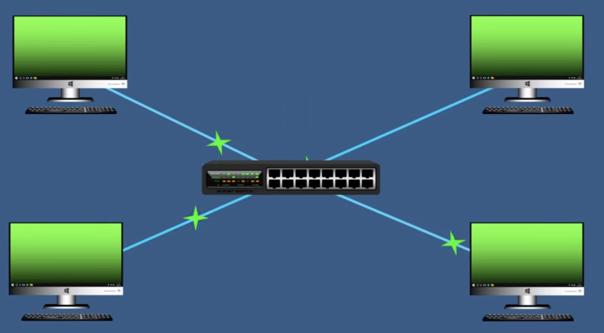
- All the computers are connected to a central wiring point
- **Advantage**: If one computer fails then the other computers would not be affected because each computer has their own cable connection
- **Disadvantage**: If the central hub fails then all the computers would be affected (single point of failure)

##### 2. **Mesh** Topology
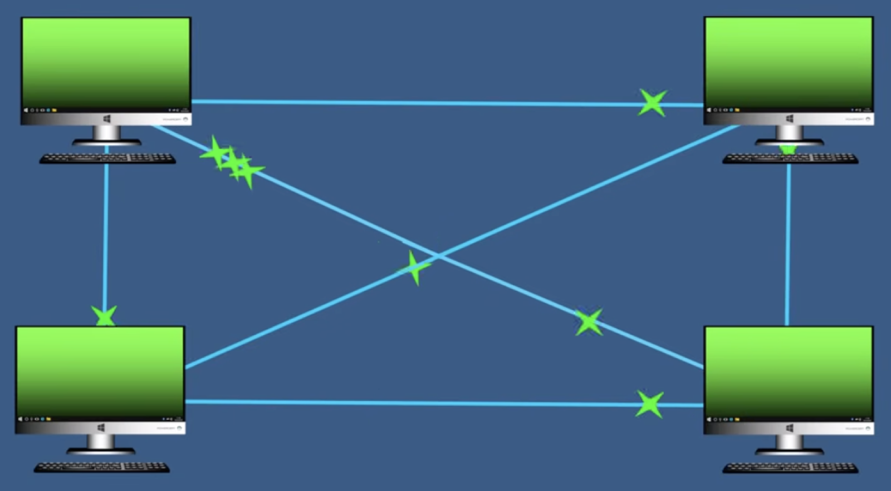
- Each computer on the network is connected to every other computer on the network
- **Advantage**: If one or more connections fail the computers will still be able to communicate with each other
- **Disadvantage**: The amount of cabling, mesh topologies can be expensive 

##### 3. **Point-to-point** Topology

- Two hosts that are directly connected to each other using a single cable

##### 4. **Hybrid** Topology
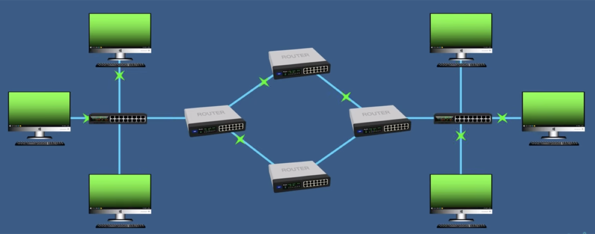
- Topologies can be combined with other topologies when needed

##### 5. **Spine-Leaf** Topology
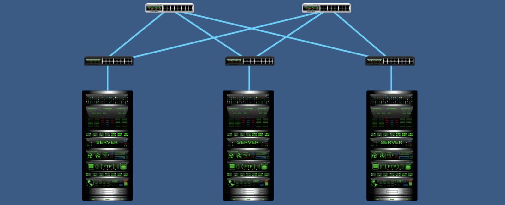
- Spine-leaf has two layers of switches, every switch in the lower layer connects to every switch in the upper layer (a full mesh between the two layers)
- **Leaf**: the access switches. Servers, storage, firewalls attach here. Leaf switches do not connect to each other
- **Spine**: it only carries traffic quickly between leaves. Nothing else attaches to the spine, and spines do not connect to each other
- **Advantages**:
	- **Predictable latency**: any server reaches any server in exactly 3 hops: leaf -> spine -> leaf. Traffic between two servers on the same leaf stays local
	- **Simple scaling**:
		- Need more server ports -> add leaves
		- Need more bandwidth between leaves -> add spines

##### 6. **Three-tier Hierarchical** model
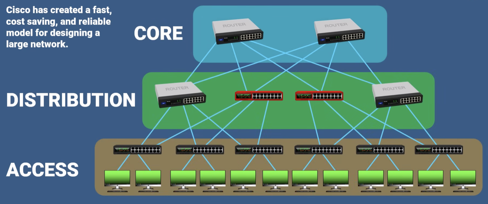
- The three-tier model splits a network into three layers, each with a specific job
- The three layers:
1. **Access layer**
	- Where end devices connect
	- Users can use their computers to access network resources
2. **Distribution layer**
	- Provides intelligent switching, routing, and network access policies for the network
	- Acts as a middle-man for exchanging data between the core and access layer
3. **Core layer**
	- Goal: move packets as fast as possible
	- Needs high availability and redundancy (usually at least two core switches with redundant links because if one fails, traffic just reroutes around a failure in milliseconds)

##### 7. **Collapsed Core** model
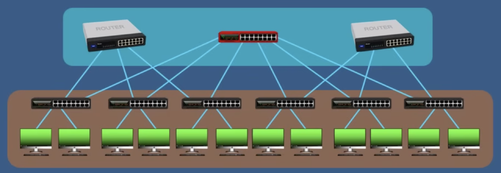
- Designed for smaller networks
- It combines the core and distribution layers into one layer, creating a **two-tier** model

#### Traffic Flow
In computer networking there are terms for the flow of traffic

##### East-west traffic
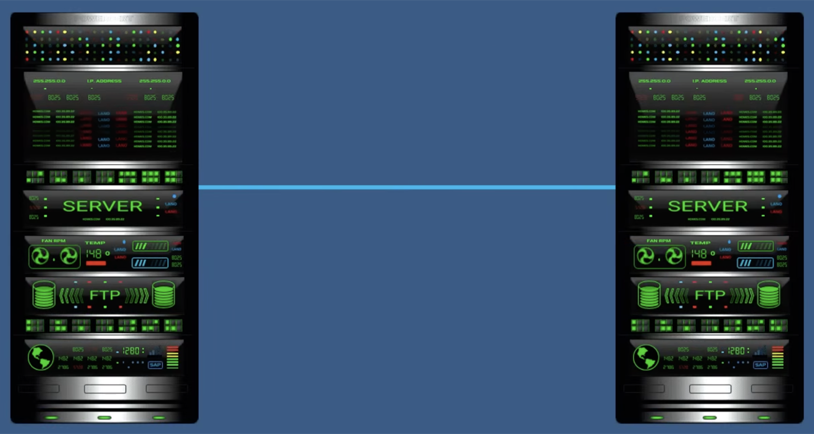
- Refers to network traffic between machines in a particular data center

##### North-south traffic
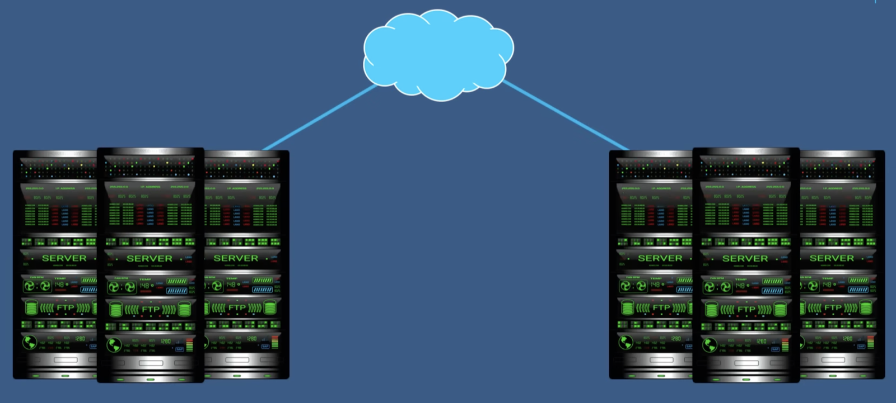
- Refers to network traffic from a system that is physically located outside the data center

[↑ Back to top](#networking)

---

### OSI Model

The OSI (Open Systems Interconnection) model was developed to create a set of standards for network communication.
It describes how information from software in one computer, moves through a network to reach software on another computer.
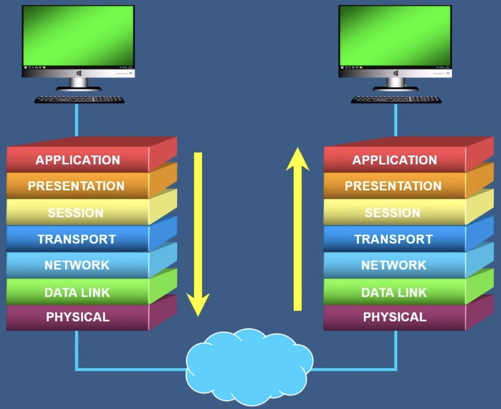

The OSI model breaks down the data communication into 7 different layers:
##### 1. Physical
- Deals with how raw bits of data are transmitted through **cables** and connectors
- Defines the **topology** of a network

##### 2. Data Link
- Responsible for getting the raw bits of data from the physical layer and organizing it into **frames**
- A frame is when raw data is properly formatted and prepared by adding headers and trailers
- The frame contains the **MAC** address, which is used when devices talk to each other
- A common layer 2 device is a **switch** because it reads the **MAC** address in a frame and uses it to determine where to forward it

##### 3. Network
- Responsible for routing the **packets** across different networks using **IP** addresses
- Data is encapsulated into **packets**
- Some examples of layer 3 devices are **routers** and **layer 3 switches**

##### 4. Transport
- Provides the transfer of data between end users by using the **TCP** or **UDP** protocols
- TCP is responsible for resending any data packets that did not receive an acknowledgement from the destination ensuring that the data packets are received by the destination
	- It also reassembles the data in the correct order
- UDP does not guarantee the delivery of the data
	- It is a faster protocol that's mainly used for applications such as streaming videos

##### 5. Session
- Controls the dialogue during communications
- The session layer is responsible for **starting**, **managing** and **ending** the communication
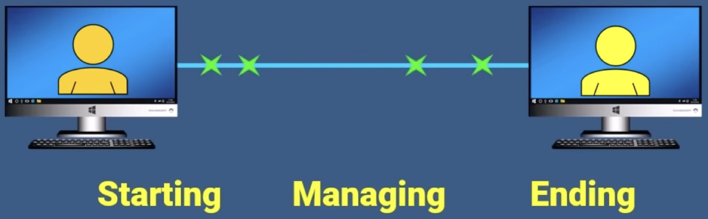

##### 6. Presentation
- Responsible for **translating** the data into a readable format as it hands it off to the application layer
- This layer is where the data is **compressed** or **decompressed** or **encrypted** or **decrypted**
- The presentation layer is sometimes referred to as the **translation layer**
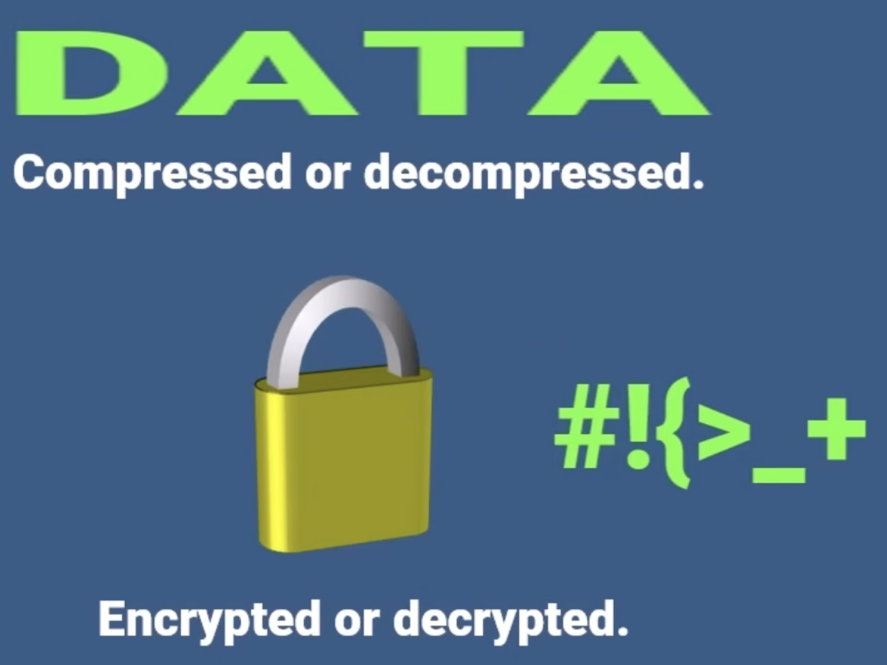

##### 7. Application
- Provides the **protocols** that applications use to communicate over the network (e.g. **HTTP/HTTPS**, **DNS**, **SMTP**, **FTP**)
- It is not the application itself (e.g. a web browser), but the network services the application relies on

[↑ Back to top](#networking)

## Network devices & services

### Network Devices, Applications, & Functions

#### Switch
- It connects all of your network devices together on a local network
- Has multiple ports that accept **Ethernet connections** from network devices
- Is considered intelligent because it learns the physical addresses that are connected to it and stores these **MAC** addresses in its table, so when a **frame** is sent to a switch it is forwarded only to the intended destination port
- Works at **layer 2** (Data Link) of the [OSI Model](#osi-model)
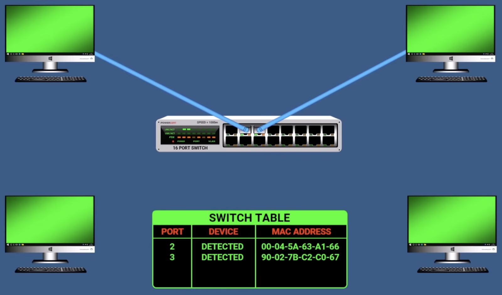

#### Router
- Routes or forwards data from one network to another based on the **destination IP address**
- Inspects the packet's destination IP address and **determines**, using its **routing table**, where to forward it next
- Is the **default gateway** for a network: devices send traffic meant for other networks to the router
- Works at **layer 3** (Network) of the [OSI Model](#osi-model)
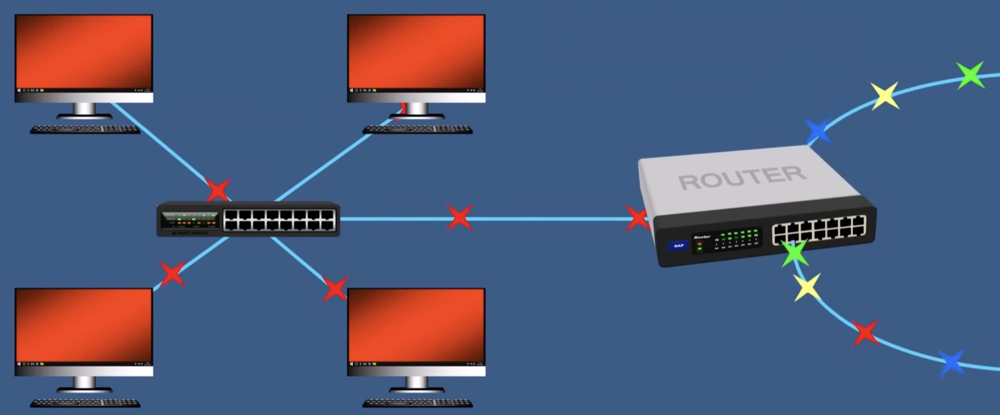

#### Firewall
- A hardware or software system that is designed to block unwanted traffic from entering a private network by filtering the information that comes in from the internet
- A firewall uses a set of rules to decide whether traffic is allowed or blocked; these rules are often implemented as an **access control list (ACL)**
- The rules of a firewall are customizable and configured by the network administrator, they can be configured not only to decide what can enter a network but also what can leave a network
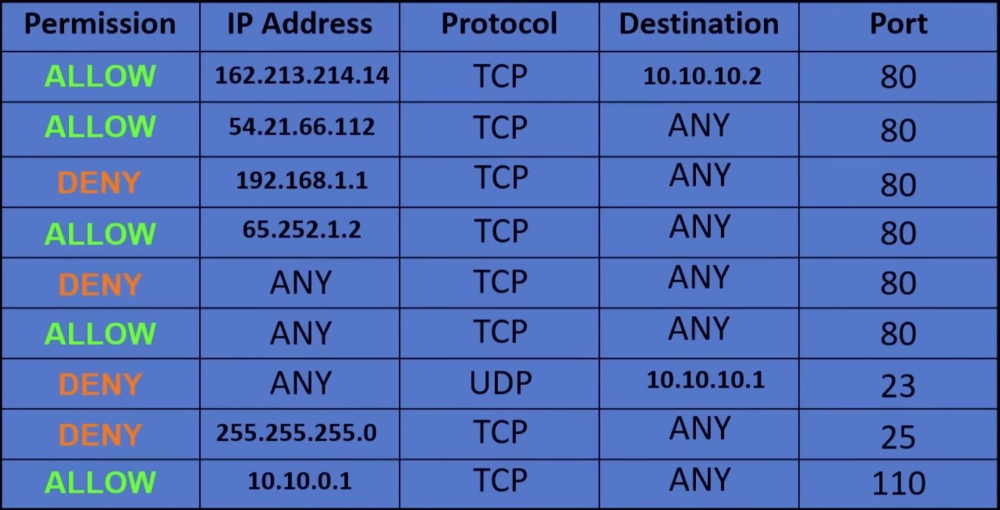

#### IDS / IPS
- Alert and protect a network from attacks (viruses, malware, hackers), including threats coming from inside the network
- Intrusion detection/prevention systems can be hardware or software, and are usually placed between the internet and the firewall (many modern firewalls have one built in)
- Monitors traffic flowing through a network looking at suspicious patterns
- **IDS** (detection) works on a copy of the traffic and sends alerts but doesn't block the packets
- **IPS** (prevention) sits inline, traffic passes through it, so it can drop malicious packets
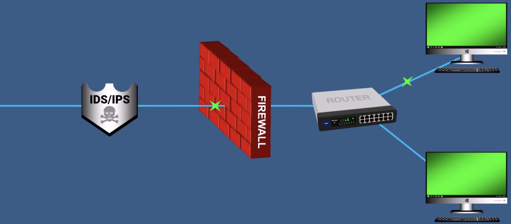

#### Load Balancer
- It is a piece of hardware or software that is used to distribute incoming traffic across **multiple servers** so that no single server becomes overwhelmed with the workload
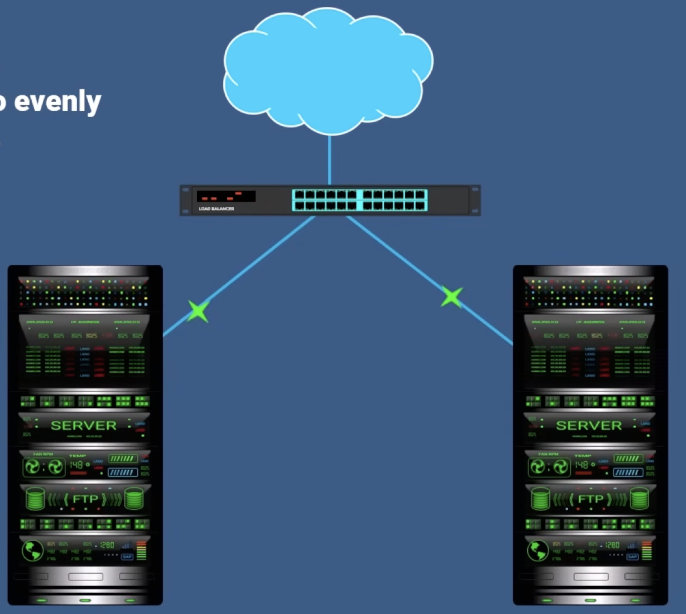

#### QoS (Quality of service)
- Quality of service is a feature that's built into many routers and switches
- It is used to prioritize network traffic based on certain applications and devices
- **Traffic shaping** is one QoS technique: it controls the rate at which traffic is sent to smooth out bandwidth usage
- For example: a network administrator can decide if an application such as voice communication is more important than web browsing, then it can give voice communication a higher priority so it gets bandwidth before the other application

[↑ Back to top](#networking)

---

### Proxy

- A proxy is something that has the authority to do something for another person or thing
- In networking a proxy is a **server**
- A proxy server is the **middleman** that sits between a private network and the public internet
- By using a forward proxy we create a **safety barrier** between a private network and the internet because it can **regulate** traffic by blocking harmful websites
- A proxy also hides the identity of clients by masking their IP addresses and using its own IP address so the websites and servers only see the IP address of the proxy server and not the clients
- **Logs** user activity (organizations like to know what websites their clients are visiting) and keeps **track** of what websites were visited and how long they were on those websites
- It can **bypass** restricted content
- Another benefit of using a proxy server is **speed** because a proxy can cache or store copies of websites that are frequently used by their clients
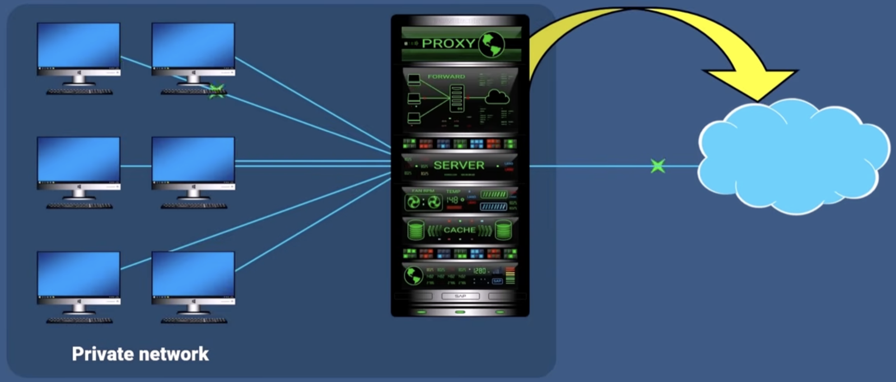

#### NAS (Network Attached Storage)
- It is a storage device that is used strictly for storing data
- It may have multiple drives for redundancy and a network interface card that is directly attached to a switch or a router so that the data can be accessed over a network
- Used in homes and small to medium-sized businesses
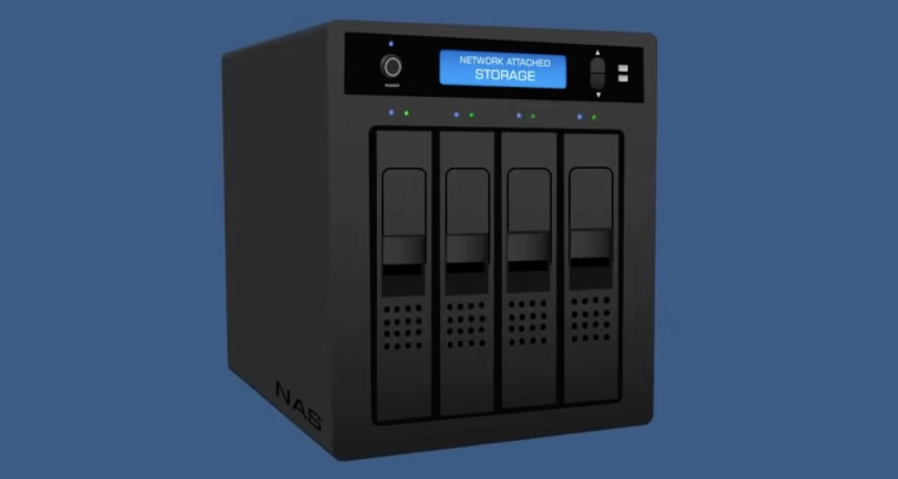

#### SAN (Storage Area Network)
- A special high speed network that stores and provides access to large amounts of data
- It is a dedicated network that is used for data storage
- This network consists of:
  1. disk arrays
  2. switches
  3. servers
- It has multiple disk arrays, switches and servers so it is **fault tolerant**: the data is shared among the disk arrays, so if a disk array, a switch or a server goes down the data can still be accessed
- When a server accesses the data, it sees it as if it was a local hard drive (**block-level** access), because that is how operating systems recognize a SAN, unlike a NAS, which appears as a shared network drive (**file-level** access)
- They are very expensive so they are used mainly by large companies
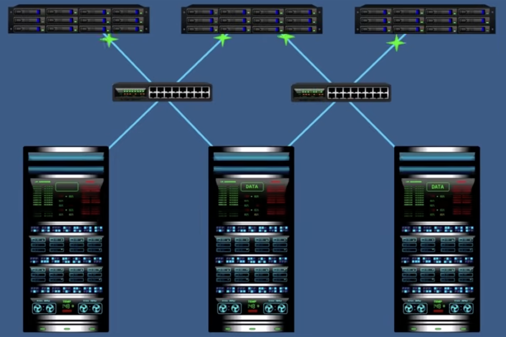

#### Wireless access point
- It acts as a **bridge** that wireless devices use to connect to an existing wired network
- Are primarily used by medium and large organizations
- An organization will have multiple access points to make sure it covers the entire building
- A wireless access point is connected to the network (usually a **switch**, or directly to the router) through an Ethernet cable, then the access points broadcast a Wi-Fi signal so that other devices can connect wirelessly and join the network
- The wireless laptops, tablets and phones will use wireless access point unlike the desktop computers that connect to the wired network directly using Ethernet cables
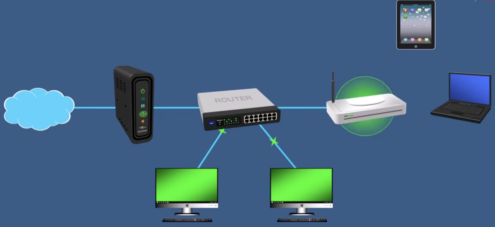

#### Wireless LAN controller
- Wireless access points can work on their own, but in larger networks they are also managed by a **wireless LAN controller**
- It is a device that manages wireless access points configurations in a network, so instead of configuring each wireless access point, you configure everything on the wireless LAN controller and it pushes the settings to all the wireless access points
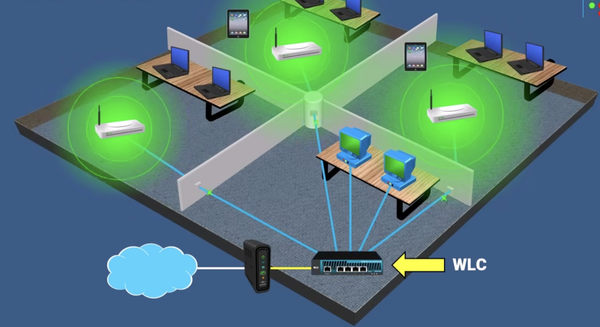

[↑ Back to top](#networking)

---

### CDN

- Stands for **content delivery network**
- It makes websites faster by bringing the website content closer to the user
- The distance between the user's location and the webserver will directly affect how fast the website loads
- If the origin web server is located in the USA and a user accessing it is located also in the USA the website is going to load fast because the distance is short, but if you are located in Asia the website will take longer to load because of the further distance
- A CDN was created to make websites faster by reducing the distance between the user and the origin web server
- A CDN works by establishing **points of presence (PoPs)**, and these PoPs are placed in different geographical areas all over the world
- The PoPs are made up of servers called **edge servers**
- The edge servers **cache** the content of the origin webserver to deliver the website data to users faster by bringing the website data closer to the users
- Instead of users connecting directly to the origin web server to retrieve the web page they will connect to an edge server closest to their location which reduces the latency caused by long distances and dramatically speeds up website retrieval
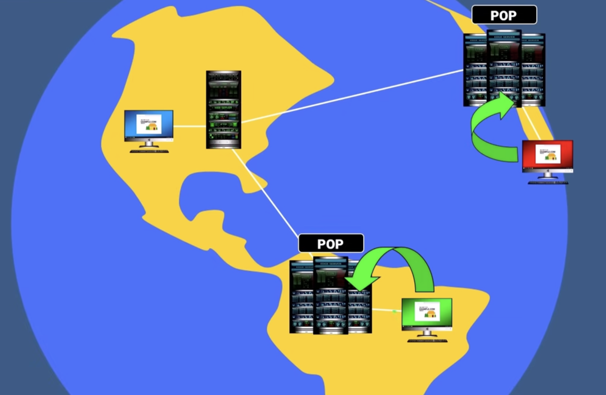

[↑ Back to top](#networking)

## Cloud & virtualization

### Virtualization

> [!NOTE]
> **Definition**
>
> **Virtualization** is the process of simulating hardware and software in a virtual (software) environment.

#### The traditional approach
Traditionally, a business runs **one application per physical machine**, e.g.:
1. A server dedicated to running an **email service**, with **Windows** as its OS
2. A server dedicated to running a **website**, with **Linux** as its OS
3. A server dedicated to running a **database**, with **UNIX** as its OS

#### The virtualized approach
- Instead of having three servers each running one application, we can use **one server** to take the place of all three, running every application along with its own OS. This is what virtualization does.
- In other words, virtualization **consolidates multiple physical servers**, with their different operating systems and applications, and runs them on **just one physical server** in a virtual environment.
- All of this is done **entirely through software**.
- Users interact with a virtual server the same way they would with separate physical servers, **without being able to tell the difference**.

#### The hypervisor
- The software that creates and runs the virtualization is called a **hypervisor** (e.g. *VirtualBox*).
- It **allocates and controls the sharing** of a machine's resources, such as storage space, RAM, CPUs, etc.

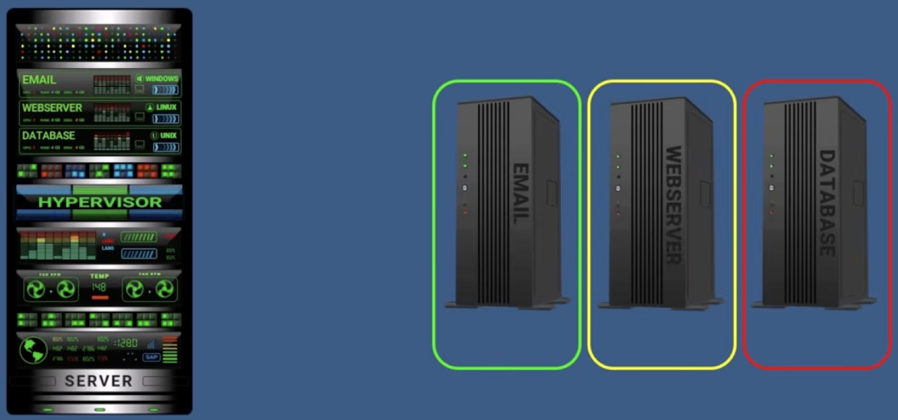

[↑ Back to top](#networking)

---

### VPC

> [!NOTE]
> **Definition**
>
> **VPC** stands for **Virtual Private Cloud**. It is an **isolated private network** within a **public cloud**.

#### What is a cloud?
- The cloud is just **a bunch of servers in a building**.
- These servers are **accessed from the internet** and provide services on behalf of clients, such as businesses and organizations.
- The **public cloud** is available for the public to use.
- A public cloud is a **3rd-party service provider** that sells its servers' computing resources to the public.

> [!TIP]
> **Example**
>
> An organization wants to run its applications, such as a website or a database. It could either:
> 1. **Build its own servers:** spend the money and time to build and maintain its own servers on-site and run these applications on them.
> 2. **Use a public cloud:** go with a cloud provider and use its servers instead to run the applications.

**Popular cloud providers:**
1. Amazon Web Services
2. Microsoft Azure
3. Google Cloud Platform

#### Public cloud vs. virtual private cloud
- In a **public cloud**, computing resources are **shared** between all the clients using that public cloud.
- A **VPC** is the creation of a **secure and isolated private network** within a public cloud.
- Its purpose is **isolation and security**, so it provides **greater security** than the shared public cloud.

#### How do you create a VPC?
For example, a business wants to use a VPC. What do they do?
1. They go to a **public cloud provider** of their choosing.
2. In that public cloud, they **create and configure their own VPC**.
3. In a VPC you can configure an **entire network**: servers, route tables, internet gateways, subnets, security groups, etc. It is **all done virtually**. You can also create **multiple networks** in your VPC.

##### Why would you need different networks in your VPC?
Let's say the business wants to create separate networks in its VPC by creating a couple of **subnets**:
- **1st subnet:** hosting their **website**
- **2nd subnet:** hosting their **database**

**Website → public subnet**
- The website needs to be accessed by the public from the internet, so its subnet needs internet access.
- This makes it a **public subnet**, so you have to configure a **virtual internet gateway** and **routing tables** to let traffic in and out.

**Database → private subnet**
- The database holds **sensitive information** that should not be accessed by the public, so its subnet will be a **private subnet**.
- No internet gateway needs to be configured for it.
- However, the company itself still needs to access the database on this private subnet. This is done by configuring a **VPN**, which creates a **secure and direct connection** from one network to another over the internet.

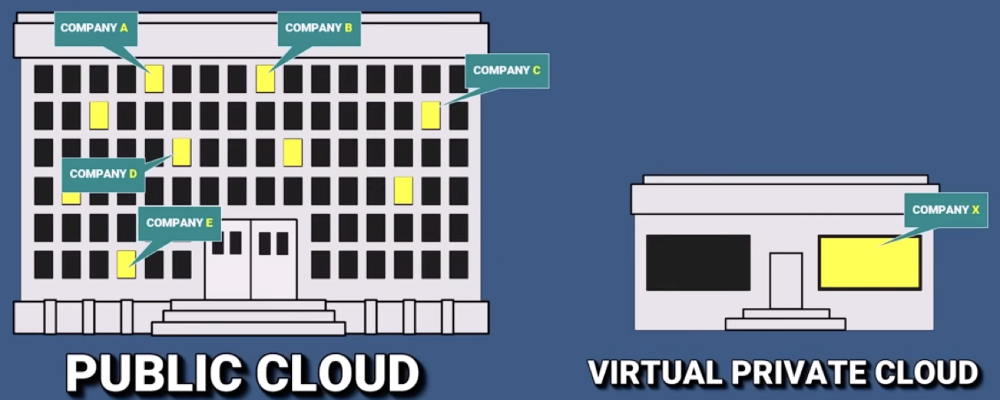

[↑ Back to top](#networking)

---

### Cloud

- It is just a **bunch of servers in a big building**
- The servers provide services on behalf of clients, such as businesses and organizations
- The cloud offers **scalability**, meaning it can add more resources, such as servers, when needed and it can do this on the fly
- It also offers **elasticity**, which means that the cloud can dynamically adjust its resources quickly, whether it's up or down, to adapt to fluctuations in a business or an organization
- It also offers **multitenancy**, which means multiple customers or clients share the same resource infrastructure in the public cloud

---

#### Cloud deployment models
When a company is ready to deploy a cloud, that company must decide what type of **cloud deployment model** it wants to use.

1. **Public model**
   - Is when a company is going to offer their product or service accessible to **anyone** who wants to access it.
   - For example, this could be a company's website where anyone can just use their computer to access the website.
   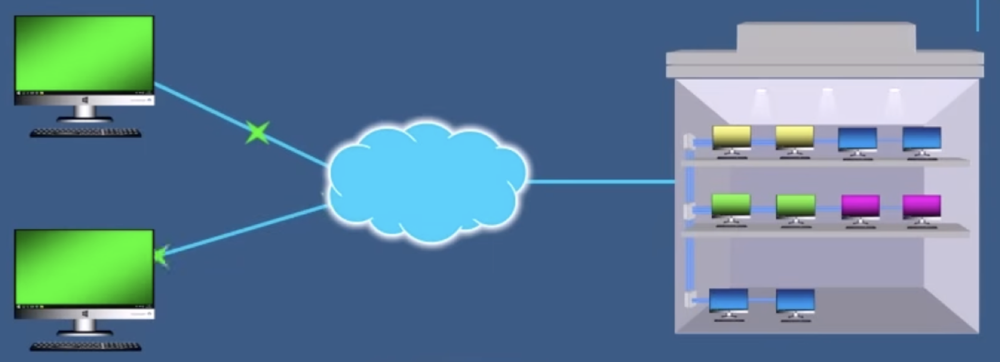

2. **Private model**
   - Is when a company offers their service to **private users** instead of the general public.
   - For example, an internal website where only employees of that company can access it.
   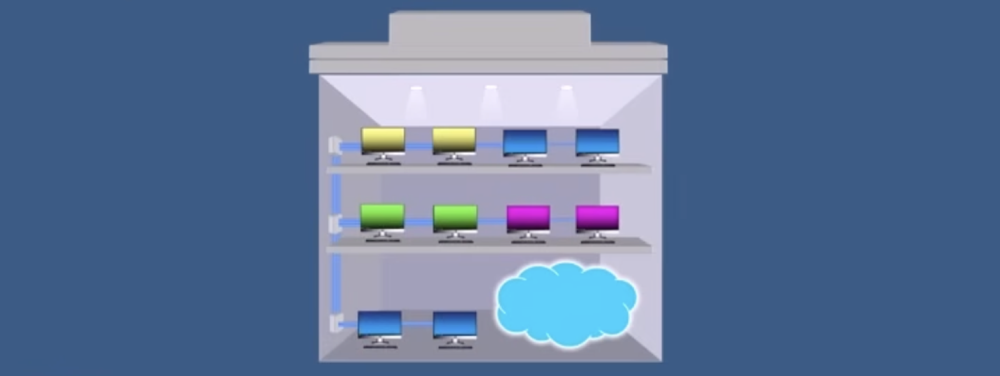

3. **Hybrid model**
   - Is a **mixture** of private and public models.
   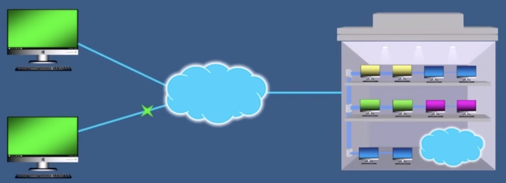

---

#### Service models in Cloud computing
There are **3 different service models** in cloud computing:

1. **IAAS (Infrastructure as a Service)**
   - It means that you allow the cloud provider to manage a portion of your business, which is going to be the **hardware portion**. The cloud provider will manage the servers, storage, virtualization, and the networking portion. You will still have control over the **software portion**, such as the applications, data, operating system, middleware, runtime.
   - An example of IAAS would be **iDrive**, which provides cloud storage.
   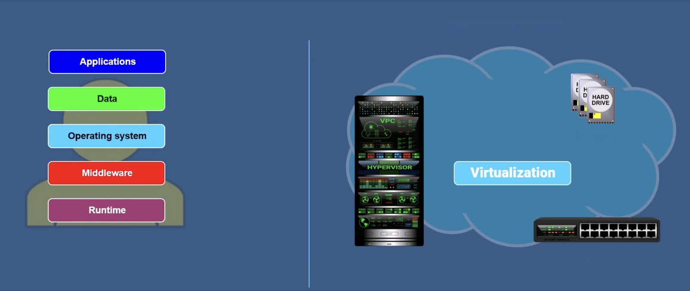

2. **PAAS (Platform as a Service)**
   - PAAS, like IAAS, allows the cloud provider to manage a portion of your business, but the cloud provider has **more control**. In a PAAS, the cloud provider not only manages the hardware, such as server, storage and networking, but it also manages the **OS, middleware, and runtime**. You will be only responsible for the **applications and the data**.
   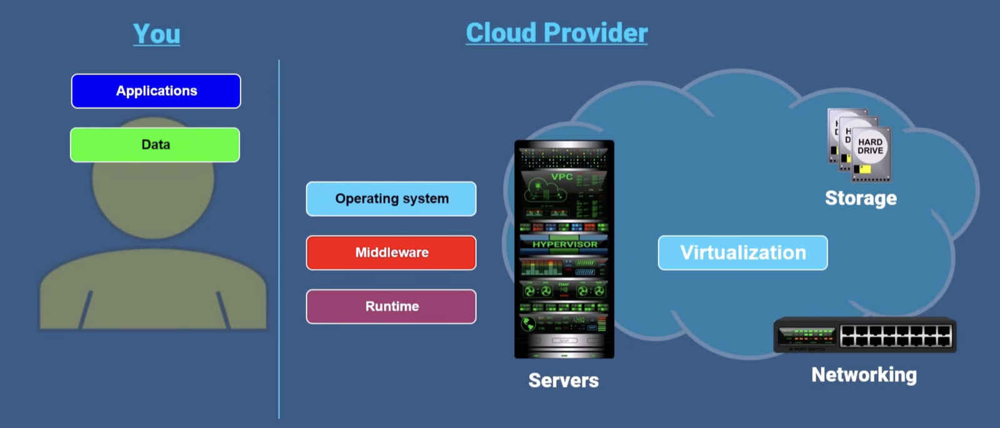

3. **SAAS (Software as a Service)**
   - This is the **most common** cloud service by far. In this type, the cloud provider manages all the hardware, software, networking, operating system, and storage. There is no software to install on your computer and no hardware to manage. You just simply access and run the application from your computer when you connect to the cloud service through the internet.
   - A good example of SAAS is **Google Docs**, which is a free online office suite that is accessed using a web browser. There is no additional software that needs to be installed on your computer to use Google Docs. Everything is accessed and managed from your web browser.
   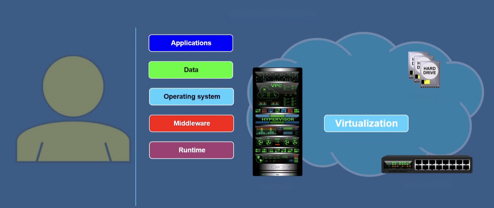

[↑ Back to top](#networking)

## Ports & protocols

### Ports, Protocols, Services & Traffic Types

#### Ports
- A **port** is a logical connection that is used by programs to exchange information.
- These ports have a **unique number** that identifies them.
- Port numbers range from **0 - 65535**
- Some ports that are very common and used every single day are:
  1. **Port 80/TCP (HTTP):** used by the web server for HTTP connections to serve web pages on the internet over HTTP without encryption
  2. **Port 443/TCP (HTTPS):** used by the web server for HTTPS connections to serve secure web pages over HTTPS
  3. **Port 25/TCP (SMTP):** used for sending email through SMTP
  4. **Port 22/TCP (SSH):** used for remotely managing network devices and Linux servers
  5. **Port 53 (DNS):** used for DNS queries and responses to resolve domain names into IP addresses
  6. **Port 67/UDP and 68/UDP (DHCP):**
     - **Port 67:** Used by DHCP servers to listen for client requests, such as DHCPDISCOVER and DHCPREQUEST, and send responses from source port 67 to destination port 68.
     - **Port 68:** Used by DHCP clients to receive responses, such as DHCPOFFER and DHCPACK, from DHCP servers. Clients send DHCP requests from source port 68 to destination port 67.
  7. **Port 161/UDP and 162/UDP (SNMP):**
     - **Port 161:** Used by network management systems to query and manage network devices and retrieve information and statistics.
     - **Port 162:** Used by network management systems to receive SNMP notifications.
  8. **Port 179/TCP (BGP):** Used by the Border Gateway Protocol to establish connections between BGP peers and exchange routing information between autonomous systems.
  9. **Port 446/TCP (SMB):** Used by the Server Message Block protocol for network file sharing and other shared resources, particularly in Windows environments.
  10. **Port 514/UDP (Syslog):** Commonly used to transmit system logs from network devices and servers to centralized logging systems.
  11. **Port 3389/TCP (RDP):** Used by Microsoft's Remote Desktop Protocol to access and manage Windows systems remotely.
  12. **Port 23/TCP (Telnet):** Used for remote command-line access, but it transmits data without encryption and is generally avoided in favor of SSH.

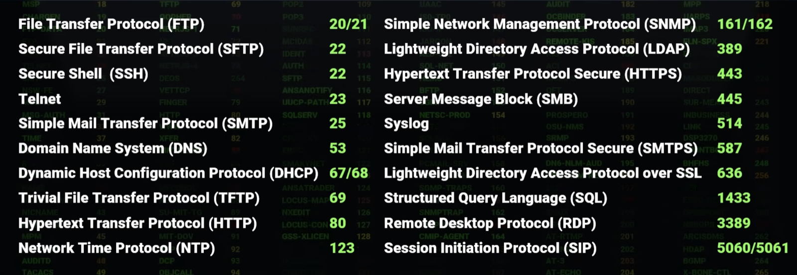

---

#### TCP
Whenever a computer wants to communicate with another computer, the communication between these two computers needs to be good and reliable so it can guarantee that the data is received correctly. E.g.: when you want to view a web page or download a file or look at an email, you would expect to view the web page intact and in order with nothing missing, or if you download a file you would want the entire file and not just a part of the file. This is where TCP comes in. TCP stands for **Transmission Control Protocol**.

- TCP is used to **guarantee that all the data is received and in order**

  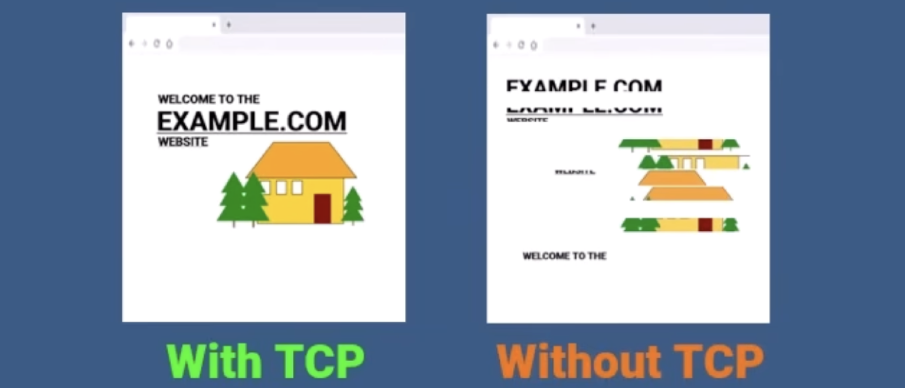

- TCP is a **connection-oriented** protocol, which means that it must first acknowledge a session between two computers that are communicating
- The two computers verify a connection before any communication takes place by using a **three-way handshake**:
  1. First step is that a computer will send a message called a **SYN**
  2. The receiving computer will send back an **acknowledgement** message telling the sender that it has received the message
  3. Finally, the sender computer sends another **acknowledgement** message back to the receiver

  Once these steps have taken place, data can be delivered.

  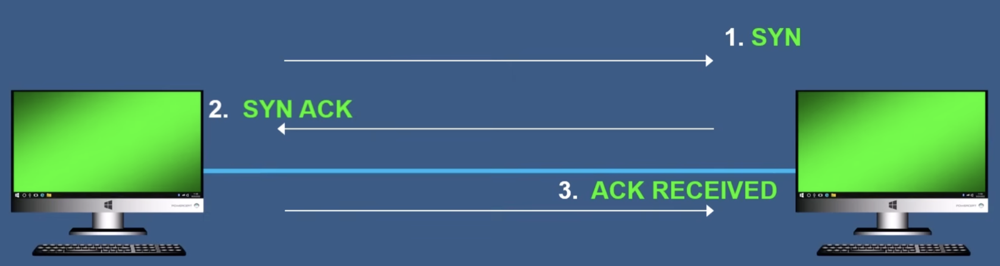

- TCP **guarantees the delivery** of the data, so if a data packet goes astray and doesn't arrive, then TCP will resend it.

  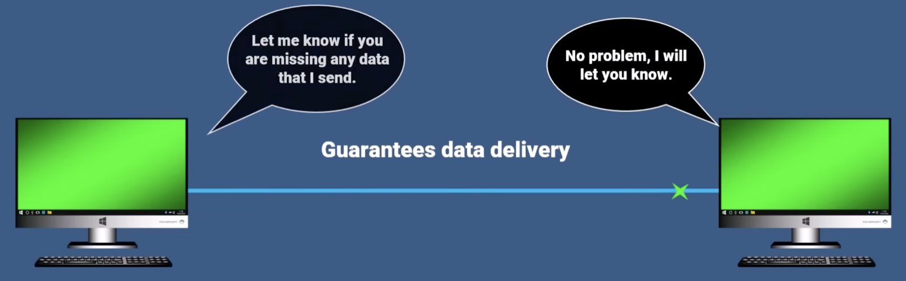

---

#### UDP
UDP is also for sending and receiving data.
- The main difference from TCP is that UDP is **connectionless**, which means that it does not establish a session and it does not guarantee data delivery
- UDP is also known as a **fire and forget** protocol because it sends data and it doesn't really care what happens to it

  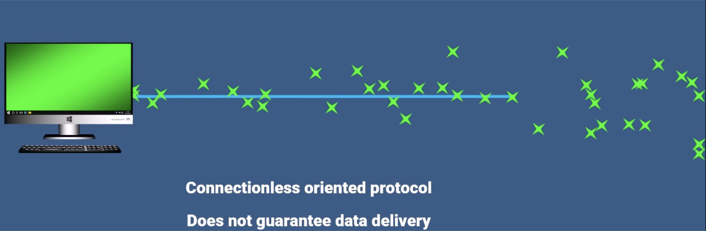

- Because of the less overhead that is involved of not guaranteeing data delivery, **UDP is faster than TCP**

---

#### IPsec
It is a set of protocols used for **security at the network layer** of the OSI model.
- **IP** stands for Internet Protocol, which is what the internet uses to route data, which is by using IP addresses
- **Sec** stands for secure, which is exactly what IPsec does: it secures the data when communication is happening between two points over a network

- IPsec secures the data by adding **encryption and authentication**
- It is the protocol that is commonly used to create **VPNs** (VPN just means making a public network, like the internet behave as if it were a private one, Private means that the traffic is hidden from everyone else, encrypted and the two sides can talk to each other as if they were directly connected. The tunnel is what makes it “virtual” and “private”, virtual because there’s no dedicated physical cable, private because the data inside is encrypted and only reachable by the two endpoints.)

When devices communicate over a public network such as the internet, the data that is being exchanged is sent in **clear text**, which means anyone can steal the data. It would not normally be a big deal if they were just sending nonsensitive information. But when sending sensitive information such as credit card or other personal information, then this would be a major problem.

IPsec was developed to ensure that the data cannot be stolen by protecting the data while it's being transferred over the internet. It does this by authentication and making sure that the data is impossible to read by using encryption algorithms to scramble the data that is being transferred.

- IPsec creates **secure tunnels** (a tunnel isn't a real physical path, it's a name for what happens when a packet gets wrapped inside another) to protect the data during transfer, and it is done in two phases using a protocol called **IKE (Internet Key Exchange)**:
  1. **Phase 1:** The 2 sites will identify each other and negotiate parameters for authentication and encryption methods. This is the first tunnel that is used to protect the negotiation process.
	- In order to use IPsec, both sender and receiver must **share a public or private key**. This key is what locks and unlocks the encrypted data as it travels across a network. This ensures that the data cannot be read and tampered with. The sender will secure the data by encrypting it with the key and the receiver will use the key to decrypt the data so it can be read.
	- **Diffie-Hellman Key Exchange:** Both sides publicly agree on **P** (a large prime, prime becua) and **G** (a base). Each then picks a private number it never shares: Alice picks **a**, Bob picks **b**. Each computes a public number and sends it over the network:
	  - Alice sends A = G^a mod P
	  - Bob sends B = G^b mod P
	
	  Each then raises the other's public number to their own private number:
	  - Alice computes B^a mod P
	  - Bob computes A^b mod P
	
	  Both results equal **G^(a·b) mod P**, so they get the same shared key. Only G, P, A and B ever cross the network, and recovering a or b from them is the **discrete logarithm problem**, which is infeasible at real sizes.
  1. **Phase 2:** Creation of the IPsec tunnel, and in this tunnel the protected data is going to be exchanged between the two sides.
	- Before the data is sent, it needs to be protected, and this can be done by using a couple of different protocols:
		  1. **AH - Authentication Header:** It offers authentication and integrity, but it doesn't do any encryption
		  2. **ESP - Encapsulating Security Payload:** It is the better of the two protocols. ESP does offer all three: authentication, integrity, and encryption

  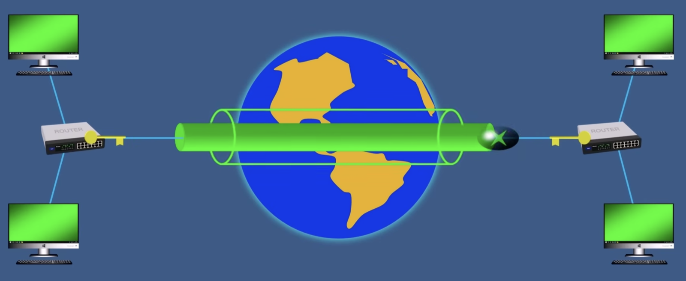

- IPsec operates in **2 different modes**:
  1. Transport mode
  2. Tunnel mode
- When data is sent across the network, the data is not sent in one chunk. It's sent in smaller chunks called **packets**.
- These packets have an **IP header, TCP header, and a payload**. The IP and TCP headers contain information such as the source and destination IP address, port and sequence numbers, and more. The payload contains the actual data. Right now this IP packet has no security.

  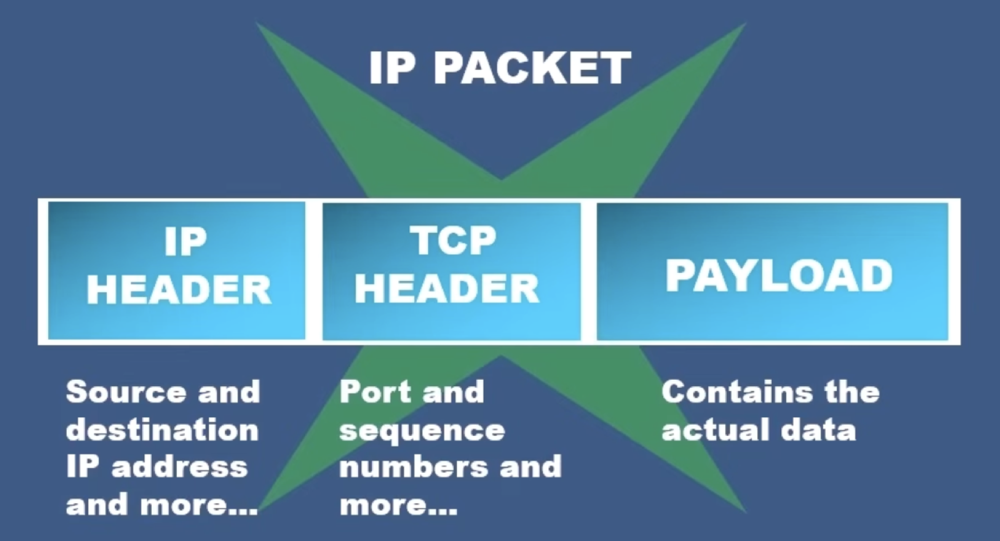

If we would want to add security to this packet with IPsec using **transport mode**, an ESP header, trailer, and authenticator gets added to the original packet. And the TCP header, payload and ESP trailer are all encrypted.
Transport mode is used when **two devices** connect over the public internet.

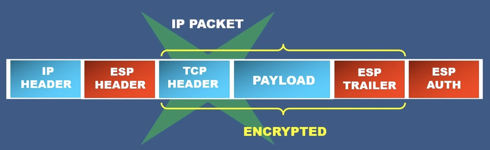

In **tunnel mode**, a new IP header is attached to the packet, and in addition to the TCP header, payload, and ESP trailer, the IP header also gets encrypted. So it provides even more security than transport mode.
Tunnel mode is used when **two sites**, such as two businesses, are connected over the public internet using a VPN.

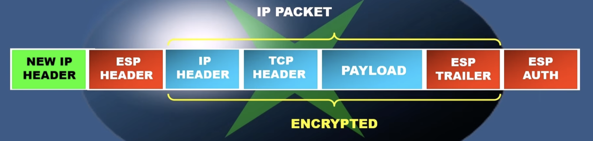

---

#### GRE
Stands for **Generic Route Encapsulation**
- Is used with point-to-point tunneling protocol in creation of a VPN network
- GRE is actually what **creates the tunnel in PPTP**; it is used to encapsulate the data in a secure manner
- It wraps one packet inside another, but with **no encryption or authentication**. It just does the wrapping

---

#### Traffic types

##### Broadcast
- When there is a **single transmitter** of data and that data is being **received by every device**
- E.g.: When a computer is sending an ARP broadcast out on the network and every computer will receive the message

  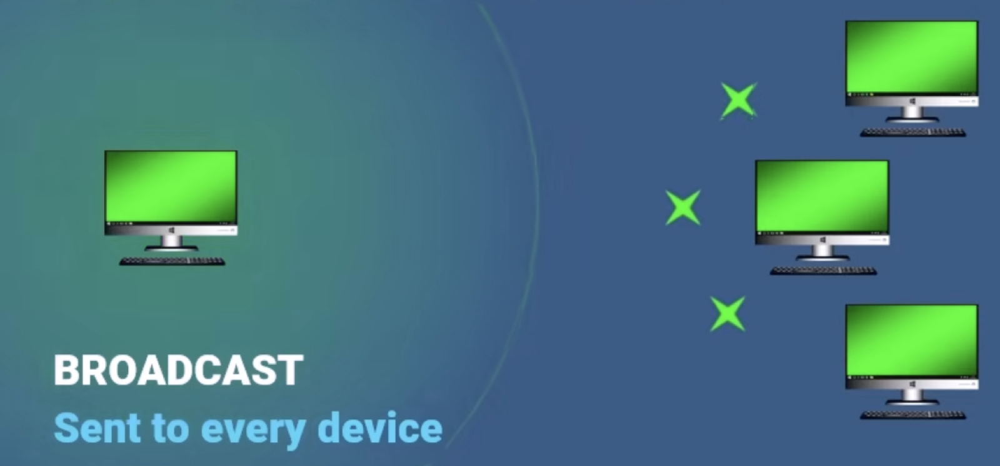

##### Unicast
- It is a **one-to-one** communication, so the data is sent to a single device

  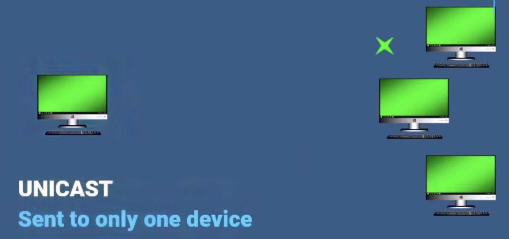

##### Multicast
- The data is sent to **multiple devices** at the same time, but not to every device

  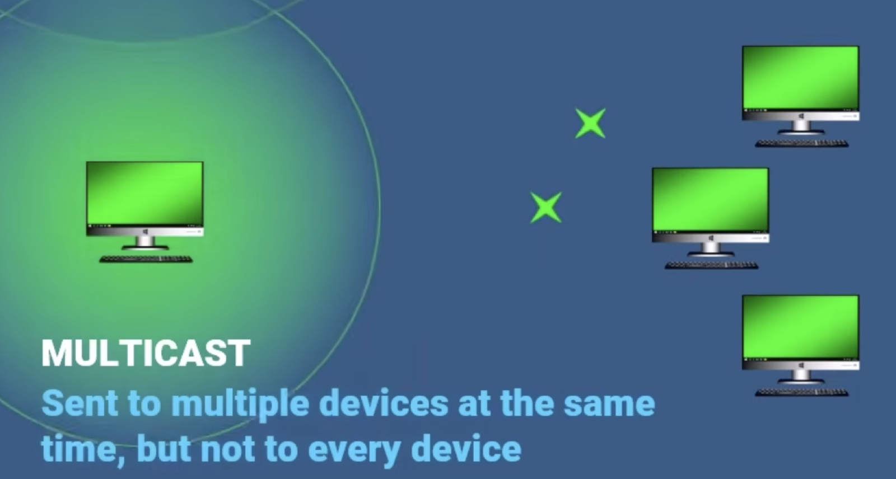

##### Anycast
- Data is sent to the **nearest device**

  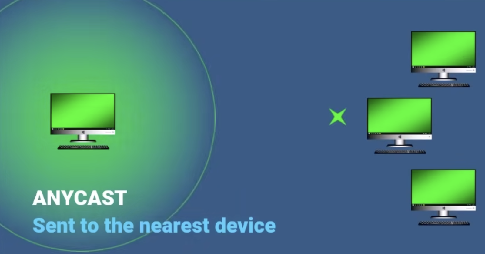

[↑ Back to top](#networking)

## Cabling & transmission

### Transmission media & Transceivers

#### Wireless

##### Wi-Fi Standards
**Wi-Fi** is a wireless technology that uses **radio waves** to allow networking devices to communicate with other networking devices wirelessly, using a device such as a **Wi-Fi router** or a **wireless access point**.

- The organization that created and maintains the wireless standards is the **IEEE** (**Institute of Electrical and Electronics Engineers**).
- The IEEE started a project called the **802 project**.
- The wireless standards they created start with the number **802.11**, first released in **1997**.

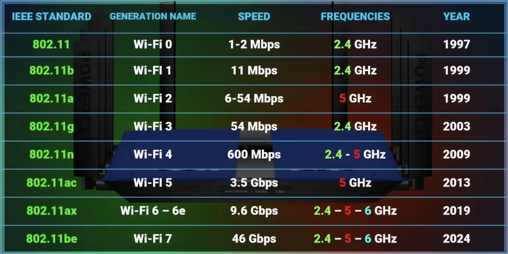

---
##### Cellular
Another method of connecting to the internet is by using **cellular networks**, which are used by devices such as cell phones and mobile tablets.

- Cellular networks divide geographical areas into sections called **cells**, with each cell having a **cellular tower** to cover that area.
- It's these cells that allow devices to connect to the internet wirelessly.
- Early on, cellular networks used technologies such as **2G** and **3G**. Today they use modern technologies such as **4G LTE** and **5G**, which significantly increase the speed of cellular data.

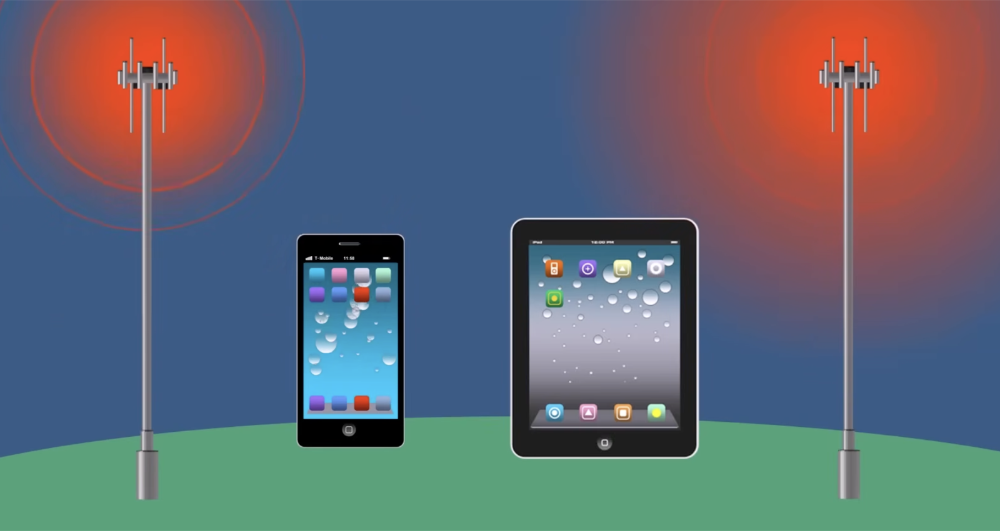

---
##### Satellite
Satellite internet is typically used when there is **no other option available** for internet access, e.g. in undeveloped areas where there is no network infrastructure.

**How it works:**
1. Data is transmitted by a **dish at the customer's location** up to **orbiting satellites**.
2. The satellites relay the data to a **broadband internet ground station**.
3. The ground station sends data back up to the satellites.
4. The satellites relay the data back to the dish at the customer's location.

> [!TIP]
> **Example**
>
> An example of a satellite internet provider is **Starlink**.

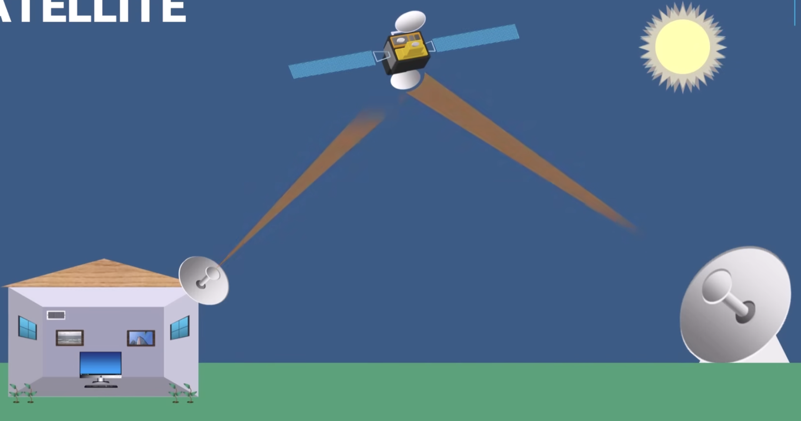

---
#### Wired

##### 802.3 Ethernet
The same IEEE organization that created the 802.11 wireless standard also created standards for cables: the **802.3 Ethernet standard**, which defines how data is transmitted over **wired connections**.

- Ethernet is the **most common network technology** used today.
- Its speed ranges from **10 to 40,000 Mbps**.
- It uses both **copper wire** and **fiber optic** media.

Today there are many different Ethernet cable standards used on networks. The cables are categorized and named according to their **speed**, **type**, and **media**.

> [!TIP]
> **Analyzing the cable name "10BASE-T"**
>
> - **10** → the maximum speed of this cable, which is **10 megabits per second**
> - **BASE** → **baseband transmission**: the signal is sent directly in its original form, for example on a copper cable. (Unlike **broadband transmission**, where data is modulated onto carrier waves at different frequencies.)
> - **T** → **twisted pair** cable

###### 10 – 100BASE Ethernet cables
- Maximum speed of **10 and 100 megabits per second**.
- There are variations in lengths and cable types. Examples in the following chart:

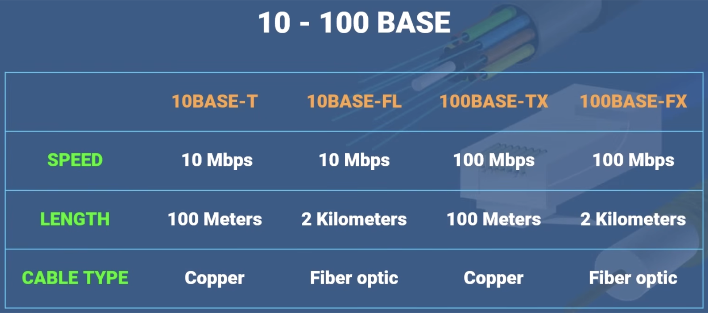

###### 1000BASE Ethernet cables
- Maximum speed of **1000 megabits per second**. Examples in the following chart:

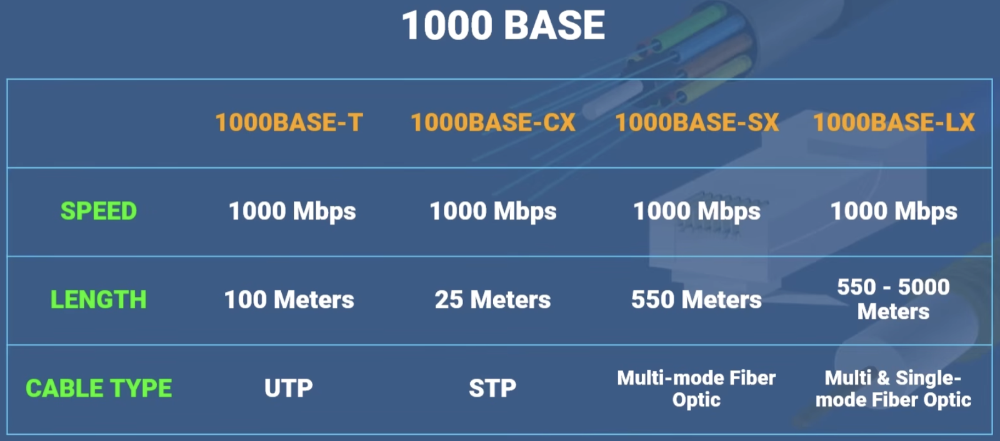

###### 10GBASE Ethernet cables
- Maximum speed of **10,000 megabits per second**. Examples in the following chart:

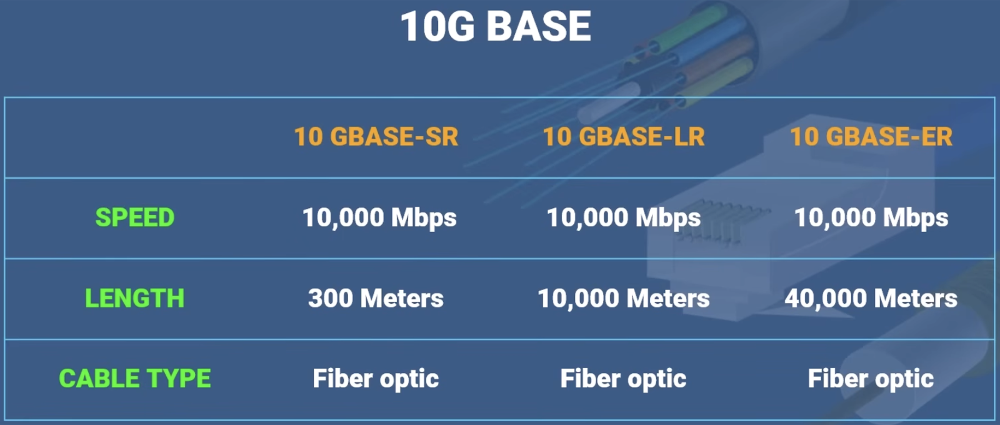

---
##### Twisted-Pair Cables
**Twisted-pair cables** are Ethernet network cables used in **local area networks**.
- These are the Ethernet cables you'll use to connect your computer to your router or modem so you can have internet access.
- One end of the cable plugs into your computer's **network interface card**, and the other end plugs into the network port of the **router, switch, or modem**, depending on what you're using.

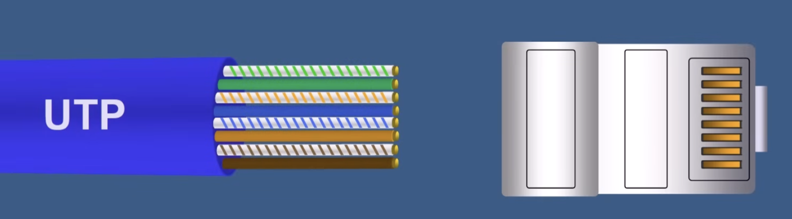

**There are 2 different types:**
1. **Unshielded Twisted Pair (UTP)**
	- The **most common** type of cable used today.
	- Consists of **four pairs of color-coded wires** twisted around each other.
	- The wires are twisted to **prevent electromagnetic interference (crosstalk)** ([explanation](html/twisted_pair_signaling_1.html)).
	- It is what most people use in their **home or business**.
2. **Shielded Twisted Pair (STP)**
	- Similar to UTP, except it has a **foil shield** covering the wires, which adds an extra layer of protection against electromagnetic interference leaking into and out of the cable.
	- Mainly used for **industrial purposes**, not so much in a home or business.

**There are 7 cable categories:**
- Category 3
- Category 5
- Category 5e
- Category 6
- Category 6a
- Category 7
- Category 8

> [!NOTE]
> - The difference between the categories is the **maximum speed** they can handle **without any crosstalk** (interference).
> - The category numbers represent the **tightness of the twists** applied to the wires.
> - If you have an older network running slower speeds, you can still use Cat 7, because it is **backward compatible**.

---
##### DAC Cable
**DAC** stands for **Direct Attach Copper** cable.
- It is a copper cable used for **high-speed data transmission over a short distance**.
- Typically used in **data centers** to connect devices to each other, such as switches on the same rack.
- DAC uses **twinaxial cable**, which has two conductor wires in a twisted pair separated by an insulator.
- The cable comes **pre-made from the manufacturer** and is terminated with transceiver housings at each end using **small form-factor pluggable (SFP)** connectors.
- They are simple to use: you just plug them into the **SFP ports** on the switches to connect them, and that's it. **No special configuration** needs to be done.
- DAC cables are better than Ethernet cables because they offer **lower latency**, **higher speeds**, **better signal quality**, and are **cost-effective**.

---
##### Plenum Cables
The term **plenum** refers to a space where there is **open airflow circulation**, usually between the **drop ceiling** and the **structural ceiling**. As a result, buildings that have plenum spaces are **more prone to fires**.

Therefore, cables that run through these plenum spaces must meet certain requirements:
- must be **more fire resistant**
- must **not produce toxic fumes**

This is the environment where **plenum cables** should be used.

Buildings that don't have plenum spaces have **air ducts** encapsulating the airflow, so there is no open airflow circulation. Because of this, the chances of a fire happening and recirculating toxic fumes are minimal. This is an example where you could use **nonplenum cables**.

---
##### Coaxial Cable
Used today primarily by **cable providers** to provide a computer with a **broadband internet connection**.

**There are 2 types:**
- **RG-6:** made for **long distances**; commonly used for cable television and internet connections
- **RG-59:** made for **short distances**; generally used for HD/HQ video

---
##### Fiber Optic Cable
It uses **pulses of light** to send data, and as a result it is **very fast** and can span **great distances**.

**There are 2 different modes in fiber optics:**
1. **Single-mode fiber**
	- Allows light to enter at **only a single angle**. Because the light enters at this single angle, it can span **great distances**.

2. **Multi-mode fiber**
	- Light travels in **multiple beams** that reflect off the walls of the cable.
	- Unlike single-mode fiber, multi-mode is made for **short distances**.

---
#### Connectors

##### RJ-11 Connector
- A **4-wire connector** used mainly to connect **telephone equipment**.
- Also used to connect computers to a local area network through the computer's **modem**.
- It resembles the RJ-45, but it is **a little bit smaller**.

---
##### RJ-45 Connector
- The **most common network connector**.
- An **8-pin modular connector** used to connect computers and other network devices in a local area network.

**How it's used:**
1. The RJ-45 is used with **unshielded twisted pair** cable that has **8 wires**.
2. The wires are arranged in a certain order and inserted into an RJ-45 connector.
3. They are then **crimped** on both ends using a **wire crimper**.
4. One connector plugs into the computer's **network card**, and the other end into a device such as a **switch, modem, or router**. Once that's done, the computer can connect to a network.

---
##### F-Type Connector
- A **threaded connector** typically used on **coaxial cables**.
- Primarily used by **cable providers** to attach to **cable modems**.
- In addition to broadband cable, it is also used with **satellite internet**.

---
##### BNC Connector
- Used on **coaxial cable**.
- Used for both **analog and digital video** transmissions, as well as **audio**.

---
##### SC Connector
- A **fiber optic** connector, also called the **standard**, **square**, or **subscriber** connector.
- One of the **first connectors** to be used in the marketplace.
- Uses a **push-pull** connector, similar to audio and video plugs.
- Commonly used **between floors** in a building.

---
##### LC Connector
- Also called the **local connector** or **Lucent connector**, since it was developed by **Lucent**.
- Also used **between floors** in a building.
- Designed to **compete with the SC** connector.
- About **half the size** of the SC connector, which makes it better for **highly populated racks and panels**.
- Uses a **latch** that locks itself into place, similar to the RJ-45.

---
##### MPO (Multi-Fiber Push On) Connector
- **Multiple fibers** are combined into a **single interface** via an MPO connector.
- A type of fiber optic connector used in **high-density environments** and for **high-speed data transfer** applications.

---
##### ST Connector
- Uses a **half-twist bayonet** type of lock and is commonly used with **single-mode** fiber optic cable.
- A **large** connector developed by **AT&T**. Because of its large size, its usage has **declined** in favor of smaller connectors such as the **LC** and the **MTRJ**.

[↑ Back to top](#networking)

## IP addressing

### IPv4 Addressing

#### Public vs. Private IPv4 addresses

##### Public IP addresses
When you order internet service from a company, they assign the modem in your home or business a **public IP address**.
- A public IP address is **registered** on the internet. It is what gives you access to the World Wide Web, so if you don't have a public IP, you **cannot access the internet**.
- Public IP addresses are **unique**, so there are **no duplicates**.

> [!WARNING]
> **The IPv4 shortage**
>
> When public IP addresses were created, engineers didn't realize how big the internet would become. Even though there were **over 4 billion IPv4 addresses** available, the engineers thought this would be enough, but they were wrong.
>
> To prevent a shortage of public IPv4 addresses, engineers from the **Internet Engineering Task Force** developed **private IP addresses** in a document labeled **RFC 1918**.

##### Private IP addresses
- Private IP addresses are **not publicly registered** on the internet, so you **can't access the internet** using a private IP address.
- If your device has a private IP address and you want to access the internet, your private IP has to be **converted into a public IP address** first.
- Private IP addresses are only used **internally**, such as inside a home or a business, and are not used on the public internet.

---
#### NAT and PAT

##### NAT
The service that converts (translates) a private IP address into a public IP address is called **NAT** (**Network Address Translation**).
- This service is **built into a router**.
- It translates **both ways**:
	- **private → public**
	- **public → private**: if a computer on the internet wants to communicate with a computer on this private network, NAT needs to translate the public IP address to the private IP address of that computer.

##### PAT
**PAT** (**Port Address Translation**) is an **extension of NAT**.

> [!IMPORTANT]
> **The problem with only NAT**
>
> With only NAT, we can't have **multiple devices** accessing the internet through a router. When a reply comes back, the router's job is to translate it into the right **private** IP. With only NAT and several devices, **every reply has the same destination**, so the router can't decide which private IP to pick.

> [!TIP]
> **How PAT fixes it**
>
> PAT gives **each connection its own port number**, which allows devices on a private network to **share a single public IP address**. When the router gets a reply, it can decide which private IP to pick, because the **port number is mapped to the private IP**.

---
#### Private IP Address Classes
Private IP addresses come from **special ranges** that are **reserved for use in local networks** and are **never used on the public internet**.

There are **3 different classes** of private IP addresses, and each class has a different range:

| Class | Starts with | Range | Used for |
| --- | --- | --- | --- |
| **Class A** | 10 | 10.x.x.x | Large organizations |
| **Class B** | 172 | 172.16.x.x to 172.31.x.x | Medium-size organizations |
| **Class C** | 192.168 | 192.168.x.x | Small organizations or homes |

[↑ Back to top](#networking)
